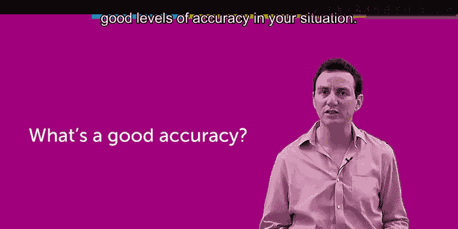
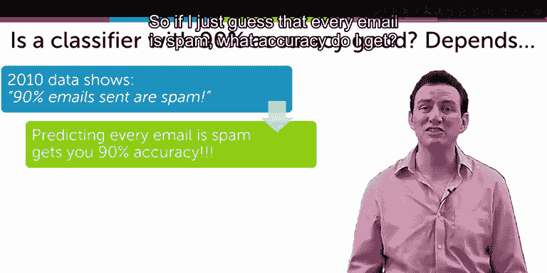
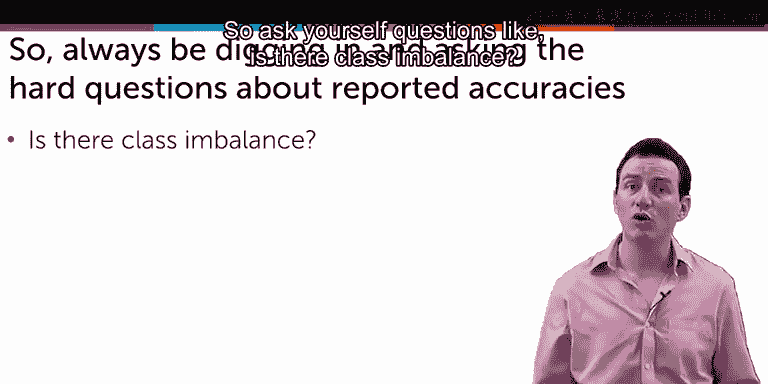

# 第一部分 44：什么是好的准确率？🤔

在本节课中，我们将探讨如何评估分类器的性能。我们将学习如何判断一个准确率数值是否“足够好”，并介绍几个关键的基准比较方法。

---

我们已经讨论了使用**错误率**和**准确率**来评估分类器。准确率的计算公式为：

**准确率 = (正确预测的样本数) / (总样本数)**

现在，理解你从分类器中得到的准确率或错误率非常重要。你需要深入思考，这些数值在你的具体情境下是否真的代表了良好的性能。

---

上一节我们介绍了准确率的基本概念，本节中我们来看看如何判断一个准确率是否“足够好”。

一个常见的错误是孤立地看待分类器的准确率。当你构建一个分类器时，第一个应该做的基准比较是**与随机猜测进行比较**。

以下是几种基准比较方法：

*   **随机猜测**：对于一个二分类问题（例如，判断句子情感是积极还是消极），随机猜测的平均准确率是50%。对于有K个类别的问题，随机猜测的准确率是 **1/K**。你的分类器性能至少应该显著优于随机猜测，否则你的方法基本没有意义。

*   **多数类预测**：在某些存在**类别不平衡**的问题中，简单地预测出现次数最多的类别（多数类）就能获得很高的准确率。例如，在2010年的数据中，90%的邮件是垃圾邮件。如果一个垃圾邮件过滤器简单地将所有邮件都预测为垃圾邮件，它就能获得90%的准确率。这个数值看起来很高，但实际上这个分类器毫无用处。

因此，你必须非常谨慎，在判断准确率是否良好时，需要检查你的数据是否存在类别不平衡。

当然，如果你知道多数类是哪个，这种“多数类预测”方法的表现也会优于随机猜测。

---

你应该始终深入研究你的问题，理解你得到的预测结果，并思考这个准确率对你的问题是否真的有意义。

你可以问自己以下几个问题：

*   我的数据是否存在**类别不平衡**？
*   我的模型性能与**随机猜测**、**多数类预测**等基线方法相比如何？
*   最重要的是，结合你的应用场景思考：**需要多高的准确率才能让我的用户真正满意？**

例如，在垃圾邮件过滤中，如果准确率不够高，可能会导致重要邮件被误判进入垃圾文件夹，这可能造成严重的后果。

---

本节课中我们一起学习了如何评估分类器的准确率。我们了解到，不能孤立地看待准确率数字，而应该将其与**随机猜测**和**多数类预测**等基线进行比较，并充分考虑数据中的**类别不平衡**问题以及实际应用场景对性能的要求。始终要问：这个准确率对我的具体问题来说，是否真的“足够好”？