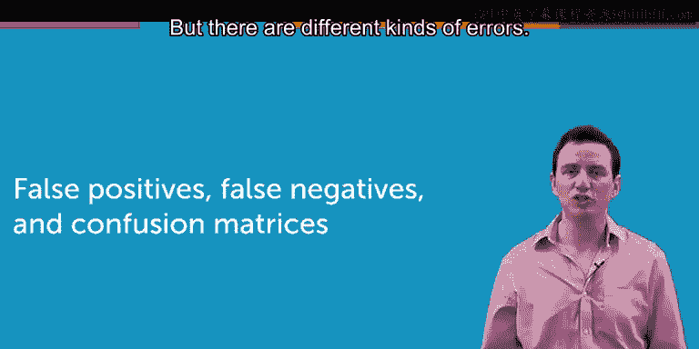
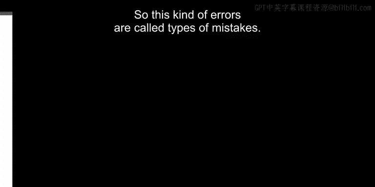
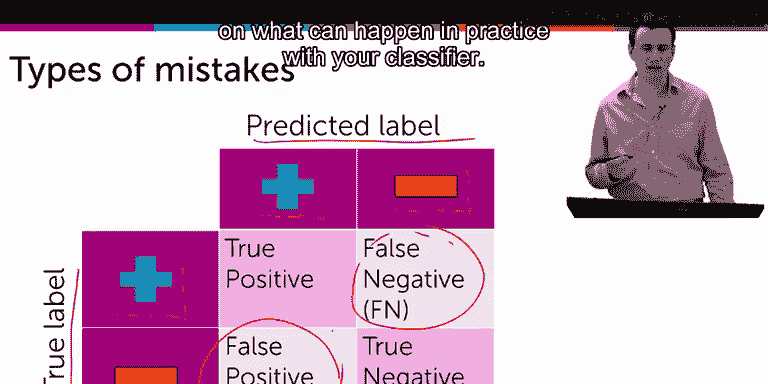
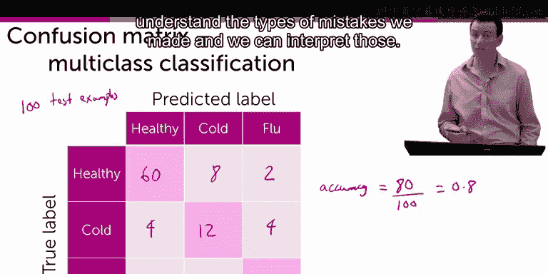
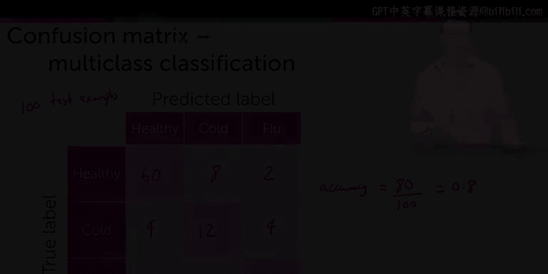

# 第一部分 45：假阳性、假阴性及混淆矩阵 📊

在本节课中，我们将学习分类器可能犯的不同类型的错误，特别是**假阳性**和**假阴性**，并介绍如何通过**混淆矩阵**来系统分析这些错误。理解这些概念对于评估分类器在实际应用中的表现至关重要。

---

## 分类器的错误类型

上一节我们讨论了分类器的准确率和错误。然而，错误并非只有一种，分类器可能犯不同类型的错误。

以下是两种主要的错误类型：

*   **假阴性**：真实标签为**正类**，但分类器预测为**负类**。
    *   公式表示：`真实标签 = 正类`，`预测标签 = 负类`。
*   **假阳性**：真实标签为**负类**，但分类器预测为**正类**。
    *   公式表示：`真实标签 = 负类`，`预测标签 = 正类`。

假阳性和假阴性在实际应用中可能带来不同的影响。

---

## 错误类型的实际影响

为了理解这两种错误的重要性，我们来看两个实际应用的例子。

以下是两个场景中假阳性和假阴性带来的不同代价：

*   **垃圾邮件过滤**
    *   **假阴性**：一封垃圾邮件被错误地放入了收件箱。这令人烦恼，但代价相对较低。
    *   **假阳性**：一封正常邮件被错误地标记为垃圾邮件并进入垃圾箱，导致用户可能永远错过这封邮件。这种错误的代价更高。

*   **医疗诊断**
    *   **假阴性**：患者实际患病，但未被检测出来。这可能导致疾病得不到治疗，后果可能非常严重。
    *   **假阳性**：健康人被误诊为患病。这可能导致患者接受不必要的、可能带有严重副作用的治疗。

在医疗诊断等场景中，哪种错误更严重取决于治疗的成本、副作用以及疾病本身的危害程度。

---

## 混淆矩阵

真实标签与预测标签之间的关系，包括假阳性和假阴性，可以通过**混淆矩阵**来清晰展示。

让我们通过一个二分类的例子来理解混淆矩阵。假设我们有100个测试样本，其中60个真实标签为正类，40个为负类。

以下是分类器的预测结果：
*   在60个真实正类中，分类器正确预测了50个（真阳性），错误预测了10个为负类（假阴性）。
*   在40个真实负类中，分类器正确预测了35个（真阴性），错误预测了5个为正类（假阳性）。

根据这些数据，我们可以计算：
*   **准确率** = (50 + 35) / 100 = 0.85 或 85%。
*   假阴性数量为10，假阳性数量为5。

混淆矩阵清晰地展示了错误的具体类型和数量。

---

## 多分类问题的混淆矩阵

假阳性和假阴性的概念主要适用于二分类问题。然而，混淆矩阵同样适用于具有多个类别的分类问题。

让我们看一个医疗诊断的三分类例子。假设有100个测试样本，真实分布为：70人健康，20人感冒，10人患流感。

以下是分类器的预测结果构成的混淆矩阵：
*   **健康**：60人被正确分类。在10个错误中，8人被误判为感冒，2人被误判为流感。
*   **感冒**：12人被正确分类。在8个错误中，4人被误判为健康，4人被误判为流感。
*   **流感**：8人被正确分类。在2个错误中，0人被误判为健康，2人被误判为感冒。

总准确率为 (60 + 12 + 8) / 100 = 0.80 或 80%。通过这个混淆矩阵，我们可以深入分析错误模式，例如，健康人更容易被误判为感冒而非流感。

---

## 总结

本节课我们一起学习了分类器评估中的关键概念。我们明确了**假阳性**和**假阴性**这两种错误类型的定义及其在不同应用场景（如垃圾邮件过滤和医疗诊断）中可能带来的不同代价。更重要的是，我们引入了**混淆矩阵**这一强大工具，它不仅能用于二分类问题，也能扩展到多分类问题，帮助我们系统、直观地分析分类器所犯错误的具体类型和分布，从而对模型性能有更深入的理解。