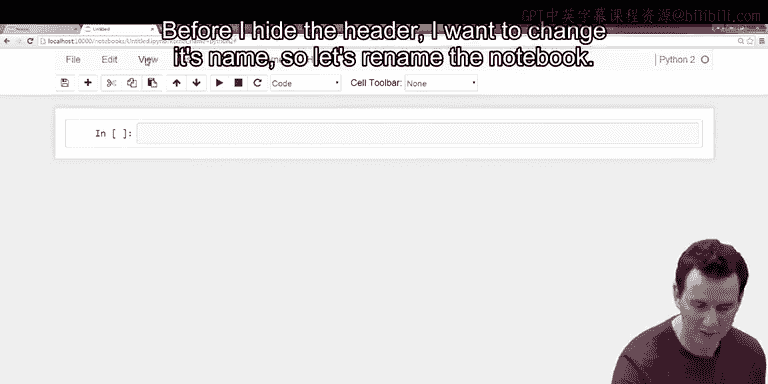
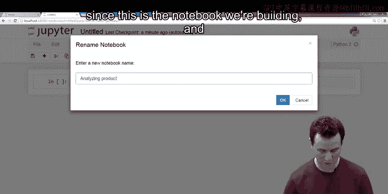
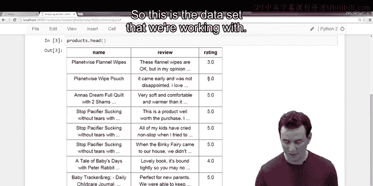
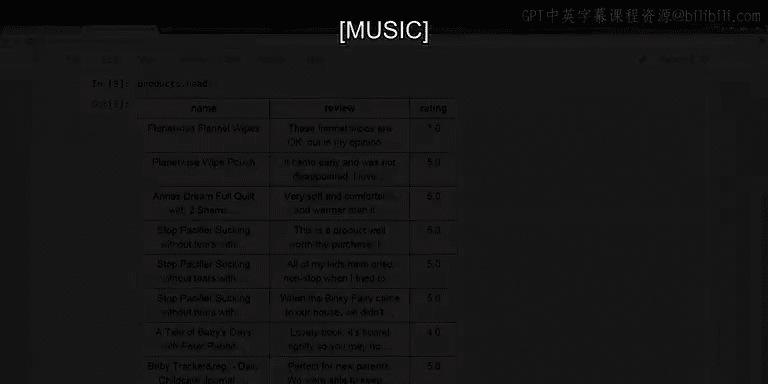

# 第一部分 49：加载并探索产品评论数据 🎯


在本节课中，我们将学习如何加载并探索产品评论数据集，为后续构建情感分析工具做准备。我们将使用真实的数据集，并通过简单的步骤了解其结构。

---




上一节我们介绍了情感分析的基本概念，本节中我们来看看如何实际操作数据。



首先，我们需要导入必要的库并加载数据。以下是初始步骤：

```python
import graphlab
products = graphlab.SFrame('amazon_baby.gl')
```

数据加载完成后，我们可以开始进行初步的探索。

---

以下是数据探索的具体步骤：

1.  **查看数据表的前几行**：这有助于我们了解数据的整体结构和内容。
    ```python
    products.head()
    ```

2.  **观察数据列**：数据集包含三列信息：
    *   `name`：产品名称。
    *   `review`：用户撰写的文本评论。
    *   `rating`：用户给出的评分（1到5星）。

通过查看数据头部，我们发现例如“Plantwise Flanno Wipes”这款产品的评分为3星（中等评价），而另一款产品“Plantwise Wipe Pouch”的评分为5星（高度评价）。这直观展示了数据的基本形式。

---





本节课中我们一起学习了如何加载一个真实的产品评论数据集，并使用`head()`方法进行了初步的数据探索。我们了解到该数据集包含产品名称、评论文本和星级评分三列关键信息，这为后续分析情感倾向奠定了数据基础。