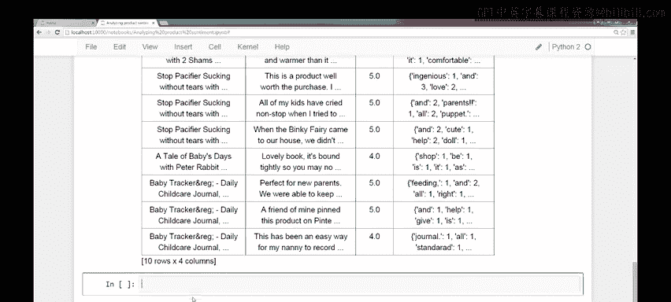

# 第一部分 50：创建词频向量 📊

在本节课中，我们将学习如何为文本数据创建词频向量。词频向量是文本分析中的基础工具，它将每篇评论转换为一个数值向量，其中每个元素代表一个特定单词在该评论中出现的次数。通过这种方式，我们可以将非结构化的文本数据转化为结构化的数值数据，以便后续的机器学习模型进行处理。

---

上一节我们介绍了文本数据的基本概念，本节中我们来看看如何具体构建词频向量。

构建词频向量的过程通常包括逐篇审阅评论、将句子分割成单词（这个过程称为“分词”），然后统计每个单词的出现次数以构建向量。然而，在本课程使用的工具中，我们可以通过一个简单的命令来完成所有这些步骤。

在 `products` 数据框中，我们将添加一个名为 `word_count` 的新列，用于存储词频统计结果。我们使用 `graphlab` 库中的 `text_analytics` 工具箱，它包含了许多文本分析函数。其中有一个函数叫做 `count_words`。此外，如果你希望使用二元组或三元组，还有一个名为 `count_ngrams` 的函数可供选择。

以下是具体操作步骤：

*   我们调用 `graphlab.text_analytics.count_words` 函数。
*   将 `products` 数据框作为输入传递给该函数。
*   指定对 `review` 列中的文本进行词频统计。

执行上述命令后，操作即告完成。现在，如果我们再次查看 `products` 数据表，会发现表中新增了第四列，即 `word_count` 列。我们稍后会对此进行更深入的探索。从第一行数据可以看到，单词“love”出现了5次，单词“it”出现了1次，这或许解释了为何该产品评价不高。数据表中还包含其他许多类似的词频统计信息。

---

本节课中我们一起学习了如何为产品评论数据创建词频向量。我们利用 `graphlab` 库的 `count_words` 函数，高效地将文本评论转换成了结构化的词频数据，为后续的机器学习建模任务做好了准备。