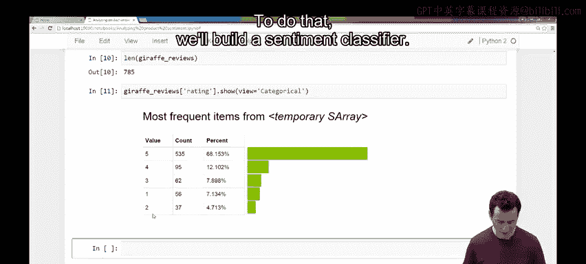

# 机器学习基础篇（第1课/共4课）📊：探索最受欢迎的产品

在本节课中，我们将学习如何使用数据可视化工具来探索数据集，并聚焦于分析特定产品（如一款名为“Vulli Sophie”的牙胶长颈鹿）的客户评价。我们将通过构建直方图来查看产品评价的分布，并初步了解后续进行情感分析的基础。

---

## 查看现有产品与评价

首先，我们需要查看数据集中包含哪些产品以及对应的评价。我们将再次使用Canvas工具进行可视化操作。

与之前一样，我将在iPython笔记本环境中调用GraphLab Canvas，并将输出目标设置为当前笔记本，以便结果直接显示在这里。

现在，我们可以选取产品数据框（SFrame）中的某一列进行分析。例如，我们可以选取产品名称这一列，并对其调用`.show()`方法。

这将生成一个直方图，展示数据中不同产品名称的分布情况。

例如，从图中我们可以看到，名为“Vulli Sophie”的特定产品获得了最多的评价，共785条。相比之下，类似“Simple Wishes”的产品获得了562条评价。其他产品如Fisher-Price系列分别获得了489条和450条评价。这些都是我们正在分析的不同婴儿产品。该直方图清晰地展示了不同产品所获评价数量的差异。

---

## 深入分析最受欢迎的产品

接下来，让我们深入了解这款获得最多评价的产品——“Vulli Sophie”究竟是什么。

这款所谓的“Vulli Sophie”是一款极其受欢迎的产品。我这里恰好有一个实物。这是一个Vulli Sophie牙胶长颈鹿，它是一个塑料小长颈鹿，是亚马逊上赠送给婴儿的最常见礼品。作为牙胶，婴儿喜欢啃咬它，因此这款长颈鹿获得了大量评价。它由塑料制成，可以挤压发声。

我们今天将重点讨论这个长颈鹿产品。

现在，让我们专门查看这款长颈鹿的评价。我将创建一个名为`giraffe_reviews`的变量来存储这些数据。

我将从所有产品评价中，通过一个筛选条件，选择出那些产品名称等于“Vulli Sophie the Giraffe Teether”的行。这就是我们一直在讨论的产品。

如果我们快速查看一下这个新数据表`giraffe_reviews`的长度，可以看到这款塑料玩具有785条评价。

---

## 分析产品评分分布

现在，让我们查看这款长颈鹿产品的评分情况。我将从`giraffe_reviews`中提取`rating`（评分）列，并像之前一样对其调用`.show()`方法进行可视化。

这次，我想使用一种特定的视图——**分类视图**。这种视图将提供一个分类直方图，展示不同评分等级（如1星到5星）分别获得了多少条评价。

观察这个小直方图，你会发现一些有趣的现象：人们非常喜爱这个产品。有535条评价是五星，这是最多的。其次是四星评价，然后是三星。有趣的是，一星评价的数量超过了二星评价。这意味着有相当数量的人非常讨厌这个产品，但绝大多数人喜爱它。

因此，进行情感分析会很有趣，可以帮助我们理解那些极端负面或极端正面的评价究竟在谈论什么，就像我们在这个模块课程中讨论过的那样。

为了实现这个目标，我们接下来将构建一个**情感分类器**。

---

## 总结

本节课中，我们一起学习了如何利用可视化工具探索数据集中的产品与评价分布。我们聚焦于最受欢迎的产品“Vulli Sophie牙胶长颈鹿”，通过直方图分析了其评分的分布情况，发现评价呈现两极分化。这为我们下一阶段构建情感分类器来分析评价文本的情感倾向奠定了基础。