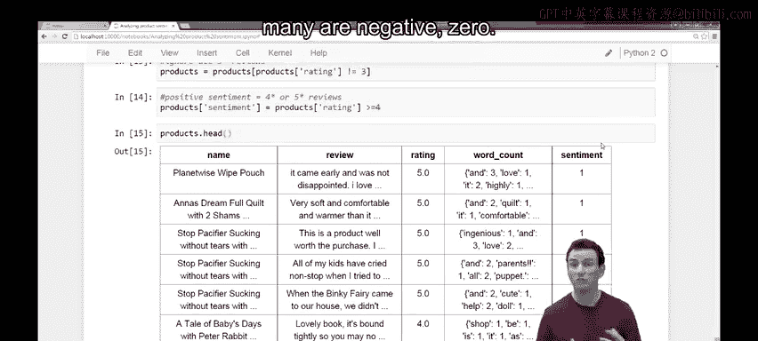

# 第一部分 52：定义情感正负向 🎯


在本节课中，我们将学习如何为情感分类任务定义正面和负面情感。具体来说，我们会基于产品评分数据，通过数据工程的方法，明确区分哪些评论代表正面情感，哪些代表负面情感。

---

## 构建情感分类器 🛠️

上一节我们介绍了情感分类器的基本概念。本节中，我们来看看如何具体定义正面和负面情感。

情感分类器通常处理的是正面和负面情感，例如“点赞”和“点踩”。但需要注意的是，我们使用的产品评分数据并非直接以“正面”或“负面”的形式存在，而是数值型的评分。

例如，如果我们查看所有产品的评分分布：

```python
# 查看所有产品评分的分布（以长颈鹿产品为例的扩展）
products['rating'].show(view='Categorical')
```

运行上述代码后，我们会得到一个所有评论评分的直方图。快速浏览该图可以发现，大多数评论都是正面的：有107,000条评论是五星好评。这符合常见现象，人们通常更倾向于为他们喜欢的产品撰写评论，而不是为他们不喜欢的产品写评论。

接下来，四星评论约有33,000条，然后是三星评论。同时，也有相当数量的人撰写非常负面的评论，即一星和两星评论。如果你真的讨厌一个产品，给两星和一星本质上没有太大区别，我们在直方图中也观察到了这一点。

然而，为了进行情感分析，我们必须明确界定什么是“点赞”（正面），什么是“点踩”（负面）。这里，我将做出一个主观的定义：

*   我们将四星或五星评论视为人们喜欢的，即**正面**情感。
*   将一星或两星评论视为**负面**情感。
*   至于三星评论，它们处于中间地带，比较模糊。因此，我们选择**忽略**这些三星评论。

这个过程就是我们所说的**数据工程**的一部分，即通过定义和转换数据来适应我们的机器学习任务。

---

## 实施数据工程步骤 ⚙️

现在，让我们开始实施上述定义。首先，我们需要从数据中移除三星评论。

以下是具体步骤：

第一步，忽略三星评论。我们从产品数据表 `products` 中，筛选出所有评分不等于3的记录。

```python
# 第一步：过滤掉三星评论
products = products[products['rating'] != 3]
```

完成第一步后，我们的数据中只剩下了一星、二星、四星和五星的评论。接下来是此任务的核心步骤：定义正面和负面情感。

第二步，定义情感标签。我们将在数据表中添加一个新的列，名为 `sentiment`（情感）。这是一个二进制的列，取值为0或1。

我们这样定义它：
*   如果评分 `rating` **大于或等于4**（即四星或五星），则 `sentiment` 为 **1**（代表正面）。
*   如果评分 `rating` **小于4**（即一星或二星），则 `sentiment` 为 **0**（代表负面）。

用代码实现如下：

```python
# 第二步：添加情感列，1代表正面（4-5星），0代表负面（1-2星）
products['sentiment'] = products['rating'] >= 4
# 将布尔值转换为整数（True->1, False->0）
products['sentiment'] = products['sentiment'].astype(int)
```

现在，如果我们再次查看数据表的前几行：

```python
products.head()
```

你应该能看到新增了一个名为 `sentiment` 的列。正如我们之前观察到的，大多数情感标签是正面的（1），但也有不少是负面的（0）。

---

## 总结 📝



本节课中，我们一起学习了为情感分类任务准备数据的关键步骤。我们首先分析了评分的分布情况，然后通过数据工程的方法，定义了正面情感（四星和五星，对应标签1）和负面情感（一星和二星，对应标签0），同时移除了含义模糊的三星评论。最后，我们在数据集中创建了一个新的二进制 `sentiment` 列来存储这些标签。

现在，数据已经准备就绪，我们终于可以开始训练我们的情感分类器了。