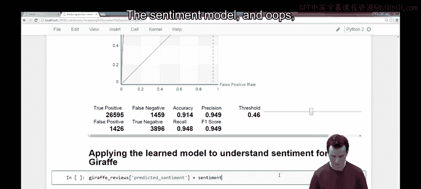
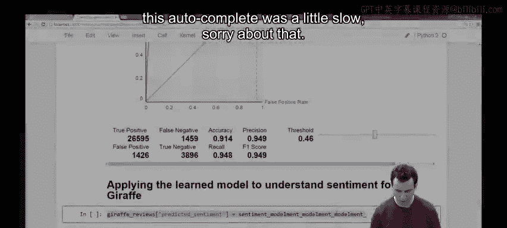
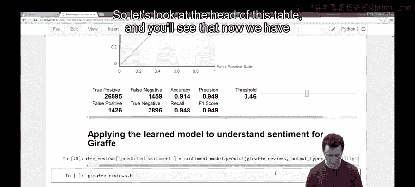

# 机器学习基础篇（第1课/共4课）｜应用模型查找产品最正面和最负面的评论 📊


在本节课中，我们将学习如何应用已训练好的情感分析模型，来识别产品评论中最正面和最负面的内容。我们将使用长颈鹿玩具的评论数据集作为示例，通过模型预测的情感评分对评论进行排序，从而快速定位极端的用户反馈。

---

## 应用模型预测评论情感

上一节我们介绍了如何构建并评估情感分析模型，其准确率约为91.1%。本节中，我们来看看如何实际应用这个模型来完成一项有趣的任务：分析用户对长颈鹿玩具的情感倾向。

首先，我们需要在已有的长颈鹿评论数据集上应用训练好的模型，生成一个新的列来存储预测的情感评分。

以下是具体步骤：



1.  加载长颈鹿评论数据集。
2.  调用之前训练好的 `sentiment_model`。
3.  使用模型的 `.predict()` 方法，并设置 `output_type='probability'` 参数，以获得更精细的情感概率预测，而不仅仅是0或1的分类结果。



```python
# 应用模型预测情感概率
giraffe_reviews['predicted_sentiment'] = sentiment_model.predict(giraffe_reviews, output_type='probability')
```

运行以上代码后，数据集中将新增一个 `predicted_sentiment` 列。该列的值介于0到1之间，数值越接近1，代表模型预测该评论越正面；越接近0，则代表越负面。

---

## 查看与理解预测结果

现在，让我们查看添加了预测评分后的数据表。我们可以使用 `.head()` 方法预览前几行数据。

```python
# 查看数据表的前几行
print(giraffe_reviews.head())
```

在输出中，你会看到每条评论都对应一个预测的情感概率值。例如，某些高度正面的评论得分可能高达0.999，而一些负面评论的得分可能低至0.001。这比简单的星级评分提供了更细致的洞察。

---



## 根据情感评分排序评论

拥有了连续的情感概率评分后，我们可以对评论进行排序，从而轻松找出最正面和最负面的评价。

以下是具体操作：

我们将根据 `predicted_sentiment` 列对数据集进行降序排序，这样最正面的评论会排在最前面。

```python
# 根据预测情感评分降序排序
giraffe_reviews_sorted = giraffe_reviews.sort('predicted_sentiment', ascending=False)
```

参数 `ascending=False` 确保了排序顺序为从大到小（降序）。排序完成后，再次查看数据表的前几行，现在显示的就是预测为最正面的评论。

```python
# 查看排序后最正面的几条评论
print(giraffe_reviews_sorted.head())
```

通过这个排序列表，产品经理或分析师可以快速聚焦于用户热情赞扬的方面，了解产品的优势所在。

---

## 查找最负面的评论

同理，如果我们想找出最负面的反馈，只需进行升序排序，让情感评分最低的评论排在最前面。

```python
# 根据预测情感评分升序排序（找出最负面评论）
giraffe_reviews_sorted_negative = giraffe_reviews.sort('predicted_sentiment', ascending=True)
print(giraffe_reviews_sorted_negative.head())
```

查看这个列表的开头部分，就能迅速定位到那些表达强烈不满的评论。例如，可能会发现用户对产品尺寸、材质或功能有特定抱怨，这些是急需改进的关键点。

---

## 总结

本节课中，我们一起学习了如何将训练好的机器学习模型应用于实际业务场景。我们通过预测评论的情感概率，并对结果进行排序，高效地识别出了产品评论中的极端反馈——无论是高度赞扬还是强烈批评。

这种方法的价值在于：
*   **精细化分析**：概率评分比二元分类或星级评分提供了更丰富的信号。
*   **提高效率**：自动化处理海量评论，快速定位关键意见。
*   **驱动决策**：基于数据洞察，明确产品改进方向或营销重点。

掌握如何应用模型解读数据，是机器学习从理论走向实践的重要一步。