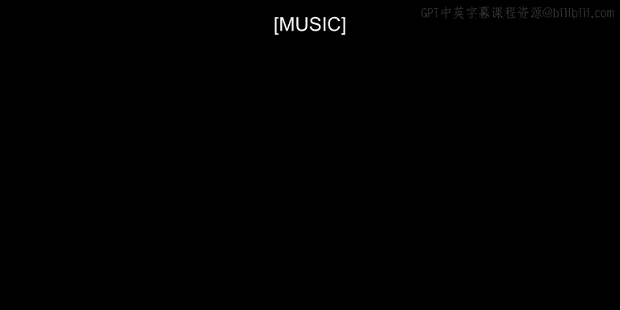
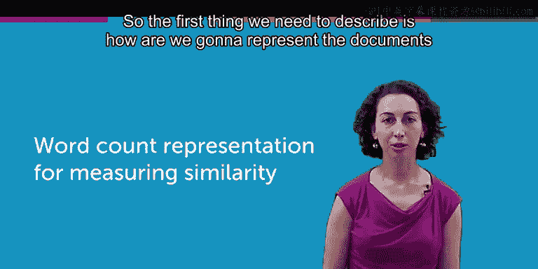
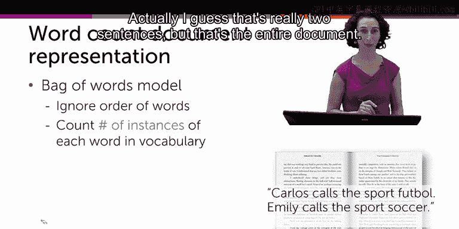
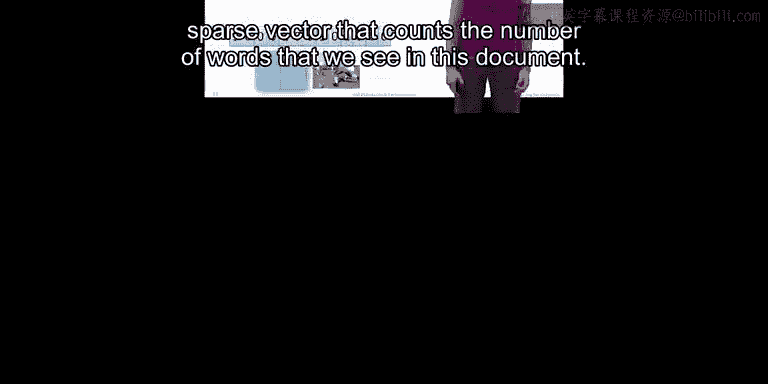
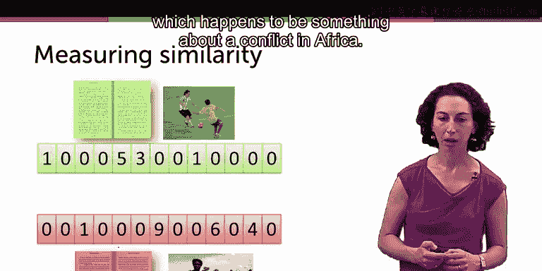
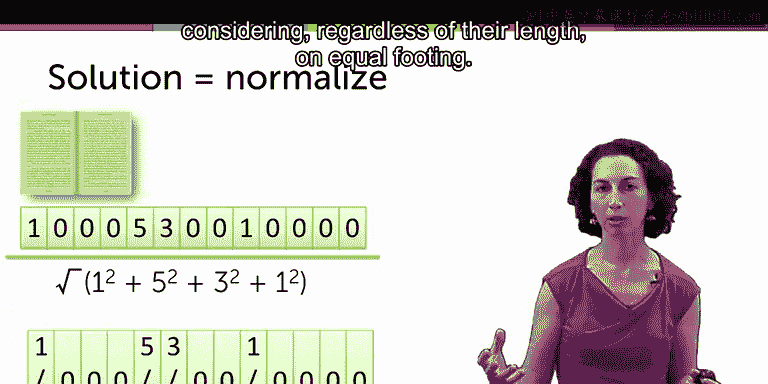

# 机器学习基础篇（第1课/共4课）：用于度量相似度的词频表示 📚

在本节课中，我们将学习如何表示文本文档，以及如何基于这种表示来度量不同文档之间的相似度。这是信息检索和文档推荐等任务的基础。

---

## 文档表示：词袋模型 📄

首先，我们需要描述如何表示我们正在查看的文档。

最流行的文档表示模型之一是**词袋模型**。在这个模型中，我们简单地忽略文档中单词出现的顺序。之所以称为“词袋”，是因为我们可以想象将文档中的所有单词扔进一个袋子，摇晃均匀。这样，单词顺序被打乱后形成的新文档，其表示方式与原始有序文档的表示方式完全相同。

### 从结构到计数

我们不考虑单词的结构和顺序，而是简单地统计文档中每个单词出现的次数。

让我们看一个具体的例子。假设我们有一个非常短的文档，内容如下：
> Carlos calls the sport football. Emily calls the sport soccer.

实际上，这是两个句子，但我们将它视为整个文档。为了统计这个短文档中的单词出现次数，我们将使用一个向量。这个向量基于我们所使用语言的词汇表来定义。

例如，在我们的词汇表中：
*   一个位置对应单词 “Carlos”。
*   另一个位置对应单词 “sport”。
*   还有位置对应 “football”、“Emily”、“calls”、“the” 和 “soccer”。

以下是该文档的词频统计向量：
*   Carlos: 1
*   calls: 2
*   the: 2
*   sport: 2
*   football: 1
*   Emily: 1
*   soccer: 1

这个向量非常长且稀疏，因为它包含了词汇表中所有单词的位置，而大多数单词（如 “cat”、“dog”、“tree”）在该文档中的计数为零。

---

## 度量文档相似度 📏

上一节我们介绍了如何使用原始词频向量来表示文档。本节中，我们来看看如何度量不同文档之间的相似度，因为我们将利用这一点来查找彼此相关的文档。

想象一下，Carlos 正在阅读一篇关于著名阿根廷球员梅西的足球文章，我们有一个对应的词频向量。同时，还有另一篇关于著名足球球员帕韦（Pave）的蓝色文章及其词频向量。

### 相似度计算方法

我们可以通过计算两个向量的**逐元素乘积之和**来度量相似度。具体来说，对于向量中的每个元素，我们将两个不同计数向量中对应位置的数值相乘，然后将所有元素的乘积结果相加。

**公式**：
`相似度 = Σ (向量A[i] * 向量B[i])`，其中 `i` 遍历词汇表中的所有单词。

**示例计算**：
假设两篇足球文章的词频向量在 “Carlos” 位置分别是 1 和 3，在 “sport” 位置分别是 5 和 2，其他位置大多为 0。
那么相似度 = (1 * 3) + (5 * 2) + ... = 13。

现在，如果我们比较足球文章和另一篇关于非洲冲突的文章，由于它们没有共享重要的词汇，计算出的相似度很可能为零。这表明我们的方法能够区分不同主题的文档。

---

## 原始词频的问题与归一化解决方案 ⚖️

然而，使用原始词频度量相似度存在一个问题。让我们再次审视之前那两篇关于足球的绿色和蓝色文章。

我们之前计算出的相似度是 13。现在，假设我们将其中一篇文档的长度简单地**加倍**（即每个单词都出现两次），那么其词频向量也会变为原来的两倍。

**问题**：
当我们计算长文档与原始短文档的相似度时，结果会变成 52，远高于两个短文档之间的相似度（13）。这意味着，仅仅因为一篇文档更长，它就被认为与另一篇文档“更相似”。这在文档检索中是不合理的，因为它会强烈偏向于长文档。

### 如何解决：向量归一化

一个直接的解决方案是**归一化**词频向量。我们计算向量的范数（长度），然后用每个元素除以这个范数。

**向量范数公式**：
对于一个向量 `v = (v1, v2, ..., vn)`，其范数（L2范数）为：
`||v|| = sqrt(v1² + v2² + ... + vn²)`

**归一化公式**：
`v_normalized = v / ||v||`

**示例**：
对于向量 `(1, 5, 3, 1)`，其范数为 `sqrt(1² + 5² + 3² + 1²) = sqrt(36) = 6`。
归一化后的向量为 `(1/6, 5/6, 3/6, 1/6)`。

归一化操作将所有文档向量都缩放到单位长度，使得不同长度的文档能够站在同一起跑线上进行比较。之后，我们使用这些归一化后的向量进行相似度计算（即计算点积，其结果就是余弦相似度）。

---

## 总结 📝

本节课中我们一起学习了：
1.  **词袋模型**：一种忽略单词顺序、仅统计词频的文档表示方法。
2.  **相似度度量**：通过计算两个词频向量的逐元素乘积之和（点积）来量化文档间的相似性。
3.  **原始词频的局限性**：直接使用原始词频会偏向于长文档。
4.  **归一化解决方案**：通过计算向量的 L2 范数并除以它，将文档向量归一化到单位长度，从而公平地比较不同长度的文档，为后续的余弦相似度计算打下基础。