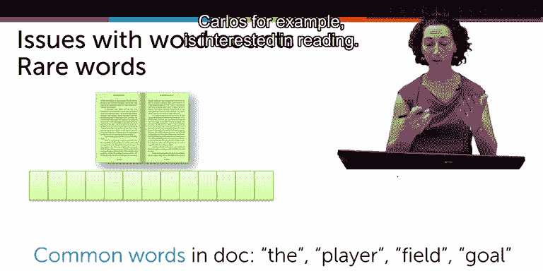
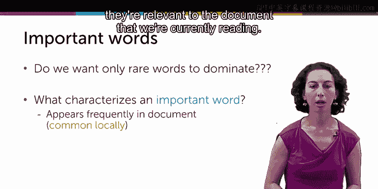

# 第一部分 60：使用TF-IDF优先考虑重要词语 📊

在本节课中，我们将学习如何通过TF-IDF方法，在文档表示中优先考虑重要词语。我们将探讨为何简单的词频统计存在局限，以及如何通过结合词语在文档中的局部频率和在整个语料库中的全局稀有性，来更准确地捕捉文档的核心内容。

---

上一节我们介绍了归一化词频向量，它解决了原始词频统计的一些问题。本节中，我们来看看如何进一步强调文档中的重要词语。

我们刚刚描述的归一化词频向量，有助于解决最初仅使用原始词频作为文档表示方案的一些问题。但还存在另一个问题：我们通常希望真正强调文档中的重要词语。因此，我们将讨论一下“重要词语”意味着什么，以及如何考虑强调它们。

---

在讨论重要词语之前，让我们先谈谈稀有词语。

再次想象我们正在阅读一篇关于足球的文章。这篇文章中有大量常见词语，如“the”、“player”、“field”、“goal”。所谓常见词语，指的是在整个语料库中频繁出现的词。“语料库”是我们在进行检索任务时所查看的所有文档的术语。

然而，当我们与其他文档进行比较时，这些常见词语会主导我们之前讨论过的相似性度量。正如我所说，这些词语出现在非常多的文档中。相比之下，我们正在查看的这篇文档中有一些非常稀有的词语，例如“football”和特定球员“Messi”。这些词语完全被所有常见词语淹没了。像“football”和“Messi”这样的词语被淹没，是因为它们在语料库中出现的频率非常低。因此，让我们思考如何增加这些稀有词语的重要性，因为它们通常是真正相关、能描述这篇文章独特之处、并可能指示Carlos（例如）有兴趣阅读的其他文章的词语。

---

那么，正如我们所说，稀有词语的特征在于它在语料库中不常出现。我们想要做的是以某种方式提升这些稀有词语的权重。等价地，除了强调只出现在少数文档中的词语，我们还可以考虑根据每个词语在整个语料库中出现的文档数量，来折减该词语的权重。

问题是，我们真的只想强调稀有词语吗？显然，我们不想强调那些非常常见的词语，比如“the”、“you”、“it”等等。我们想要包含的是对该文档非常相关的内容，不仅仅是像“Messi”这样的词，可能还包括“soccer”、“field”、“goal”等描述我们所关注运动的词语，这些可能不同于另一篇关于篮球、谈论“basketball hoop”和“court”等词语的体育文章。

在这种情况下，我们想要强调我称之为“重要词语”的东西。因此，我们将在这里进行权衡：我们将考虑那些在文档中出现频率很高的词语（即与当前阅读的文档相关），我称之为**局部常见**。

同时，我们希望它们在语料库中相对较少出现，我称之为**全局稀有**。所谓“重要”词语的特征，就是这种局部频率和全局稀有性之间的某种权衡。

---

## 核心概念与公式

基于以上讨论，TF-IDF的核心思想可以总结如下：

*   **词频 (Term Frequency, TF)**：衡量一个词语在**当前文档**中出现的频率。频率越高，可能越重要。
    *   常用计算方式之一：`TF(t, d) = (词语 t 在文档 d 中出现的次数) / (文档 d 中的总词数)`
*   **逆文档频率 (Inverse Document Frequency, IDF)**：衡量一个词语的普遍重要性。出现在**越少文档**中，IDF值越大，重要性越高。
    *   常用计算方式：`IDF(t, D) = log( (语料库中文档总数 N) / (包含词语 t 的文档数 + 1) )`
*   **TF-IDF**：将两者结合，得到词语的最终权重。
    *   `TF-IDF(t, d, D) = TF(t, d) * IDF(t, D)`

这个公式体现了我们追求的权衡：一个词语在**当前文档中频繁出现（TF高）**，但在**整个语料库中很少出现（IDF高）**，那么它的TF-IDF值就会很高，被认为是对该文档非常重要的词语。

---

## 总结

本节课中，我们一起学习了TF-IDF方法的核心思想。我们认识到，仅依赖词频或归一化词频不足以识别文档的独特内容，因为常见词语会干扰判断。TF-IDF通过结合**词频（TF）** 和**逆文档频率（IDF）**，巧妙地权衡了词语的局部常见性和全局稀有性，从而能够优先考虑并提升那些真正能代表文档主题的重要词语的权重。这为后续的文档检索、分类等任务提供了更有效的文本表示方法。