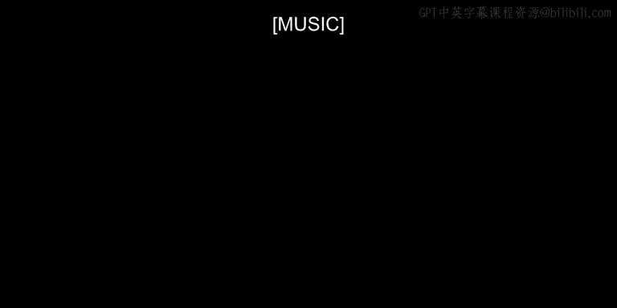
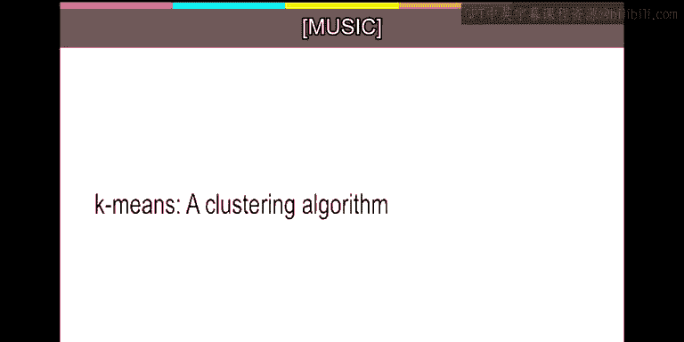
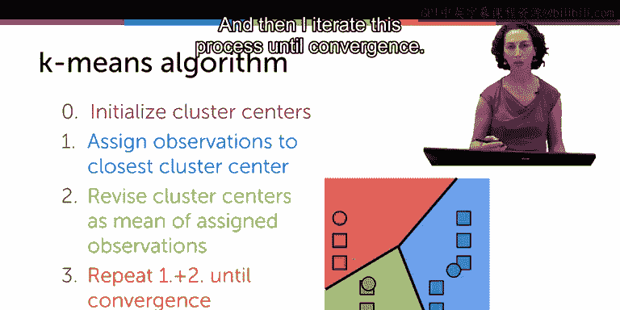
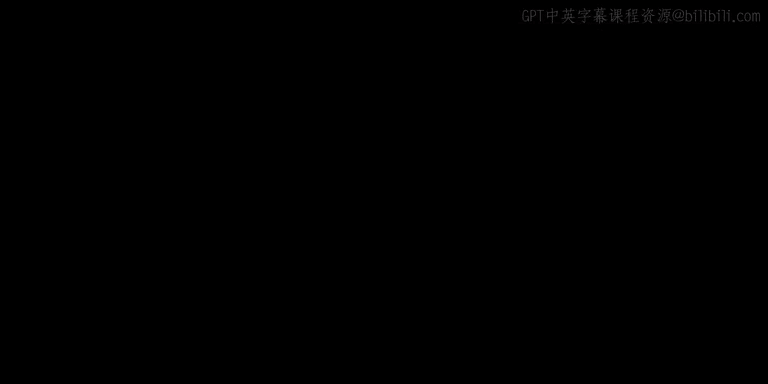

# 第一部分 65：K-means聚类算法 🧩

在本节课中，我们将学习一种名为K-means的聚类算法。该算法通过计算数据点到聚类中心的距离来对数据进行分组。我们将详细介绍算法的初始化、迭代过程以及收敛条件，确保初学者能够轻松理解。

---

## 算法概述

K-means算法是一种基于距离度量的聚类方法。它假设最终会得到K个聚类，因此需要预先指定聚类的数量。算法的名称来源于“K个聚类”和“聚类中心（均值）”这两个概念。

上一节我们介绍了聚类的基本概念，本节中我们来看看K-means算法的具体步骤。

---

## 初始化算法

首先，我们需要初始化聚类中心。初始化方法有多种，但为了简化，我们通常随机选择K个点作为初始聚类中心。例如，如果我们使用K=3，就随机指定三个聚类中心。

以下是初始化步骤的简要说明：

1.  随机选择K个点作为初始聚类中心。
2.  这些中心点将作为后续迭代的起点。

---

## 分配数据点到最近中心

初始化后，第一步是将每个数据点分配到距离最近的聚类中心。这个过程类似于构建一个Voronoi图（泰森多边形）。

我们可以这样理解：以聚类中心为基点，将整个空间划分为多个区域。每个区域内的任何点，其最近的聚类中心都是该区域的基点。

以下是分配过程的要点：

*   计算每个数据点到所有聚类中心的距离。
*   将数据点分配给距离最近的聚类中心。
*   根据分配结果，数据被初步划分为K个组。

---

## 更新聚类中心

分配完成后，我们得到了一组初步的聚类结果。但由于初始中心是随机选择的，这些聚类可能无法准确反映数据的真实结构。

因此，我们需要迭代这个过程。下一步是基于当前分配到每个聚类的所有数据点，重新计算该聚类的中心。新的聚类中心通常是该簇所有点的“质心”（即坐标平均值）。

以下是更新步骤的说明：

*   对于每个聚类，计算其所有成员点的平均值。
*   将这个平均值点设置为该聚类的新中心。
*   例如，如果一个聚类只有一个点，那么新中心就移动到这个点的位置；如果一个聚类包含多个点，新中心则移动到这些点的中心位置。

---

## 迭代与收敛

得到新的聚类中心后，我们可以重复上述步骤：

1.  根据新的中心点，重新划分Voronoi区域，并将所有数据点重新分配到最近的新中心。
2.  基于新的分配结果，再次更新每个聚类的中心点。

我们将这个过程不断重复，直到算法收敛。收敛通常意味着聚类中心不再发生显著变化，或者数据点的分配情况保持稳定。

---

## 总结

本节课中我们一起学习了K-means聚类算法。我们了解到，该算法需要预先指定聚类数量K，并通过“分配-更新”的迭代过程，不断优化聚类中心的位置，直到结果稳定。其核心步骤可以概括为：

1.  **初始化**：随机选择K个初始聚类中心。
2.  **分配**：将每个点分配到最近的聚类中心。
3.  **更新**：根据分配结果，重新计算每个聚类的中心点。
4.  **迭代**：重复步骤2和3，直至收敛。

K-means算法以其简单高效的特点，成为最常用的聚类方法之一。