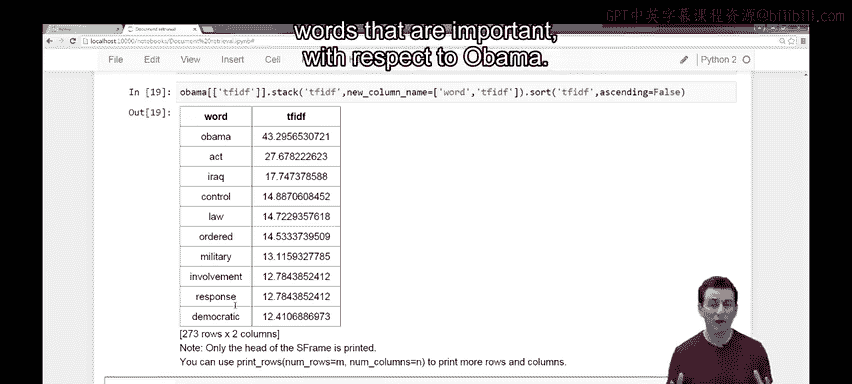
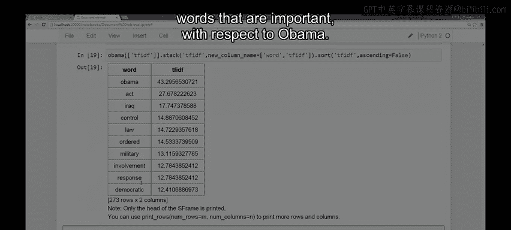

# 第一部分 70：计算与探索TF-IDF 📊


在本节课中，我们将学习如何为一个文档集合（语料库）计算TF-IDF值，并探索其在文本分析中的应用。我们将使用GraphLab Create库来简化计算过程，并通过实际例子展示TF-IDF如何帮助我们识别文档中的关键词语。

---

## 计算整个语料库的TF-IDF

上一节我们介绍了TF-IDF的基本概念，本节中我们来看看如何为一个完整的文档集合计算TF-IDF值。需要注意的是，**不能孤立地计算单篇文章的TF-IDF**，因为TF-IDF依赖于整个语料库。具体来说，IDF（逆文档频率）的计算需要知道每个词语在所有文档中出现的频率。

因此，我们必须对整个语料库进行计算。我们将分两步完成：

1.  为语料库中的每篇文章计算词频。
2.  基于词频计算TF-IDF值。

以下是具体步骤：

首先，我们需要为整个语料库计算词频。我们将为`people`数据表添加一个名为`word_count`的新列，用于存储每篇文章的词频字典。

```python
people['word_count'] = graphlab.text_analytics.count_words(people['text'])
print people.head()
```

执行上述代码后，数据表中将新增一个`word_count`列，其中包含了每篇文章的词语计数字典。

接下来，我们将计算TF-IDF。与计算词频类似，GraphLab Create库提供了内置的`tf_idf`函数，可以快速完成计算。我们只需将上一步得到的`word_count`列作为输入即可。

```python
tfidf = graphlab.text_analytics.tf_idf(people['word_count'])
```

计算完成后，我们会得到一个包含每篇文章TF-IDF字典的新表。为了便于管理，我们将这个新列添加到`people`表中。

```python
people['tfidf'] = tfidf['docs']
```

现在，`people`表中已经存储了所有文档的TF-IDF值，我们可以开始进行探索性分析了。

---

## 探索奥巴马文章的TF-IDF结果

在计算了所有文档的TF-IDF之后，让我们聚焦于奥巴马的文章，看看TF-IDF值如何帮助我们识别关键词语。

首先，我们从`people`表中提取出奥巴马的文章数据。

```python
obama = people[people['name'] == 'Barack Obama']
```

接着，我们提取并整理奥巴马文章的TF-IDF数据。我们将TF-IDF字典展开为两列（词语和TF-IDF值），并按TF-IDF值降序排列，以便查看最重要的词语。

```python
obama_tfidf_table = obama[['tfidf']].stack('tfidf', new_column_name=['word', 'tfidf']).sort('tfidf', ascending=False)
```

当我们执行这段代码并查看结果时，会发现一个显著的变化：**排名最高的词语是“Obama”**，这非常合理，因为文章就是关于他的。紧随其后的词语包括“Act”、“Iraq”、“control”、“law”、“order”、“military”、“involvement”、“response”、“Democratic”等。

这些词语清晰地揭示了文章的核心内容：奥巴马在军事、法律、伊拉克问题以及民主党事务上的行动和参与。与单纯基于词频的排序（其中充斥着“the”、“and”、“in”等常见但信息量低的词语）相比，TF-IDF有效地过滤了常见词，突出了具有实际信息价值的关键词。

---

## 总结





本节课中我们一起学习了如何为整个文档集合计算TF-IDF，并探索了其结果。我们了解到，TF-IDF的计算必须基于整个语料库，而不能孤立进行。通过使用GraphLab Create库，我们可以高效地完成词频统计和TF-IDF计算。最后，通过对奥巴马文章TF-IDF结果的分析，我们看到了TF-IDF如何有效地从文档中提取出最具信息量的关键词语，这比单纯依赖词频能提供更深刻的文本洞察。