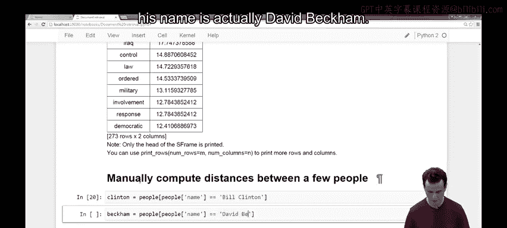
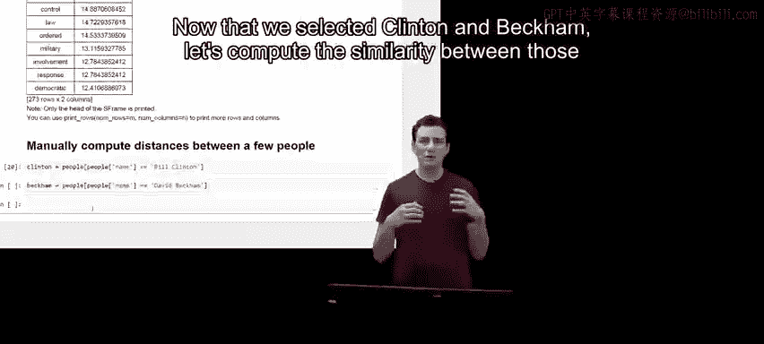
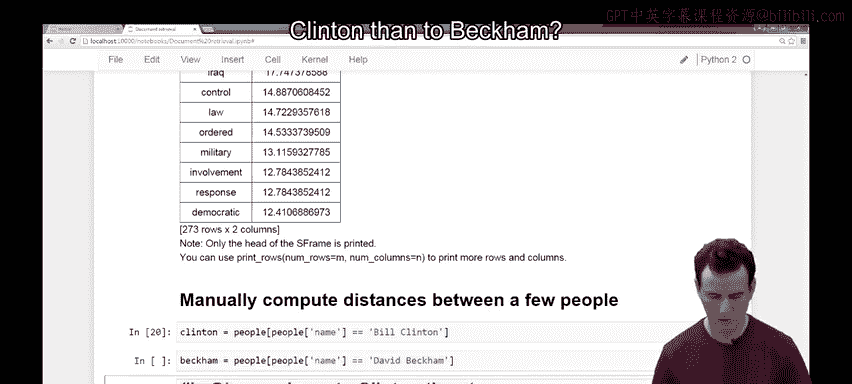
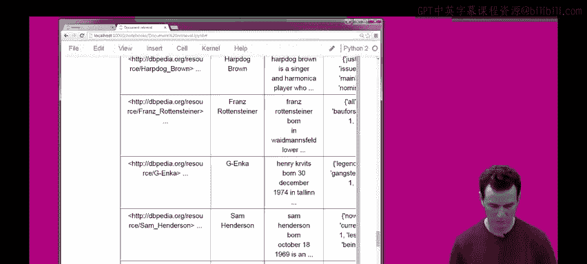
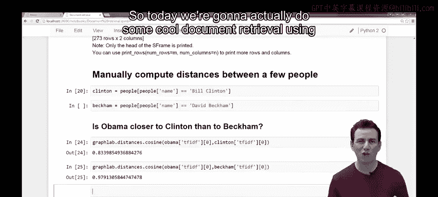

# 第一部分 70：计算维基百科文章之间的距离 📏


在本节课中，我们将学习如何利用TF-IDF向量计算维基百科文章之间的距离。我们将通过手动计算几位知名人物文章间的相似度，直观理解TF-IDF向量的含义，并最终使用最近邻模型实现自动化的文档检索。

---

## 手动计算人物文章距离

上一节我们介绍了TF-IDF向量的计算。本节中，我们来看看如何利用这些向量计算文档之间的距离。我们将手动选取三位人物——巴拉克·奥巴马、比尔·克林顿和大卫·贝克汉姆，并计算他们对应文章之间的余弦距离。

首先，我们需要从数据中提取这三位人物的TF-IDF向量。假设我们已经有一个名为`people`的数据集，其中包含`name`列和`tfidf`列。

以下是选取克林顿和贝克汉姆向量的代码示例：



```python
clinton = people[people['name'] == 'Bill Clinton']
beckham = people[people['name'] == 'David Beckham']
```

现在，我们有了代表奥巴马、克林顿和贝克汉姆文章的三个TF-IDF向量。我们的目标是计算奥巴马与克林顿、以及奥巴马与贝克汉姆之间的余弦距离。



---





## 计算余弦距离

有多种方法可以衡量两个向量（或文档）之间的距离。我们将使用**余弦距离**。请注意，余弦距离是余弦相似度的变体：**距离值越低，表示两篇文章越相似**；最高距离值为1。

我们将使用工具库中现成的函数来计算距离，无需自己实现。

以下是计算奥巴马与克林顿之间余弦距离的代码：

```python
obama_tfidf = people[people['name'] == 'Barack Obama']['tfidf'][0]
clinton_tfidf = clinton['tfidf'][0]
beckham_tfidf = beckham['tfidf'][0]

# 计算余弦距离
dist_obama_clinton = graphlab.distances.cosine(obama_tfidf, clinton_tfidf)
dist_obama_beckham = graphlab.distances.cosine(obama_tfidf, beckham_tfidf)

print("奥巴马与克林顿的余弦距离:", dist_obama_clinton)
print("奥巴马与贝克汉姆的余弦距离:", dist_obama_beckham)
```

运行上述代码后，我们可能会得到类似以下的结果：
*   奥巴马与克林顿的余弦距离：**0.83**
*   奥巴马与贝克汉姆的余弦距离：**0.97**

这个结果符合我们的直觉：作为两位美国总统，奥巴马的文章与克林顿的文章更相似（距离0.83），而与英国足球运动员贝克汉姆的文章差异较大（距离0.97）。

---

## 从手动计算到自动化检索

我们手动验证了TF-IDF向量能够有效反映文档间的语义相关性。然而，对于包含成千上万篇文章的数据集，手动计算是不现实的。

在课程中，Emily老师介绍过**最近邻模型**可用于文档检索。接下来，我们将利用一个简单的最近邻模型，自动化地找出与任何给定文章最相似的其他文章。

具体来说，我们将：
1.  使用所有文章的TF-IDF向量构建一个最近邻模型。
2.  输入某个人物的名字（例如“Barack Obama”）。
3.  模型会自动返回与其文章最相似的其他人物列表。

这使我们能够快速探索数据集中复杂的关联关系，而无需进行繁琐的手动比较。

---

## 总结

本节课中我们一起学习了：
1.  **手动计算文档距离**：通过选取特定人物的TF-IDF向量，并计算他们之间的余弦距离，直观理解了向量相似度的含义。
2.  **理解余弦距离**：认识到余弦距离值越小，文档越相似；并验证了TF-IDF特征在区分不同主题人物上的有效性。
3.  **引入自动化工具**：认识到对于大规模数据，需要借助如**最近邻模型**这样的机器学习模型来实现高效的相似文档检索。




通过本讲，我们为下一阶段使用机器学习模型进行自动化文档分析与检索打下了坚实的基础。