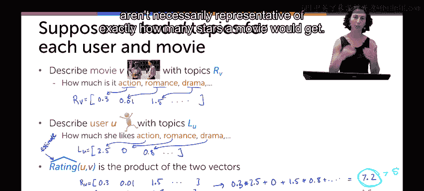

# 第一部分 80：基于已知用户-商品特征的推荐 🎬

在本节课中，我们将学习如何利用已知的用户特征和商品（电影）特征来预测用户对未观看电影的评分，并以此为基础构建推荐系统。

上一节我们介绍了推荐系统的基本概念，本节中我们来看看如何利用特征向量进行评分预测。

## 特征向量表示

假设我们拥有每部电影和每位用户的一组特征。例如，电影《肖申克的救赎》可以表示为一个向量，其中包含对不同类型（如动作、浪漫、剧情）的隶属度。同样，每位用户也可以表示为一个向量，描述其对各类电影的偏好程度。

我们定义：
- **电影向量**为 **r_v**，表示电影v的特征。
- **用户向量**为 **l_u**，表示用户u的偏好。

## 评分预测方法

为了预测用户u对电影v的评分，我们可以计算电影向量与用户向量的**点积**。点积结果越大，表示用户偏好与电影特征越匹配，预测评分就越高。

预测评分的计算公式为：

**\hat{r}_{u,v} = r_v \cdot l_u**

其中，\hat{r}_{u,v} 表示预测评分。

以下是计算过程的分解：
1.  将电影向量和用户向量对应元素相乘。
2.  将所有乘积结果相加，得到最终预测分数。

例如，若电影向量为 `[0.3, 0.01, 1.5]`，用户向量为 `[2.5, 0, 0.8]`，则预测评分为 `(0.3*2.5) + (0.01*0) + (1.5*0.8) = 0.75 + 0 + 1.2 = 1.95`。

## 生成推荐列表

获得所有电影的预测评分后，生成推荐列表的步骤如下：
1.  为用户u计算其未观看过的所有电影的预测评分。
2.  根据预测评分对所有电影进行降序排序。
3.  将排名靠前（即预测评分最高）的电影推荐给该用户。

需要指出的是，这种基于点积的模型预测出的分数可能超出实际的评分范围（例如0-5星）。但这并不影响推荐功能，因为我们只需要比较分数的相对大小，找出最可能被用户喜爱的电影。

本节课中我们一起学习了如何利用用户和商品的特征向量，通过点积运算来预测评分并构建推荐列表。这种方法的核心在于衡量用户偏好与商品特征之间的匹配程度。