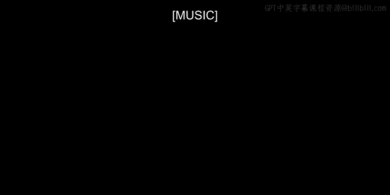
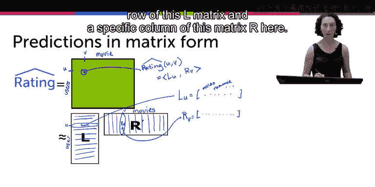

# 第一部分 82：矩阵形式的预测 📊

在本节课中，我们将学习如何用矩阵形式来表示推荐系统中的预测评分。我们将从具体的用户-电影评分出发，扩展到整个用户和电影集合的预测表示，并引入线性代数的基本概念来简化这一过程。

---

## 从单个评分到矩阵表示

上一节我们讨论了如何为一个特定用户和电影组合预测评分。本节中，我们来看看如何将这种预测扩展到所有用户和所有电影，并用矩阵形式进行统一表示。

对于一个特定用户 **U** 和电影 **V**，我们预测的评分公式如下：

**预测评分 = Σ (用户向量 L_u 的元素 × 电影向量 R_v 的元素)**

用数学符号可以简洁地表示为：

**ŷ_uv = L_u · R_v**

这里的点乘（·）表示对两个向量进行逐元素相乘，然后将所有乘积结果求和。

---

## 理解向量与矩阵

用户向量 **L_u** 是一个行向量，它代表了用户 **U** 对不同电影特征（如动作、浪漫等）的偏好程度。

电影向量 **R_v** 是一个列向量，它代表了电影 **V** 在不同特征上的强度。

当我们计算 **L_u** 和 **R_v** 的点积时，实际上是在计算一个矩阵乘法中特定位置（第 **U** 行，第 **V** 列）的元素值。

---

## 扩展到完整矩阵

为了给所有用户和所有电影进行预测，我们可以将所有的用户向量堆叠起来形成一个矩阵 **L**，其中每一行代表一个用户。

同样地，将所有的电影向量堆叠起来形成另一个矩阵 **R**，其中每一列代表一部电影。

通过矩阵乘法，我们可以一次性得到完整的预测评分矩阵 **Ŷ**：

**Ŷ = L × R**

以下是这个过程的几个关键点：

*   **矩阵 L**： 行数等于用户数，列数等于特征数（如电影类型）。
*   **矩阵 R**： 行数等于特征数，列数等于电影数。
*   **结果矩阵 Ŷ**： 行数等于用户数，列数等于电影数。矩阵中位于第 **i** 行、第 **j** 列的元素 **ŷ_ij**，就是我们对用户 **i** 给电影 **j** 的评分预测。

这种表示方法非常紧凑和高效。它允许我们利用线性代数的工具，对整个数据集进行统一的运算和分析，而不是逐个处理单个评分。

---

## 总结

本节课中，我们一起学习了如何将推荐系统的评分预测从单个计算，转化为高效的矩阵运算形式。

我们首先回顾了单个评分的预测公式，然后引入了用户偏好矩阵 **L** 和电影特征矩阵 **R** 的概念。最后，我们了解到，通过矩阵乘法 **L × R**，可以直接得到包含所有用户对所有电影预测评分的完整矩阵 **Ŷ**。

这种矩阵形式的表示是许多现代机器学习算法的基础，它使得处理大规模数据成为可能，并为后续更复杂模型的学习做好了准备。