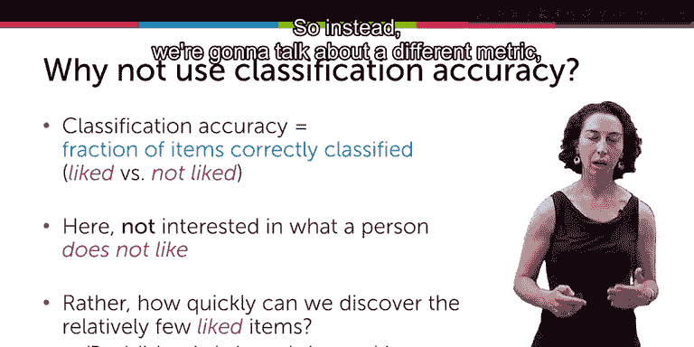

# 第一部分 85：推荐系统的性能指标 📊

在本节课中，我们将学习如何评估推荐系统的性能。我们将介绍两个核心指标：**召回率**和**精确率**，并解释为什么传统的分类准确率不适用于推荐系统场景。

---

## 推荐系统评估的挑战

上一节我们介绍了多种推荐系统的预测方法。本节中，我们来看看如何评估这些不同系统的性能差异。

假设我们需要向一位新父母推荐产品，所有可能推荐的产品集合如下图所示。用户真正喜欢的产品是其中的一个子集，在图中用洋红色方块表示。我们的目标是通过用户的购买记录，发现他们喜欢的产品，因为我们实际上并不知道用户具体喜欢哪些产品。

那么，为何不能直接使用分类准确率来衡量推荐系统的性能呢？例如，我们可以计算系统猜测用户喜欢与不喜欢的物品数量，并与实际情况进行比较。Carlos在情感分析案例研究中曾讨论过使用此类指标。

但这里的问题是多方面的：
1.  我们更关心用户**喜欢**什么，而非他们不喜欢什么。而且，我们常常面临类别极不平衡的情况。例如，产品数量极其庞大，但用户通常只喜欢其中很小一部分。如果使用分类准确率，系统只需预测用户不喜欢任何物品（即不推荐任何东西），就能在此指标上获得很好的表现，但这显然不是我们想要的。
2.  另一个问题涉及不同决策带来的成本差异。我们通常假设用户的注意力是有限的，因此只能推荐有限数量的物品给用户查看。在这种情况下，如果在我们允许推荐的这一小批物品中，**没有包含任何用户喜欢的物品**，其代价远高于在推荐列表中**遗漏了部分用户喜欢的物品**。

因此，我们将转而讨论一组不同的指标，即**精确率**和**召回率**。

---

## 理解召回率

首先讨论召回率。对于一个给定的推荐系统，它会向我推荐一组产品。在图中，我用彩色图片高亮显示了这些被推荐的产品（例如，这是一个推荐项，这也是一个推荐项），而灰色图片则表示未被推荐给我的物品。

测量召回率时，我们需要关注所有我喜欢的物品（即所有洋红色方块），并计算**其中有多少被实际推荐给了我**的比例。

以下是计算步骤：
1.  统计所有我喜欢的物品（洋红色方块）总数。
2.  统计这些喜欢的物品中被推荐的数量。
3.  计算比例：`召回率 = 被推荐的喜欢物品数量 / 喜欢的物品总数`

在示例中，共有5个喜欢的物品，其中3个被推荐。因此，召回率为 **3/5**。

**召回率衡量的是推荐物品集合覆盖我感兴趣（真正喜欢）物品的程度。**

---

## 理解精确率

接下来我们看看精确率。讨论召回率时，我们关注的世界是“所有喜欢的物品”（洋红色方块）。而讨论精确率时，我们关注的世界变成了“所有被推荐的物品”（图中绿色高亮框）。

测量精确率时，我们需要在所有被推荐的物品中，计算**其中有多少是我喜欢的物品**的比例。

以下是计算步骤：
1.  统计所有被推荐的物品总数。
2.  统计这些被推荐的物品中，用户喜欢的数量。
3.  计算比例：`精确率 = 被推荐的喜欢物品数量 / 被推荐的物品总数`

在示例中，共有11个被推荐的物品，其中3个是用户喜欢的。因此，精确率为 **3/11**。

**精确率衡量的是，在用户注意力有限的情况下，他们需要浏览多少“垃圾信息”（不喜欢的物品）才能找到喜欢的内容。它反映了推荐列表的“纯净度”。**

---

## 总结

本节课中，我们一起学习了推荐系统的核心性能指标：
*   **召回率**：关注用户喜欢的物品，衡量系统找出这些物品的能力。公式为：`召回率 = (被推荐的喜欢物品数) / (用户喜欢的物品总数)`
*   **精确率**：关注系统推荐的物品，衡量推荐列表的准确性。公式为：`精确率 = (被推荐的喜欢物品数) / (被推荐的物品总数)`

理解这两个指标有助于我们在构建推荐系统时，在“尽可能覆盖用户喜好”（高召回率）和“确保推荐内容精准”（高精确率）之间做出权衡与优化。