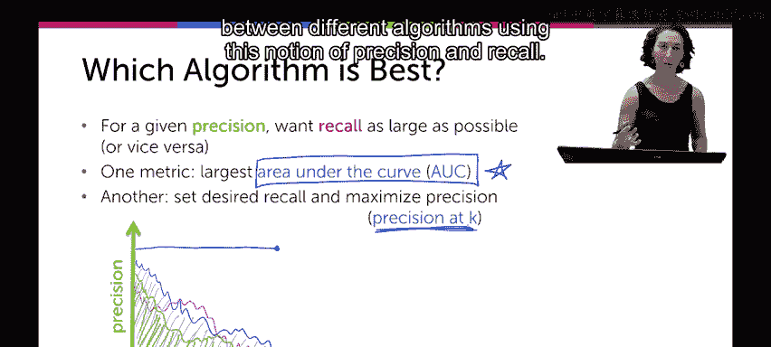

# 第一部分 87：准确率-召回率曲线 📊

在本节课中，我们将学习如何使用准确率（Precision）和召回率（Recall）这两个指标来比较不同的推荐算法。我们将重点介绍**准确率-召回率曲线**的绘制方法、含义，以及如何利用该曲线评估算法性能。

---

## 概述：准确率与召回率回顾

上一节我们介绍了准确率和召回率这两个核心评估指标。准确率衡量的是推荐物品中用户真正喜欢的比例，公式为：

**准确率 = 推荐且喜欢的物品数 / 推荐的物品总数**

召回率衡量的是系统成功找出的用户喜欢物品占所有喜欢物品的比例，公式为：

**召回率 = 推荐且喜欢的物品数 / 用户喜欢的物品总数**

本节中，我们将看看如何通过绘制**准确率-召回率曲线**，直观地比较不同算法在不同推荐数量下的表现。

---

## 什么是准确率-召回率曲线？

准确率-召回率曲线描述的是，当我们改变推荐系统允许推荐给用户的物品数量阈值时，准确率和召回率的变化关系。

以下是绘制该曲线的步骤说明：

1.  首先，系统会对所有候选物品（例如亚马逊上的所有婴儿产品）进行排序。
2.  然后，我们设定一个阈值 `k`，只允许系统推荐排名前 `k` 的物品。
3.  对于每个不同的 `k` 值（例如 `k=1, 2, 3...`），我们分别计算其对应的准确率和召回率。
4.  最后，将所有 `(召回率， 准确率)` 的点连接起来，就形成了准确率-召回率曲线。

---

## 理想情况下的曲线

让我们先看看一个**理想推荐系统**的曲线会是什么样子。假设这个系统只推荐用户喜欢的产品。

*   当 `k=1`（只推荐1个产品）时，这个产品用户喜欢，所以**准确率 = 1**。假设用户总共喜欢10个产品，那么此时**召回率 = 1/10 = 0.1**。
*   随着 `k` 增加，系统推荐更多用户喜欢的产品，准确率始终保持为1，而召回率会逐渐增加。
*   最终，当 `k` 足够大，覆盖了所有用户喜欢的产品时，召回率达到1，准确率仍为1。

因此，理想系统的曲线是一条从点 `(0.1, 1)` 到点 `(1, 1)` 的水平线，这代表了**最优性能**。

---

## 现实情况下的曲线

现在，我们来看一个更现实的推荐系统。它的表现不会那么完美。

*   最初推荐的几个产品可能用户并不喜欢，所以准确率较低。
*   随着推荐数量 `k` 增加，系统终于推荐了一个用户喜欢的产品，此时准确率和召回率都会上升。
*   但接下来，系统可能又推荐了一个用户不喜欢的物品。这时，召回率保持不变（因为没有发现新的喜欢物品），但准确率会**立刻下降**，因为分母（推荐总数）变大了，而分子（喜欢的物品数）没变。

这个过程会不断重复，导致曲线呈现出**锯齿状**的形态：先上升（发现喜欢物品），再垂直下降（混入不喜欢物品），如此反复。

---

## 如何比较不同算法？

我们已经知道，准确率和召回率都越高越好。但在比较两条不同的锯齿状曲线时，一条曲线并不总是在所有点上都优于另一条。

例如，蓝色曲线可能在召回率较低时表现更好，而绿色曲线在召回率较高时更优。那么，如何判断哪个算法整体上更好呢？

以下是两种常用的比较方法：

### 1. 曲线下面积

一种方法是计算**曲线下面积**。面积越大，代表算法在不同推荐数量阈值下的综合表现越好。我们可以通过比较不同算法曲线的面积大小来进行排序。

### 2. 特定操作点的精度

在某些实际应用中，我们可能明确知道需要推荐多少物品。例如：
*   网站页面的布局只允许展示10个推荐位。
*   根据用户注意力研究，决定最多只推荐20个产品。

在这种情况下，我们并不关心整个曲线，而只关心在**特定推荐数量 `k`** 下的准确率。我们会选择在该 `k` 值下准确率最高的算法。

---

## 总结

本节课中，我们一起学习了**准确率-召回率曲线**。我们了解了它的绘制原理，看到了理想情况与现实情况下的曲线差异。最后，我们掌握了两种利用该曲线比较算法性能的方法：**比较曲线下面积**和**比较特定操作点下的准确率**。这些工具能帮助我们在实际场景中选择最合适的推荐算法。