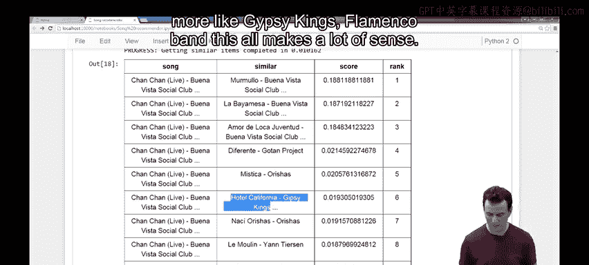

# 第一部分 91：创建并评估个性化歌曲推荐器 🎵


在本节课中，我们将学习如何构建一个个性化的歌曲推荐系统。我们将从基础的流行度推荐模型过渡到更高级的基于物品相似度的个性化推荐模型，并演示如何为用户生成定制化的歌曲推荐，以及如何查找相似歌曲。

---

## 从流行度推荐到个性化推荐

上一节我们介绍了如何创建一个基于歌曲整体流行度的推荐器。这种模型会向所有用户推荐相同的热门歌曲，缺乏个性化。

本节中，我们将构建一个**个性化推荐器**，它能根据每位用户的历史行为，提供独特的歌曲推荐。

以下是创建个性化推荐器的步骤：

1.  **初始化模型**：我们将使用物品相似度模型，而非之前的流行度模型。
2.  **配置模型**：需要指定数据集中代表用户ID和物品（歌曲）ID的列名。
3.  **训练模型**：使用训练数据来构建模型。

具体实现代码如下：

```python
# 创建个性化推荐模型（基于物品相似度）
personalized_model = graphlab.item_similarity_recommender.create(
    train_data,
    user_id='user_id',
    item_id='song'
)
```

---

## 应用个性化模型进行推荐

模型训练完成后，我们可以用它来为特定用户生成推荐。与流行度模型不同，个性化模型为不同用户推荐的歌曲列表会截然不同。

例如，为用户0和用户1生成推荐：

```python
# 为用户0推荐歌曲
recommendations_user_0 = personalized_model.recommend(users=[0])

# 为用户1推荐歌曲
recommendations_user_1 = personalized_model.recommend(users=[1])
```

运行后你会发现，用户0可能收到如“Doctor Feel Good”等歌曲的推荐，而用户1则可能收到一系列来自“Florence and the Machine”乐队的歌曲。这清晰地展示了模型的个性化能力。

---

## 探索相似物品

个性化推荐器的另一个强大功能是能够查找相似的物品。这意味着，如果你喜欢某首歌曲，模型可以找出其他被相似用户群体喜爱的歌曲。

以下是查找相似歌曲的方法：

1.  **调用方法**：使用 `get_similar_items` 函数。
2.  **指定歌曲**：提供一个你喜欢的歌曲列表作为输入。

例如，如果你喜欢U2乐队的歌曲“With or Without You”，模型会推荐其他U2的歌曲：

```python
# 查找与指定歌曲相似的歌曲
similar_songs = personalized_model.get_similar_items(items=['With or Without You - U2'])
```

结果可能包含“I Still Haven‘t Found What I’m Looking For”、“Vertigo”等U2的其他热门歌曲。

再举一个例子，如果你喜欢Buena Vista Social Club的歌曲“Chan Chan”，模型不仅会推荐该乐队的其他歌曲，还可能推荐风格相近的艺术家（如Gotan Project、Gypsy Kings）的作品，这体现了模型在音乐风格和听众品味上的深度关联挖掘能力。

---

## 总结




本节课中，我们一起学习了如何构建和评估一个个性化的歌曲推荐系统。我们从简单的流行度模型出发，进阶到基于物品相似度的个性化模型。我们不仅学会了如何为不同用户生成定制化的歌曲推荐列表，还掌握了如何根据一首歌曲来发现与之相似的其他歌曲。这个流程展示了推荐系统如何从“千人一面”进化到“千人千面”的核心思想。