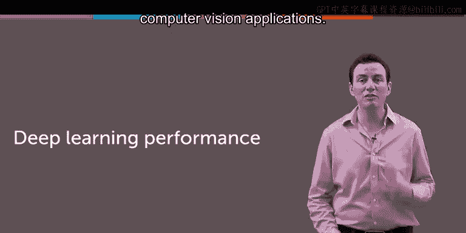
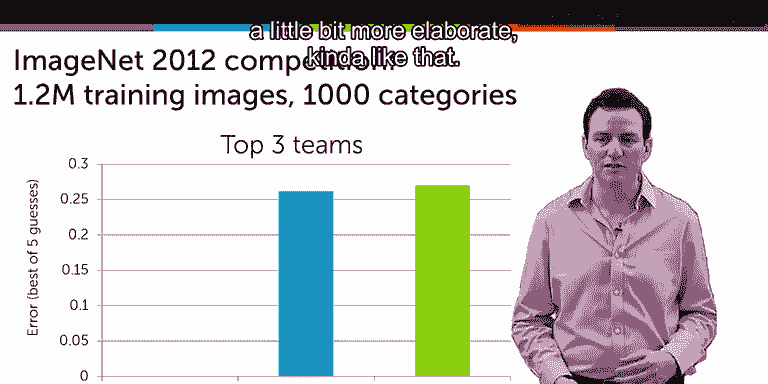
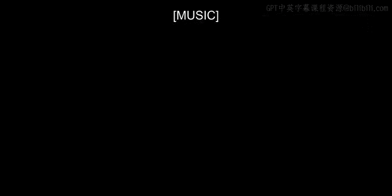

# 第一部分 97：深度学习性能 🚀

在本节课中，我们将要学习深度学习在计算机视觉领域的性能表现，特别是通过几个关键案例来理解其突破性进展。

---

## 深度学习的吸引力

深度学习之所以令人兴奋，是因为它能够学习图像的复杂特征。正如我们之前讨论的，近年来深度学习在各种计算机视觉应用中产生了巨大影响。

以下是几个早期示例。

*   **交通标志识别**：幻灯片顶部展示了一个基于神经网络的交通标志识别示例。这是一个德国交通标志数据集，目标是对每张图像识别出具体是哪种标志。使用深度神经网络，他们能够达到 **99.5%** 的准确率，这非常出色。
*   **街景门牌号识别**：底部展示的是谷歌基于街景数据识别门牌号的工作示例。这些数据是谷歌通过汽车在世界各地拍摄街道获得的。可以看到图像相当复杂，但他们仍然在单个字符级别上达到了 **97.8%** 的准确率。

这些成果令人振奋，但真正改变一切、激发整个领域热情的事件发生在2012年。

---

## 2012年的突破：ImageNet竞赛

多年来，有一个名为ImageNet的图像识别竞赛。2012年，该竞赛包含了来自大约100个不同类别的 **120万张** 训练图像。其目标是进行精细分类，例如，不仅要识别出是狗，还要识别出是金毛猎犬还是拉布拉多犬。

当时有许多团队参赛，以下是前三名团队的表现。

*   **牛津VGG团队**：取得了相当不错的准确率。如果看他们预测概率最高的五个答案（Top-5），错误率大约为 **25%**。
*   **ISI团队**：表现稍好一些。这些团队使用的是传统技术，例如更复杂的类SIFT特征。

然而，那一年出现了一个名为 **SuperVision** 的团队。

---

## SuperVision团队的革命性成果

SuperVision团队使用了深度神经网络，并取得了相对于竞争对手的巨大优势。

这一表现真正点燃了在计算机视觉中使用深度神经网络的热情，因为模型不再需要依赖手工编码的特征，而是可以自动学习这些特征。

---

## 获胜网络：AlexNet

SuperVision团队赢得比赛的神经网络被称为 **AlexNet**。

以下是该网络的关键信息：
*   **网络结构**：包含 **8层**。
*   **参数量**：高达 **6000万** 个参数。
*   **实现关键**：这种规模的网络之所以成为可能，得益于能够处理大量图像和参数的新训练算法，以及他们的 **GPU** 实现，这使其能够真正扩展到大型数据集。

---

## 总结

本节课中，我们一起学习了深度学习在图像识别任务上的卓越性能。我们回顾了早期在交通标志和门牌号识别上的成功应用，并重点分析了2012年ImageNet竞赛中AlexNet的突破性胜利。这次胜利的关键在于深度神经网络能够**自动学习特征**，并借助**GPU和大规模数据**进行高效训练，从而开启了深度学习在计算机视觉领域的新纪元。