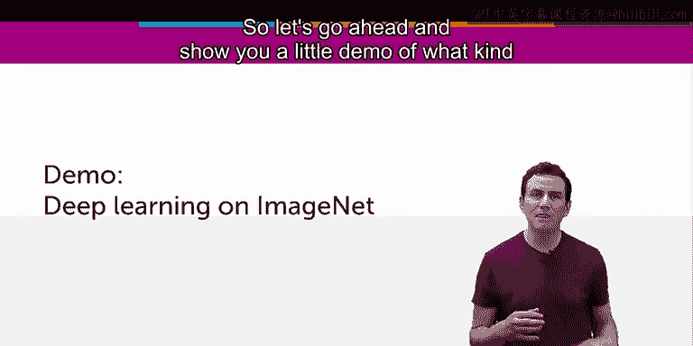

# 第一部分 98：在ImageNet数据上展示深度学习模型 🖼️

在本节课中，我们将通过一个实际演示，了解深度学习模型在ImageNet数据集上的预测能力。我们将看到模型如何准确识别上千种不同类别的图像，并探讨其实际应用潜力。

---

## 深度学习在ImageNet竞赛中的影响

上一节我们介绍了深度学习的基本概念，本节中我们来看看它在ImageNet竞赛中的具体表现。深度学习对ImageNet竞赛产生了巨大影响，使得研究人员能够利用深度神经网络处理海量图像数据，并在预测1000个不同类别时取得惊人性能。

## 演示：基于AlexNet的图像识别服务

以下是基于ImageNet数据集训练的AlexNet模型部署为服务的演示。该服务托管在网站上，每次点击图像都会将其发送至运行在GPU上的服务端，并快速返回预测结果。

### 预测示例分析

我们将通过几个具体示例，展示模型的预测效果。

**示例一：停车计时器**

点击下图中的图像，将其发送至托管在Amazon AWS上的服务：

模型返回的预测结果是“停车计时器”，这是正确的标签。第二可能的预测是“挂锁”，虽然图像中部分结构类似挂锁，但模型准确识别为停车计时器。

**示例二：显示屏**

点击另一张图像，发送至服务后返回的预测是“屏幕”或“显示器”。虽然“屏幕”和“显示器”的区分不明确，但预测基本正确。

**示例三：琵鹭**

点击下图中的图像：

模型非常确信这是一只“琵鹭”，预测结果正确。

**示例四：啤酒瓶**

点击图像后，模型预测为“啤酒瓶”或“汽水瓶”，真实标签是“啤酒瓶”，预测准确。

## 模型在未知图像上的泛化能力

以上示例均来自原始ImageNet数据集。现在，我们测试一张不在原始数据集中的图像：

点击下图中的图像（我的狗），将其发送至服务：

模型返回的预测是“拉布拉多寻回犬”。这是我的狗，图像中的狗与数据中的拉布拉多寻回犬相似。可以看到，即使对于不在原始数据集中的图像，模型仍能给出有趣的预测。

## 总结与应用展望

本节课中我们一起学习了深度学习模型在ImageNet数据集上的强大识别能力。通过实际演示，我们看到模型不仅能准确识别训练过的图像类别，还展现出一定的泛化能力。

在您的实践项目中，可以构建类似的服务，但不仅限于图像识别。例如，可以结合深度学习方法处理产品图像和文本，构建推荐系统，并部署为在线服务。这样，任何人都能通过类似网站体验您所构建的机器学习应用，亲身感受机器学习技术的实际威力。