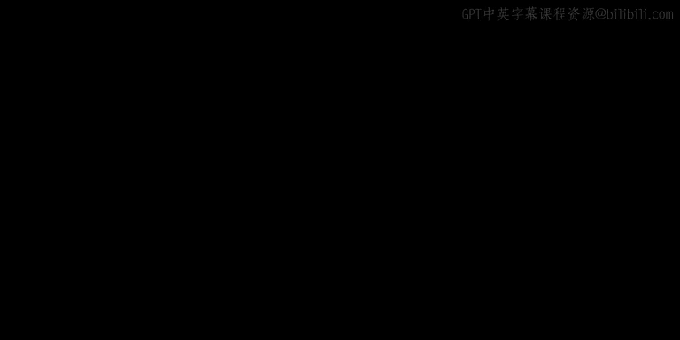
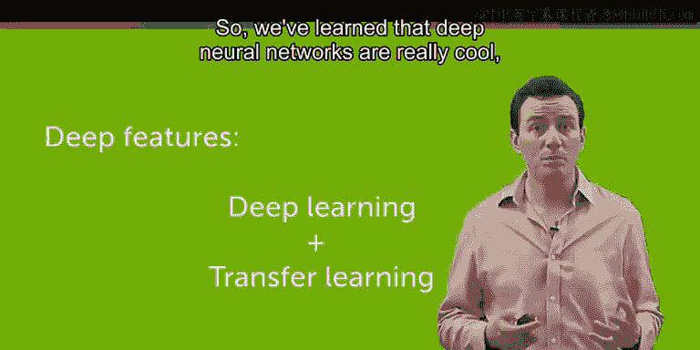
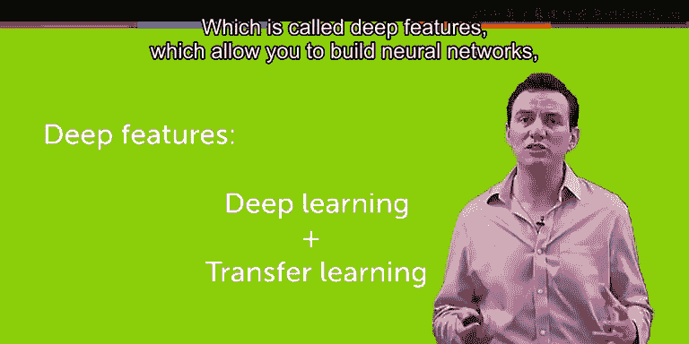
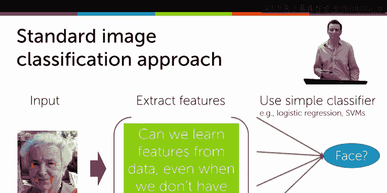
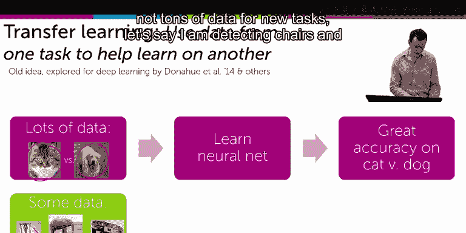
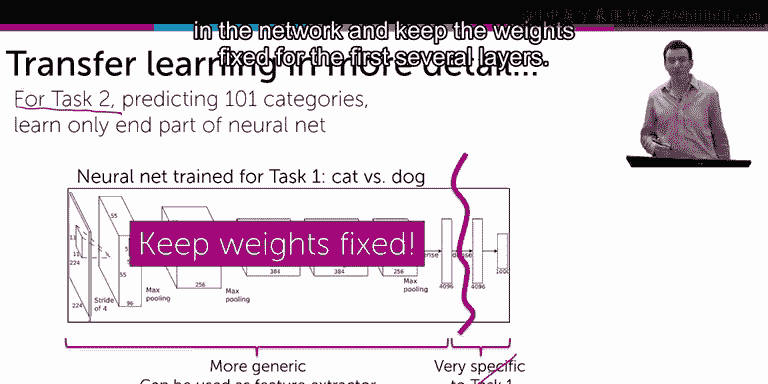
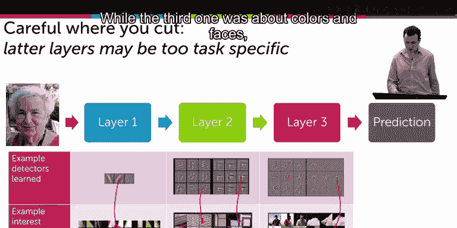
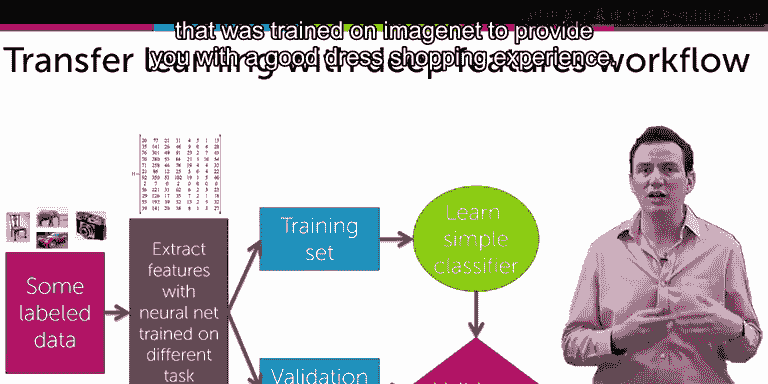
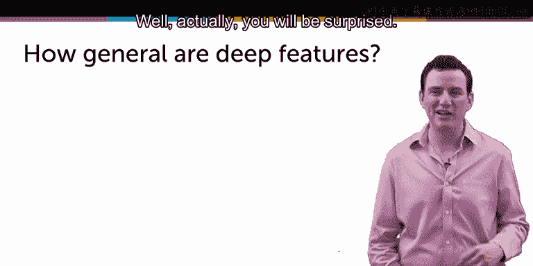

# 机器学习基础篇（第1课/共4课）｜第10讲：深度特征 🧠

在本节课中，我们将要学习**深度特征**的概念。这是一种强大的技术，它允许我们在数据量有限的情况下，依然能够构建高性能的神经网络模型。

---

我们已经了解到，深度神经网络非常强大，并且能达到很高的准确度。但是，构建和训练它们通常非常困难，并且需要海量的数据。

接下来，我们将探讨一个令人兴奋的概念——**深度特征**。它让你即使在数据不多的情况下，也能构建有效的神经网络。

---

## 从传统流程到新思路 🔄

回顾我们标准的图像分类流程：从一张图片开始，我们检测并提取一些特征，然后将这些特征输入到一个简单的分类器（如线性分类器）中。

这里的问题是：我们能否利用神经网络学习到的那些特征——那些能够识别角、边甚至人脸的强大特征——来“喂养”这个简单的分类器呢？

我们可以尝试一种不同的方法。这个想法，即深度特征的核心，被称为**迁移学习**。

---

## 理解迁移学习 🧳

迁移学习是一个存在已久的概念，但近年来在深度神经网络领域产生了巨大影响。

其核心思想是：我先在一个拥有大量数据的任务上训练一个神经网络。例如，在一个区分猫和狗的任务中，我训练了一个有8层、6000万个参数的复杂神经网络，并在此任务上获得了极高的准确度。

现在，有趣的部分来了：如果我有一个新任务（例如，检测椅子、大象、汽车、相机等上百个类别），但只有少量数据，我该怎么办？

我们能否利用从“猫狗分类”任务中学到的特征，结合一个简单的分类器，来在这个新的101个类别的任务上获得高准确度呢？这就是迁移学习的理念：从一个任务（猫狗分类）中学到的特征，被**迁移**到新任务（检测大象、相机等）中，以提升其性能。

---

## 深度网络学什么？🔍

为了理解迁移学习在深度神经网络中如何工作，我们先回顾一下深度网络可能学习到的内容。

假设我们有一个用于猫狗分类的深度神经网络。如果我们观察网络的最后几层，它们会高度专注于“猫 vs 狗”这个具体任务，就像之前例子中最后一层专门检测“珊瑚”一样。

然而，网络中间层的特征则更为通用。它们可以表示角、边、圆形、曲线等模式。这些通用特征能够从“猫狗分类”任务，很好地**泛化**到更通用的“101个类别”任务中。

---

## 如何应用迁移学习？⚙️

那么，我们如何将已训练好的猫狗分类网络，应用到第二个“101个类别”的任务上呢？

考虑到网络的末端部分（最后几层）非常特定于“猫狗”任务，对检测“椅子”可能没什么用。因此，我们可以这样做：**“砍掉”** 网络的最后几层（比如最后一层），并**固定**前面几层的权重，因为这些层已经学会了很好的通用特征。

然后，我们将这些固定层输出的特征（即**深度特征**），输入到一个新的、简单的线性分类器中。这个新分类器很简单，因此我们只需要用新任务（椅子、汽车、大象等）的少量数据来训练它即可。

用公式表示，新模型的预测过程为：
`预测结果 = 新分类器( 固定深度网络的前N层(输入图像) )`

---

## 构建基于深度特征的流程 📊

现在我们已经理解了迁移学习的概念，让我们回顾一下深度学习流程，但这次使用深度特征。

以下是构建流程的步骤：

1.  **准备少量标注数据**：为新任务收集一些标注数据，不需要海量，少量即可。
2.  **提取深度特征**：使用预训练好的深度神经网络（如砍掉最后几层的网络）来处理你的数据，提取出深度特征。
3.  **划分数据集**：将带有深度特征的数据集划分为训练集和验证集（或测试集）。
4.  **训练简单分类器**：在训练集上学习一个简单的分类器，例如线性分类器、支持向量机或线性回归。
5.  **验证与评估**：在验证集上评估这个简单分类器的性能。

由于这是一个参数很少的简单分类器，用少量数据就能训练得很好，并且很容易调优。事实上，这种思想在许多应用中效果极佳。在本模块开头的演示中，那个帮你选购新裙子的应用，正是运用了这个理念。我们没有大量关于裙子视觉描述的数据，但我们使用了在ImageNet上训练好的模型提供的特征，来为你提供良好的购物体验。

---

## 深度特征有多通用？🌍

我们可能会问：这些深度特征到底有多通用？它们真的能用于各种有趣甚至非常规的任务吗？答案是肯定的，结果可能会让你惊讶。

让我们来谈谈**垃圾**。有一家叫Compology的公司，他们正在尝试革新垃圾收集的方式。传统上，垃圾车每天或每周定期挨家挨户、逐个商铺地收集垃圾。他们希望通过优化垃圾车的路径和收集方式来减少时间消耗。

他们的做法是在垃圾桶上安装摄像头，以判断里面有什么以及有多满。然而，他们并没有大量关于“满垃圾桶”是什么样子的标注数据。于是，他们使用了深度特征，并结合少量由人工标记的垃圾桶满溢程度数据，训练出了一个垃圾检测器。这使他们能够优化垃圾车的路径，从而更高效地服务，减少收集垃圾所需的时间。

由此可见，深度特征的应用非常广泛，**甚至对处理垃圾也有用**。

---

## 总结 📝

本节课中，我们一起学习了**深度特征**与**迁移学习**。

*   我们了解到，深度神经网络的前几层学习到的是通用特征（如边、角），这些特征可以迁移到其他视觉任务中。
*   通过“砍掉”预训练网络的最后几层（任务特定层），并固定前面层的权重，我们可以提取出强大的深度特征。
*   将这些深度特征输入到一个新的、简单的分类器中，即使用于新任务的数据量很少，我们也能构建出高性能的模型。
*   深度特征的通用性极强，能够应用于从图像分类到工业优化等各种不同的领域。

掌握深度特征，是让你在有限数据条件下也能利用深度学习强大能力的关键一步。