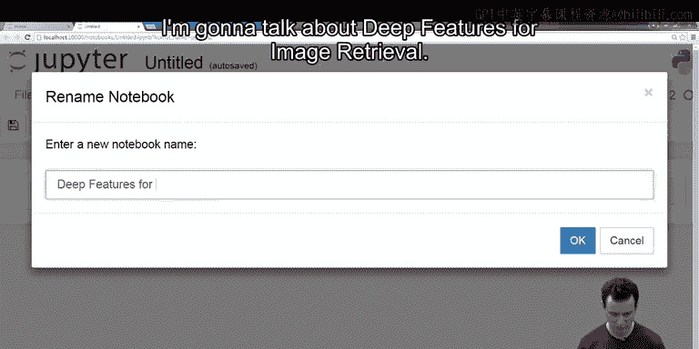
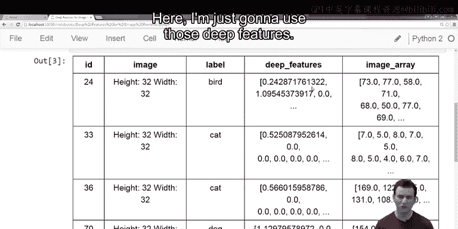

# 机器学习基础篇（第1课/共4课）｜图像检索：使用深度特征 🔍


在本节课中，我们将学习如何利用深度特征进行图像检索，而不仅仅是图像分类。我们将使用一个预先计算好深度特征的数据集，来寻找与给定图像相似的其他图像。

---

## 从分类到检索：深度特征的新应用

上一节我们介绍了深度特征在图像分类任务中的强大表现。它允许我们在特定分类任务上，即使只有少量训练数据，也能获得相当高的准确率。这些特征源自赢得了2012年ImageNet竞赛的深度学习模型。

但如果你还记得本模块开始时提到的动机和示例用例，我们的目标是寻找我喜欢的图像或产品。例如，我喜欢鞋子，我想找到与我的鞋子相似的鞋子，或者找到与我关心的产品相似的图像。


因此，我们现在不再进行图像分类任务，而是要利用这些深度特征来完成图像检索任务。接下来，让我们开始实践。



---

## 准备环境与数据

我们将命名我们的笔记本，主题是“深度特征用于图像检索”。为了获得更多空间，我们将隐藏页眉和工具栏。然后，启动GraphLab Create并加载数据集。

以下是加载数据的步骤：

1.  加载我们之前讨论深度特征分类时使用的相同数据集。
2.  在本例中，我们只加载训练集，因为我们将专注于检索任务。
3.  我们将这个SFrame命名为 `image_train`。

```python
import graphlab
image_train = graphlab.SFrame('image_train_data')
```

作为一个小提示，如果我们查看这个 `image_train` 数据集的前几行，会发现它包含以下列：
*   `image`： 实际图像。
*   `label`： 图像的标签。在检索任务中，我们完全不会使用这个标签。
*   `image_array`： 图像的像素数组。同样，我们也不会直接使用它。
*   `deep_features`： 预先计算好的深度特征。在关于深度特征分类的笔记本中，我们看过计算这个特征列所需的代码行。这里，我们将直接使用这些现成的深度特征。

---

## 总结




本节课中，我们一起学习了如何将深度特征的应用从图像分类扩展到图像检索。我们准备了实验环境，加载了包含预计算深度特征的数据集，并明确了在检索任务中我们将使用哪些数据列。接下来，我们就可以利用这些深度特征来寻找相似的图像了。