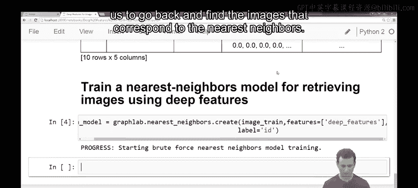

# 机器学习基础篇（第1课/共4课）📚：创建用于图像检索的最近邻模型

在本节课中，我们将学习如何构建一个用于图像检索的最近邻模型。我们将使用深度特征来代表图像，并通过计算特征之间的相似度，快速找到与给定查询图像最相似的图像。


---

## 概述与目标 🎯

上一节我们介绍了文档检索的基本概念。本节中，我们来看看如何将类似的方法应用于图像数据。

我们的目标是训练一个最近邻模型，用于基于深度特征检索相似的图像。这个过程与我们之前为巴拉克·奥巴马、克林顿、贝克汉姆等人查找相似文档的笔记本非常相似。

---

## 核心步骤与方法 ⚙️

我们将使用一个名为 **K最近邻（K-NN）模型** 的方法，就像在文档检索中所做的那样。以下是实现此模型的核心步骤：

1.  **准备数据**：我们将使用训练数据，其中每张图像都已提取了深度特征。
2.  **构建模型**：利用 `GraphLab Create` 库中的最近邻工具来创建模型。
3.  **配置模型**：指定使用哪些特征（这里就是深度特征）以及一个标签ID，以便我们能回溯找到对应的原始图像。

以下是创建模型的核心代码描述：

```python
# 伪代码示例：创建最近邻模型
model = graphlab.nearest_neighbors.create(training_data,
                                          features=['deep_feature'],
                                          label='image_id')
```

在这段代码中：
*   `training_data` 是包含图像深度特征的数据集。
*   `features=[‘deep_feature’]` 指定模型使用名为“deep_feature”的列作为比较依据。
*   `label=‘image_id’` 指定图像的唯一标识符，用于后续检索对应图像。

---

## 实现细节 📝

现在，让我们详细拆解每个部分。

首先，我们需要训练数据。这些数据中的每张图像都已经通过一个深度神经网络转换为一组数值向量，即“深度特征”。这些特征能有效捕捉图像的高级语义内容。

接下来，我们调用创建函数来实际构建这个最近邻模型。与文档检索模型类似，我们需要向它提供数据。在本例中，就是我们的训练数据。我们还需要告诉它使用哪些特征，这里我们将明确使用那些深度特征。

最后，作为一个重要提醒，你可以为模型指定一个标签ID。这里的标签，我们将使用**图像ID**。这样，当我们找到最近的邻居（即最相似的图像）时，就能通过这个ID回溯并找到对应的原始图像文件。

---

## 总结与回顾 📖

本节课中，我们一起学习了如何为图像检索创建一个最近邻模型。

我们回顾了该方法与文档检索的相似性，明确了使用**深度特征**作为图像表示的核心思想，并了解了构建**K-NN模型**的关键步骤：准备带特征的数据、利用库函数创建模型、并通过设置`label`参数来确保结果的可追溯性。



通过这个模型，我们能够高效地根据图像内容进行相似性搜索，这是许多图像应用（如以图搜图、产品推荐）的基础。