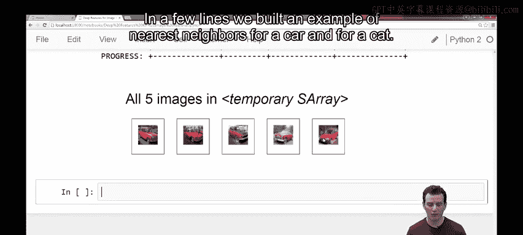

# 机器学习基础篇（第1课/共4课）🚗 第108讲：查询与汽车图像最相似的图像


在本节课中，我们将学习如何利用已构建的辅助函数，为一张新的汽车图像查找其最相似的图像（即“最近邻”图像）。我们将通过一个具体示例，演示从查询图像到获取相似图像的完整流程。

---

上一节我们介绍了辅助函数的创建，本节中我们来看看如何将这些函数应用于另一张图像。

这里我使用了一张汽车图像进行演示。该图像来自训练集，是其中的第八张图像。为了明确查询对象，我们首先查看这张汽车图像。

以下是加载并显示该汽车图像的代码：

```python
car_image = image_train[8]
car_image.show()
```

如图所示，这是一辆红色汽车。

接下来的问题是：这辆红色汽车的最近邻图像有哪些？我们可以使用之前定义的 `get_images_from_ids` 函数进行查询。但为了更直接地演示，这里采用一个简化的方法。

以下是查询最近邻图像的代码：

```python
nearest_neighbors = model.query(car_image)
similar_images = nearest_neighbors['image']
similar_images.show()
```

执行上述代码后，我们可以看到输入图像（红色汽车）及其最近邻图像。结果显示，系统成功找到了一系列红色汽车作为最相似的图像。

通过短短几行代码，我们便完成了针对汽车和猫咪图像的最近邻搜索示例，这展示了该方法的简洁与高效。

---



本节课中我们一起学习了如何查询指定图像的最近邻图像。我们加载了一张汽车图像，利用模型进行查询，并成功获取并展示了一系列相似的红色汽车图像。这个过程展示了最近邻算法在图像检索中的直观应用。