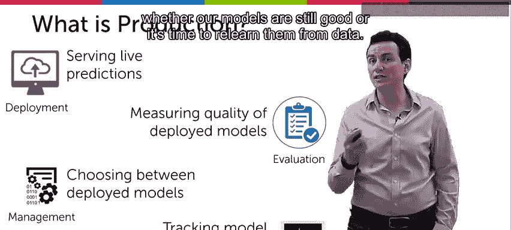
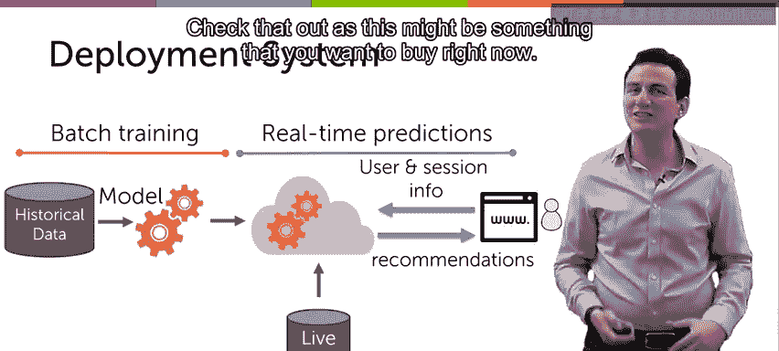

# 112：部署机器学习服务 🚀

在本节课中，我们将要学习如何将训练好的机器学习模型部署到实际应用中，使其能够实时地为用户提供预测服务。我们还将探讨如何评估模型在长期使用中的表现，以及如何管理和更新模型，确保其持续有效。

---

## 模型部署概述

到目前为止，我们主要讨论了如何使用数据构建机器学习模型、如何评估模型质量以及如何判断模型是否有效。然而，要构建一个智能应用，仅做到这些是不够的。当你构建智能应用时，你需要将训练好的模型真正地部署到生产环境中，例如，让公司网站的客户能够使用它来购买产品。那么，这个过程具体是怎样的呢？

模型部署涉及多个方面，我们称之为**模型部署**，即让模型能够实时提供预测。我们将详细讨论这一点。此外，我们还需要探讨如何评估模型，确保我们在离线训练阶段所做的工作在长期使用中仍然有效。

---

## 部署流程详解

上一节我们介绍了模型部署的基本概念，本节中我们来看看一个完整的部署系统是如何工作的。

考虑以下场景：你正在构建一个全新的产品推荐系统，使用了数百万条产品评论和用户数据。你希望在笔记本电脑、台式机或大型集群上训练好模型后，将其部署到与用户实时交互的网站上。这具体是怎样的过程呢？

整个系统始于一些历史数据，即你收集的关于系统用户的数据，包括他们写的评论、偏好等。我们利用这些数据训练模型，正如Emily在推荐系统模块中介绍的那样。

这个过程通常是在**批量离线设置**中完成的。你在本地机器或集群上训练模型，然后将其部署到云端，以便进行**预测服务**。这是系统的在线实时部分。

例如，如果你有一个网站，系统会实时获取用户当前的行为信息，例如他们正在浏览的页面、考虑购买的产品等。基于这些信息，系统会实时提供预测，比如“看看这个长颈鹿玩具，你可能现在就想购买”。用户看到这个推荐后，可能会购买，也可能不会。这种反馈（用户是否购买）将影响实时决策，并最终被收集为历史数据，用于长期改进模型。

随着我们从现实世界中收集越来越多的数据，模型也会不断优化。

这就是一个完整的机器学习部署系统可能的样子。

---

## 模型管理与持续改进

在部署模型后，我们还需要考虑所有的管理环节。以下是几个关键方面：

- **确保模型持续有效**：我们需要监控模型的表现，确保其预测质量不会随时间下降。
- **模型更新与替换**：当有更好的模型出现时，我们需要知道如何安全地替换旧模型。
- **监控与响应**：我们需要定义并监控一系列指标，以判断模型是否仍然有效，或者是否需要重新从数据中学习。

所有这些环节并非孤立存在，而是相互关联、相互影响的。我们需要深入理解这些环节，并创建一个模型持续改进的循环。

---

## 总结

本节课中我们一起学习了机器学习模型部署的全过程。我们从构建和评估模型的基础出发，探讨了如何将模型部署到生产环境中进行实时预测服务。我们了解了部署系统的关键组成部分，包括离线训练、在线服务以及用户反馈的收集。最后，我们强调了模型持续管理和改进的重要性，确保模型能够长期有效地服务于应用。

通过本课的学习，你应该对如何将机器学习模型从开发环境推向实际应用有了更清晰的认识。记住，构建一个成功的智能应用不仅仅是训练一个准确的模型，更在于如何可靠、高效地部署和管理它。