# 115讲：机器学习的发展方向 🚀

在本节课中，我们将探讨机器学习的当前应用与未来发展方向。我们将从机器学习的普及现状出发，分析其在多个前沿领域的潜在应用，并讨论实现这些愿景所面临的技术挑战。

---

## 机器学习的现状 🌐

上一节我们回顾了机器学习的历史，本节中我们来看看它的现状。机器学习已深度融入日常生活。每次打开网页应用或使用手机时，其背后都有机器学习系统在运行。这些系统可能部署在本地设备，也可能由云端支持。

可穿戴设备是当前应用的典型例子。例如，智能手表能追踪用户活动，判断用户是在跑步、休息还是睡眠。所有这些功能都依赖于机器学习算法。

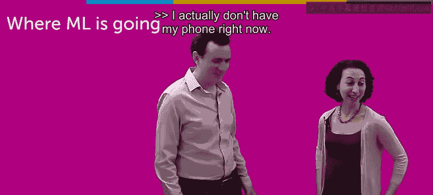

尽管应用广泛，但我们目前可能只触及了机器学习潜力的表面。

---

## 机器学习的未来方向 🔮

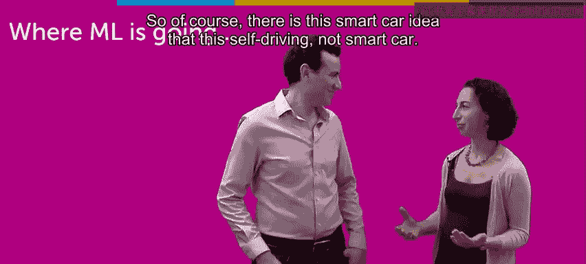

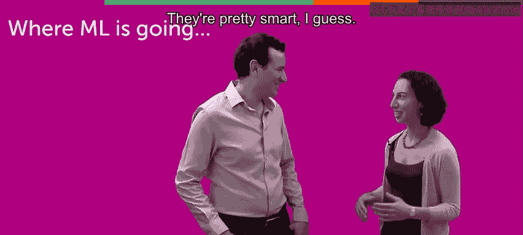

以下是机器学习几个关键的未来发展方向，每个方向都伴随着独特的机遇与挑战。

### 1. 自动驾驶汽车 🚗

自动驾驶技术是机器学习的一个重要应用领域。其核心目标是让车辆能够感知环境、做出决策并自主行驶。这涉及到复杂的计算机视觉、传感器融合和实时决策算法。

**核心挑战**包括处理复杂的道路环境、确保安全以及应对各种极端天气和光照条件。

### 2. 个性化医疗 🏥

当前医疗实践中，针对同一种疾病，不同患者往往接受相似的治疗方案。个性化医疗旨在改变这一现状。

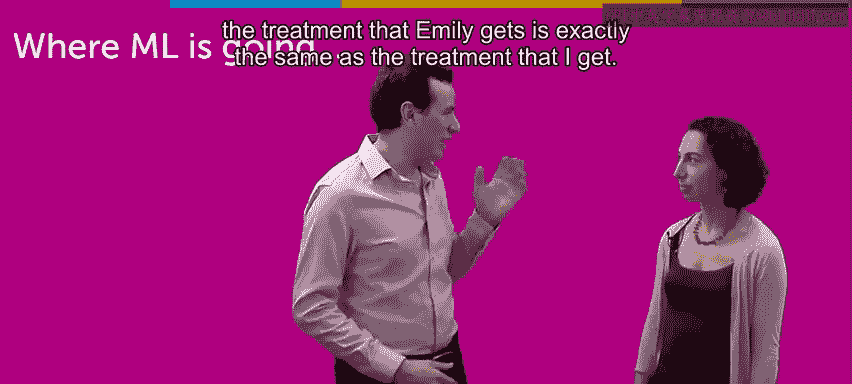

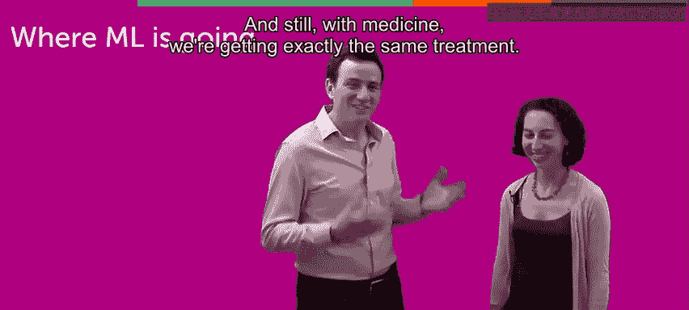

其目标是基于每个人的独特信息定制治疗方案，这些信息包括：
*   生活方式
*   身体类型
*   基因构成（DNA）

然而，实现个性化医疗面临巨大挑战。医疗数据通常非常嘈杂且不完整，原因可能包括：
*   医生记录的主观性和差异性。
*   患者可能错过检查。
*   数据录入可能存在错误或不一致。

因此，未来的机器学习算法必须能够解析这些复杂、有噪声且不完整的数据，以实现精准的个性化治疗。

### 3. 高度个性化的体验 🌍

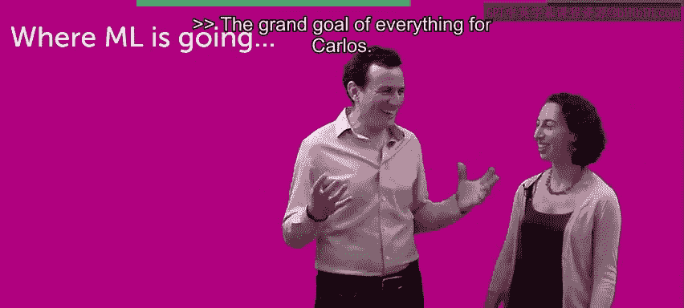

随着数据收集能力的增强和算法的进步，未来的技术将更加贴合个人需求。无论是网页浏览、购物还是其他服务，体验都将变得高度个性化。

这意味着技术将主动适应我们，而非让我们去适应技术，从而减少技术带来的困扰。

### 4. 实时多模态数据处理 ⚡

另一个激动人心的方向是处理实时、多模态的数据流。这不仅仅是重复现有的推荐任务，而是在更复杂、更快速的环境中进行。

这涉及到整合多种类型的数据，例如：
*   **时序数据**：随时间变化的数据。
*   **空间数据**：与位置相关的数据。
*   **多模态数据**：如图像、视频、音频和各种传感器数据。

核心挑战在于开发能够实时融合这些异构数据源并做出预测的新算法。这是一个当前非常活跃的研究领域。

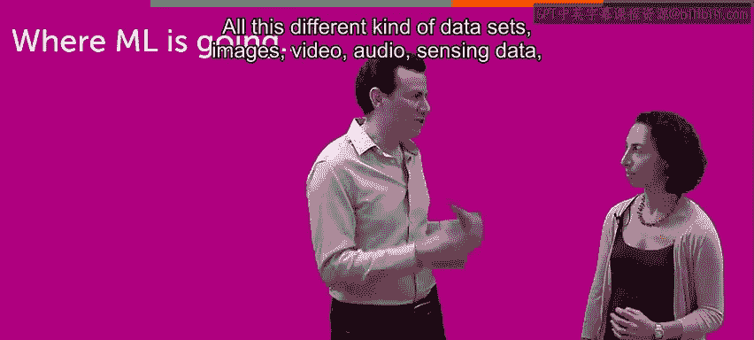

### 5. 算法的可扩展性与易用性 🛠️

为了实现上述愿景，我们开发的机器学习方法必须具备以下特性：
*   **可扩展性**：能够处理海量数据集。
*   **鲁棒性**：对数据中的噪声和不完整性具有容错能力。
*   **易用性**：不应要求使用者必须具备机器学习博士学位。算法需要足够健壮和易用，让更广泛的开发者，即使没有深厚的理论背景，也能构建出智能的应用程序。这是让机器学习技术真正普及的关键。

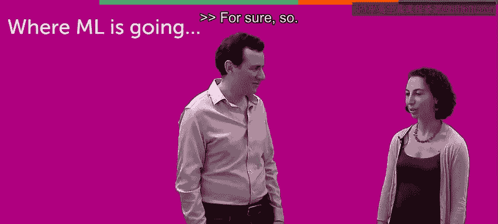

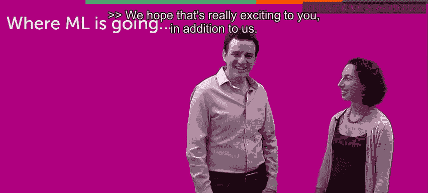

---

## 总结 📝

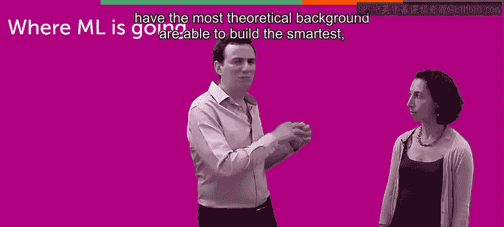

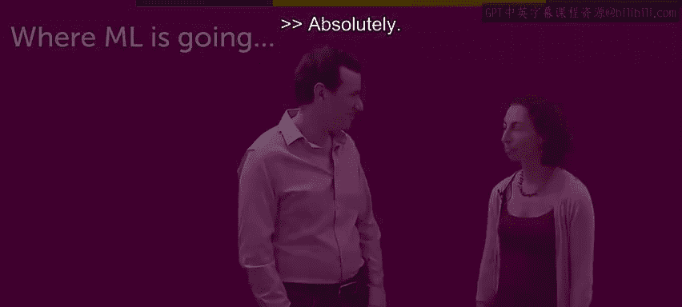

本节课中我们一起学习了机器学习的现状与未来。我们看到，机器学习已无处不在，但其潜力远未完全发掘。未来，它将在自动驾驶、个性化医疗、定制化体验等领域发挥更大作用。同时，处理实时多模态数据、提升算法的可扩展性与易用性，是推动这些发展必须克服的核心技术挑战。机器学习的未来充满机遇，也要求我们持续创新，以应对复杂的数据和现实问题。