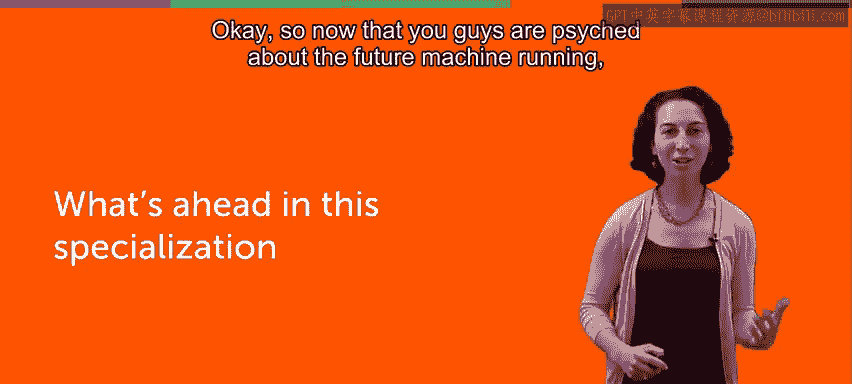
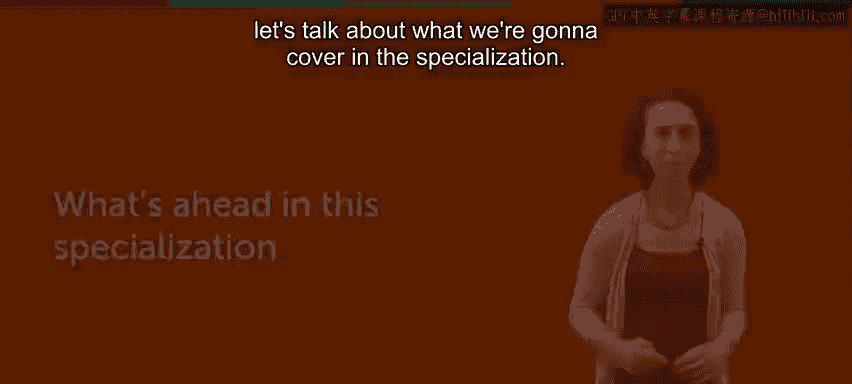
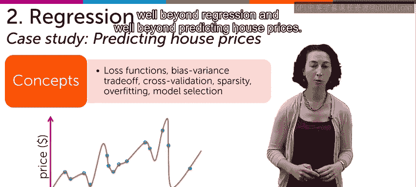
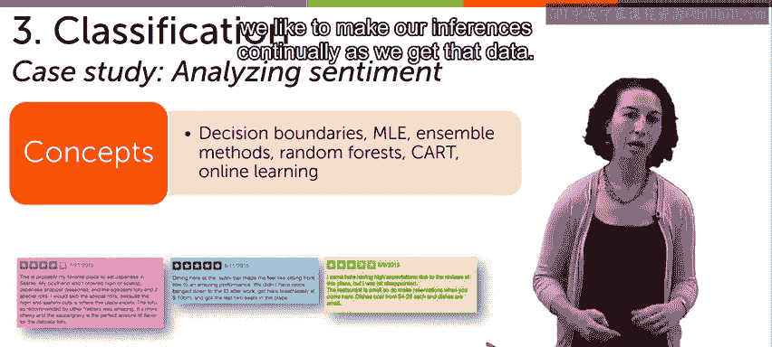
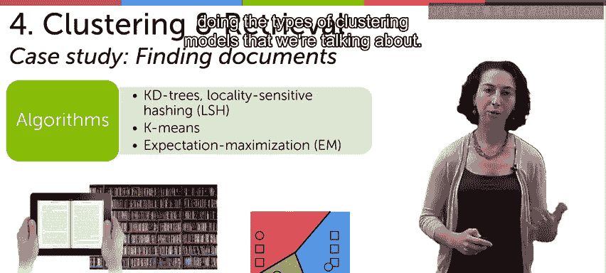
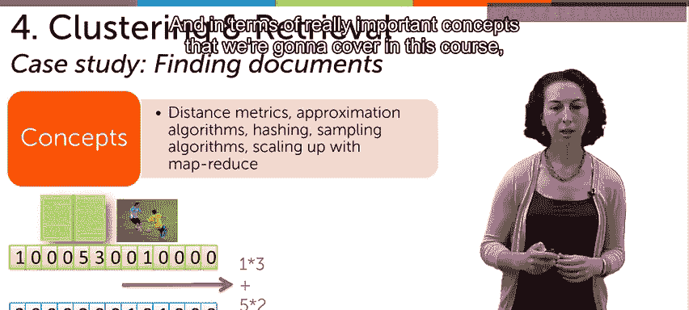
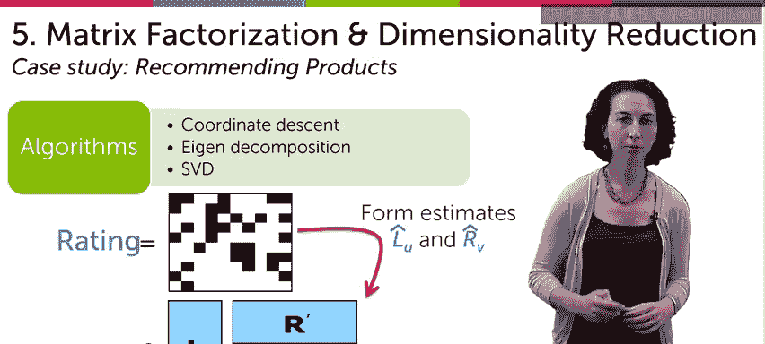
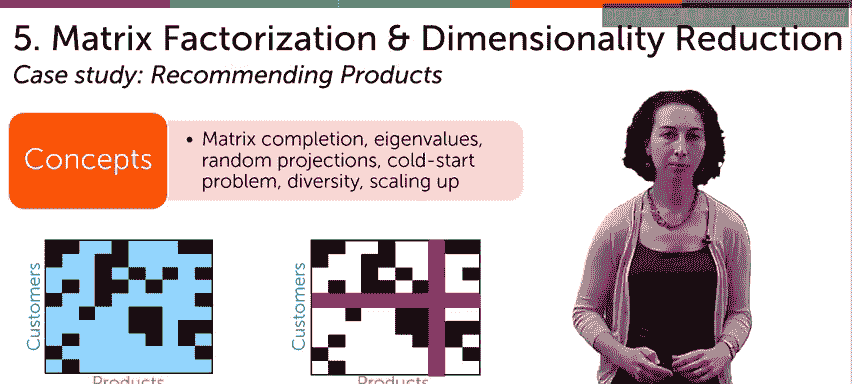
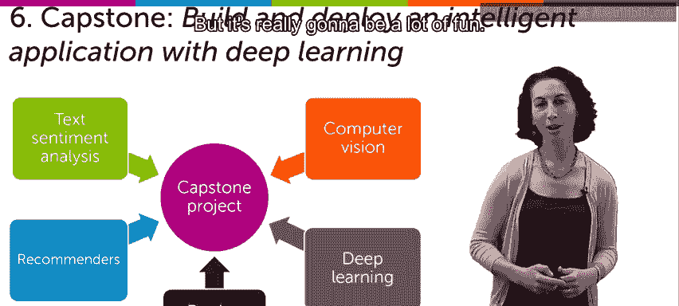

# 机器学习专业课程概览 🧠

在本节课中，我们将介绍华盛顿大学机器学习专业课程后续内容的核心模块。课程将深入探讨回归、分类、聚类与检索、推荐系统与降维，以及最终的顶点项目。每个模块都将扩展我们在基础课程中学到的概念，并引入新的算法与实际问题解决方案。

---

## 回归课程 📈

上一节我们介绍了机器学习的基础概念，本节中我们来看看回归课程的详细内容。在回归课程中，我们将深入探讨模型的不同构建方式，例如如何处理大量特征。我们还将详细讨论用于拟合这些模型的算法。

以下是回归课程将涵盖的核心内容：

*   **模型公式化**：探讨如何应对大量特征，这是基础课程中提及过的问题。
*   **优化算法**：我们将讨论不同的优化算法，例如**梯度下降**和**坐标下降**，用于实际执行优化。其核心思想是最小化成本函数，例如残差平方和（RSS）。
    *   **梯度下降公式**：`θ = θ - α * ∇J(θ)`，其中 `θ` 是参数，`α` 是学习率，`∇J(θ)` 是成本函数 `J` 的梯度。
*   **案例研究**：通过预测房价的案例研究，我们将涵盖许多对机器学习各个领域都至关重要的基础概念。

在预测房价的案例中，我们将探索如何衡量成本、如何在模型之间进行选择以及如何处理模型过拟合。这些思想不仅适用于回归问题，也广泛适用于其他机器学习任务。

---

## 分类课程 🏷️

接下来，我们将转向分类课程。本节将讨论线性分类器的具体示例，以及如何扩展到使用大量特征并在高维特征表示中创建分类器的方法。

以下是分类课程的重点：

*   **线性分类器**：学习具体的线性分类模型。
*   **特征扩展**：探索如何扩展到使用海量特征。
*   **分类算法**：讨论执行此类分类的算法，特别是关注一种能够扩展到真正大型数据集的优化算法。
*   **模型融合**：介绍如何使用**提升**（Boosting）方法来融合不同模型。
*   **在线学习**：探讨一种非常有趣的概念——**在线学习**，即如何处理持续流入的数据流并随之持续进行推断。

---

## 聚类与检索课程 🔍

在了解了聚类和文档检索任务的基础思想后，本课程将进一步深化。例如，在考虑文档聚类时，一个文档可能不仅仅是关于体育、世界新闻、科学或娱乐，它可能混合了不同的主题。

以下是本课程的核心内容：

*   **复杂结构建模**：学习如何对数据中可能存在的更复杂结构进行建模。
*   **高效检索算法**：在执行检索任务时，探索非常高效的数据搜索方法。
*   **聚类算法**：学习多种用于实现我们所讨论的聚类模型的算法。
*   **大规模扩展**：一个关键概念是思考如何使用 **MapReduce** 等技术，将聚类扩展到真正海量的文档集合。

---

## 推荐系统与降维课程 🎯

本课程将超越我们已经讨论过的协同过滤和矩阵分解类型。我们将探讨处理高维数据集的方法，并思考如何用一些低维表示进行建模。

以下是本课程的要点：

*   **降维算法**：思考用于执行这种降维的不同算法。
*   **矩阵分解模型拟合**：讨论用于拟合我们在本课程中描述的矩阵分解模型的算法。
*   **核心概念**：我们将深入研究一些重要概念，特别是在思考矩阵分解时，如何执行**矩阵补全**（即填充所有未知方格）。此外，还有一个更普遍的问题——**冷启动问题**，即在推荐系统中，我们可能没有关于用户或产品的任何信息，却需要形成推荐。

---

## 顶点项目 🏆

最后，我们将进入顶点项目。希望你们已经感受到，这将是非常酷的部分。在完成了本课程后，你们已经理解了构成这个顶点项目的一些概念。

顶点项目将构建一个推荐系统，该系统结合了文本情感分析的思想和计算机视觉中搜索不同图像的重要思想。为此，我们将使用**深度学习**。在顶点项目中，将提供关于深度学习的一些非常重要且更详细的信息。

完成这一切将使你能够构建一个真正智能的Web应用程序并将其部署，做出一些不仅能给朋友和家人留下深刻印象，也能吸引潜在雇主的事情。当然，这对一些人来说是潜在的奖励，但这真的会很有趣。我们希望你能达到那个阶段，并享受顶点项目。

---

在本节课中，我们一起学习了机器学习专业课程后续四个核心模块（回归、分类、聚类与检索、推荐系统与降维）以及顶点项目的主要内容。每个模块都旨在深化基础概念，引入强大的新工具（如梯度下降、Boosting、MapReduce、深度学习），并通过实际案例研究（如房价预测、智能推荐系统）将理论应用于实践。完成整个系列课程，你将具备构建和部署复杂机器学习应用的能力。