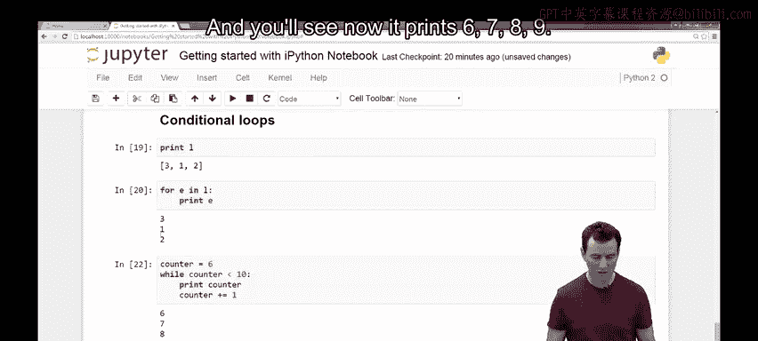

# 课程1：Python中的条件语句和循环 🐍


在本节课中，我们将要学习Python编程中的两个核心控制结构：**条件语句**和**循环**。我们将通过具体的例子，了解如何使用`if`、`else`、`for`和`while`来控制程序的执行流程。

---

## 条件语句

上一节我们介绍了变量类型和简单的转换，本节中我们来看看如何让程序根据不同的条件做出决策，这就是条件语句的作用。

在Python中，有多种方式构建条件语句，其复杂程度取决于你的需求。让我们从一个简单的例子开始。

假设我们想检查之前创建的整数变量`i`是否等于1，同时检查浮点数变量`f`是否大于4。条件语句的写法非常直观易读。

```python
if i == 1 and f > 4:
```

在Python中，`if`语句后面需要加上冒号`:`。与C或Java等语言不同，Python不使用花括号`{}`来定义代码块，而是依靠**缩进**（空格或制表符）来区分。下一行开始的缩进部分，就相当于其他语言中花括号内的代码。IPython Notebook会自动帮你处理缩进。

如果上述条件成立，我们执行一些操作，例如打印一条信息。

```python
    print("The value of i is 1 and f is greater than 4.")
```

我们还可以添加其他条件。Python允许你将多个`elif`（即“else if”）串联起来。这是一种简洁的语法糖。

如果第一个条件不成立，我们可以询问下一个问题：`i`是否大于4？或者`f`是否大于4？这里我们使用逻辑运算符`and`和`or`，它们就是简单的英文单词，没有其他特殊符号。

```python
elif i > 4 or f > 4:
    print("i and f are both greater than 4.")
```

最后，我们可以添加一个`else`语句来处理所有其他情况。

```python
else:
    print("Both i and f are less than or equal to 4.")
```

现在，让我们回顾一下变量`i`和`f`的值。之前我们打印过，`i`是4，`f`是4.1。因此，程序会这样执行：
1.  检查第一个条件：`i == 1 and f > 4`？不成立。
2.  检查第二个条件：`i > 4 or f > 4`？`f > 4`成立，所以条件成立。
3.  执行对应的打印语句：“i and f are both greater than 4.”

运行这段代码，我们成功构建了第一个条件判断结构。

---

## 循环

掌握了条件语句后，让我们进入下一个主题：循环。循环允许我们重复执行某段代码，这在处理数据集合或需要重复操作时非常有用。

在Python中，我们可以使用`for`循环和`while`循环。

### For 循环

首先，我们来看`for`循环。还记得我们之前创建的列表`L`吗？让我们先打印它来回忆一下。

```python
L = [3, 1, 2]
print(L)
```

现在，我们创建一个`for`循环来遍历这个列表中的每一个元素。

```python
for element in L:
    print(element)
```

这段代码的意思是：对于列表`L`中的每一个`element`（元素），执行打印操作。变量名`element`可以任意命名，比如`e`。循环会依次取出3、1、2并打印。在Python中，`print()`函数默认会在每次输出后换行，所以你会看到三个数字各自独占一行。

### While 循环

接下来，我们创建一个简单的`while`循环。`while`循环会在条件为真时一直执行。

例如，我们想让一个计数器从某个数开始，一直打印并增加1，直到它不小于10为止。

```python
while counter < 10:
    print(counter)
    counter += 1  # 这等同于 counter = counter + 1
```

但是，我们注意到代码中使用了变量`counter`，却没有先给它赋一个初始值。这会导致错误。让我们运行一下看看。

果然，程序报错了。Python的错误信息有时看起来有点吓人，但关键是要找到错误类型和发生位置。这里错误类型是`NameError`，提示`counter`未定义。它还会指出错误发生的代码行。

我们需要回到代码中，在`while`循环之前初始化`counter`，比如设为6。

```python
counter = 6
while counter < 10:
    print(counter)
    counter += 1
```

现在再次执行，你会看到程序打印出6、7、8、9，当`counter`达到10时，条件`counter < 10`不再为真，循环停止。

---

## 总结

本节课中我们一起学习了Python中控制程序流程的两个重要工具。

我们首先学习了**条件语句**，使用`if`、`elif`和`else`来让程序根据不同条件执行不同的代码块，并了解了Python依靠**缩进**来定义代码结构的特点。

接着，我们探索了**循环**。`for`循环用于遍历序列（如列表）中的每个元素，而`while`循环则在指定条件为真时重复执行代码块。我们还实践了如何初始化变量以避免运行时错误。



掌握这些基础控制结构，是编写更复杂、更智能程序的关键一步。