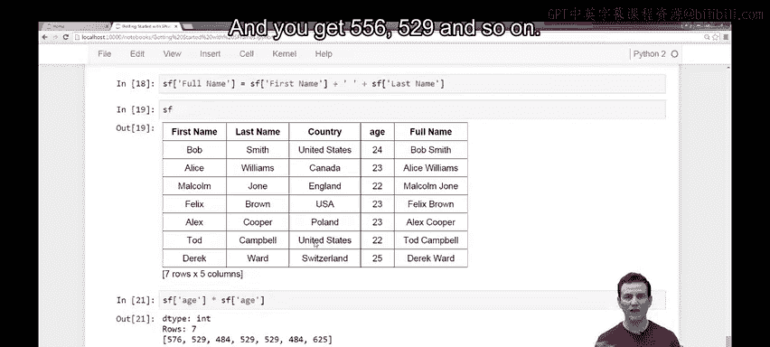

# 17：与SFrame的列交互 📊


在本节课中，我们将学习如何与SFrame数据集的列进行交互。具体内容包括：查看列数据、对列进行基本计算，以及创建新的列。这些操作是数据预处理和特征工程的基础。

---

## 查看数据列 🔍

上一节我们介绍了SFrame的基本结构，本节中我们来看看如何查看其中的列数据。

输入以下代码可以查看名为“country”的列：

```python
sframe['country']
```

执行后，该列的所有值会以水平方式打印出来，例如：United States, Canada, England, USA, Poland, United States, Switzerland。

同样，我们可以查看“age”列：

```python
sframe['age']
```

这会显示年龄数据：24, 23, 22, 23, 23, 22, 25。

---

## 对列进行计算 🧮

查看数据后，我们可以对列进行一些基本的统计计算。

以下是计算“age”列平均值的方法：

```python
sframe['age'].mean()
```

计算结果约为23.14。

接下来，计算“age”列的最大值：

```python
sframe['age'].max()
```

最大值为25。

---

## 创建新列（特征工程）⚙️

在机器学习中，经常需要基于现有列创建新的列，这个过程称为特征工程。

假设我们的数据集中有“first_name”和“last_name”列，但没有“full_name”列。我们可以轻松创建一个。

以下是创建“full_name”列的步骤：

```python
sframe['full_name'] = sframe['first_name'] + ' ' + sframe['last_name']
```

这段代码将“first_name”列、一个空格和“last_name”列连接起来，形成新的“full_name”列。创建后，SFrame的末尾会新增这一列，例如第一个条目会是“Bob Smith”。

---

## 对列进行数学运算 ➕➖✖️➗

除了拼接字符串，我们还可以对数值列进行数学运算。

例如，将“age”列的每个值加2：

```python
sframe['age'] + 2
```

这不会修改原数据，但会输出每个年龄加2后的结果。

我们也可以计算“age”列的平方：

```python
sframe['age'] * sframe['age']
```

或者更简洁地：

```python
sframe['age'] ** 2
```

结果会显示每个年龄值的平方，例如576, 529等。

---



本节课中我们一起学习了如何与SFrame的列进行交互：包括查看列数据、进行基本的统计计算（如求平均值和最大值），以及通过拼接或数学运算创建新的列。这些是数据预处理中非常实用和基础的操作。