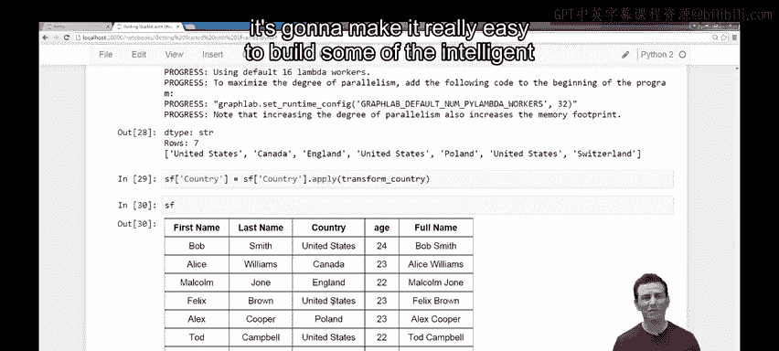

# 18：使用apply进行数据转换 📊


在本节课中，我们将学习如何使用`apply`函数对数据进行高级转换。我们将通过一个具体示例，演示如何统一数据集中不一致的国家名称，从而为后续的机器学习模型构建打下良好基础。

---

上一节我们介绍了如何对数据进行简单的数学运算转换。本节中，我们来看看如何使用`apply`函数执行更复杂的数据清洗操作。

数据集中有时会存在不一致的条目。例如，在“country”（国家）这一列中，有些行记录为“United States”，有些则记录为“USA”。对于机器学习模型而言，这会被视为两个不同的类别，因此我们需要将其统一。

以下是解决此问题的步骤：

首先，我们需要创建一个函数，用于将“USA”转换为“United States”。

```python
def transform_country(country):
    if country == 'USA':
        return 'United States'
    else:
        return country
```

这个函数接收一个表示国家的字符串作为输入。如果输入是“USA”，则返回“United States”；否则，原样返回输入值。

我们可以测试一下这个函数：
*   输入 `transform_country('Brazil')`，输出 `'Brazil'`。
*   输入 `transform_country('USA')`，输出 `'United States'`。

接下来，我们需要将这个函数应用到数据集的每一行。虽然可以使用`for`循环，但使用`apply`函数更为高效。

以下是具体操作：

```python
# 将transform_country函数应用到‘country’列的每一行
data['country'] = data['country'].apply(transform_country)
```

这行代码的作用是：获取`data`数据框中名为`'country'`的列，对其中的每一个值调用`transform_country`函数，并将返回的结果重新赋值给`'country'`列。执行后，数据集中所有的“USA”都会被替换为“United States”。

---



本节课中我们一起学习了如何定义函数，并使用`apply`方法对数据框（DataFrame）中的列进行批量转换。这种创建和操作数据框的技能，将是本课程后续构建智能应用的基础，我们会反复使用并看到它的多种应用方式。