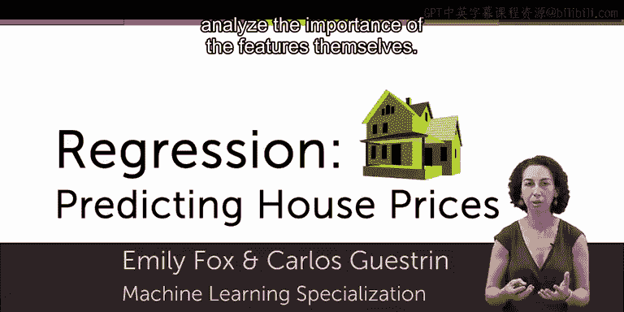

# 18：预测房价 - 回归案例研究 🏠

在本节课中，我们将要学习**回归**这一核心的机器学习工具。回归是一种应用极其广泛的统计方法，其核心思想非常简单：我们拥有一些特征，并希望建立一个模型，来描述与这些特征相关联的观测值如何随着特征值的变化而变化。

为了更具体地理解回归，我们将以一个**预测房价**的案例研究作为基础。你可以想象，一栋房子拥有许多特征，例如房屋面积、卧室数量、浴室数量等等。而我们希望预测的观测值，就是房屋的价值或销售价格。

然而，回归工具的用途远不止于预测任务。正如我们将在后续的分类课程中看到的，回归工具也可以用于分类问题。例如，我们有一封电子邮件，希望判断它是否是垃圾邮件。这封邮件可以看作拥有许多文本特征，这些特征能指示它是否为垃圾邮件。此外，回归还可以用于**分析特征本身的重要性**，我们将在回归课程中对此进行更深入的探讨。

---

## 什么是回归？📈

上一节我们介绍了回归的基本概念和应用场景。本节中，我们来看看回归的正式定义和核心思想。

回归分析旨在建立一个模型，来描述一个**因变量**（或称目标变量、输出）与一个或多个**自变量**（或称特征、输入）之间的关系。在房价预测的例子中，房价是因变量，而房屋面积、卧室数量等是自变量。

其核心目标是找到一个函数 **f**，使得：

**房价 ≈ f(房屋面积, 卧室数量, 浴室数量, ...)**

这个函数 **f** 就是我们的回归模型。通过这个模型，当我们输入一套新房子的特征时，就可以预测出它的价格。

---

## 回归的应用场景 🌍

我们已经知道回归可以用于预测房价。以下是回归分析其他几个重要的应用领域：

*   **金融**：预测股票价格、评估投资风险。
*   **医疗**：根据患者的年龄、体重、病史等特征预测疾病风险或药物剂量。
*   **市场营销**：分析广告投入、促销活动对销售额的影响。
*   **社会科学**：研究教育水平、收入等因素对个人幸福感的影响。

---

## 构建回归模型的步骤 🛠️

理解了回归是什么以及它能做什么之后，本节我们来看看构建一个回归模型通常包含哪些步骤。这是一个系统化的过程：

以下是构建一个回归模型的关键步骤：
1.  **问题定义与数据收集**：明确你要预测的目标是什么，并收集相关的特征数据。
2.  **数据探索与清洗**：检查数据质量，处理缺失值和异常值，初步观察特征与目标之间的关系。
3.  **特征工程**：选择和构造对预测目标最有用的特征。例如，从“总房间数”和“卧室数”衍生出“平均每间卧室面积”。
4.  **模型选择**：根据问题的特点选择合适的回归算法，例如线性回归、决策树回归等。
5.  **模型训练**：使用收集到的数据来“训练”或“拟合”模型，即找到函数 **f** 的最佳参数。
6.  **模型评估**：使用未参与训练的数据来测试模型的预测性能，常用指标包括均方误差（MSE）、R平方等。
7.  **模型部署与监控**：将训练好的模型应用到实际问题中，并持续监控其在新数据上的表现。

---

## 总结 📝

本节课中，我们一起学习了机器学习中的**回归**方法。我们从预测房价的案例入手，理解了回归的核心思想是建立特征与观测值之间的数学模型。我们探讨了回归不仅可用于预测任务，还能应用于分类和特征重要性分析。最后，我们概述了构建一个回归模型的完整流程，从数据准备到模型评估。

掌握回归是理解更复杂机器学习模型的重要基础。在接下来的课程中，我们将深入探讨具体的回归算法及其实现。