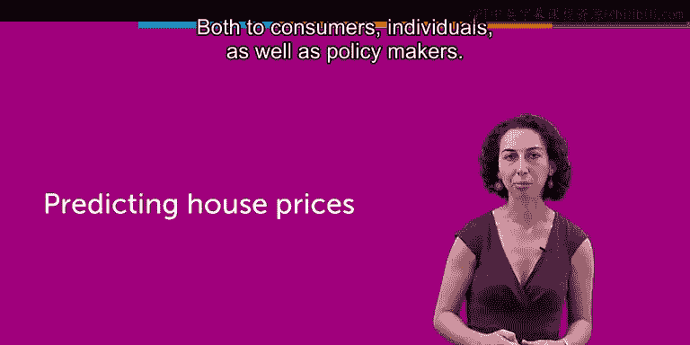
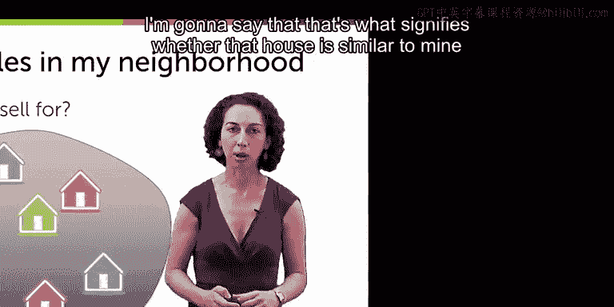
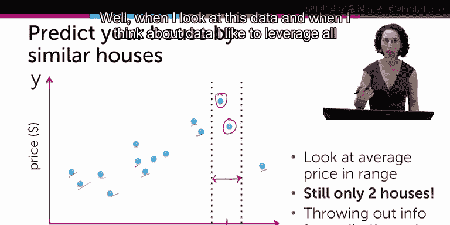

# 机器学习基础篇（第1课/共4课）🏠 第20讲：目标是什么以及如何初步应对

在本节课中，我们将学习如何通过观察历史数据来预测房屋价值。这是一个典型的回归问题，我们将探讨如何利用房屋面积这一特征来估计其销售价格。

---

## 问题背景

预测房屋价值是一个重要问题。在美国，家庭财富的近50%投资于房地产。这对消费者个人和政策制定者都至关重要。

假设我打算出售房屋，但不确定其市场价值。合理的做法是参考附近区域的近期房屋销售记录。

## 数据收集与可视化

为了估计房屋价值，我记录了附近近期每笔房屋销售的两个关键信息：销售价格和房屋面积。在美国，房屋面积通常以平方英尺为单位。

作为统计学家，我将这些观察结果绘制成散点图。横轴（X轴）代表房屋面积（平方英尺），纵轴（Y轴）代表销售价格。图中每个点代表一次具体的房屋销售。

以下是相关术语介绍：
*   **特征（Feature）**：变量X，也称为协变量（Covariate）、预测变量（Predictor）或自变量（Independent Variable）。在本例中，指房屋面积。
*   **观察值（Observation）**：变量Y，也称为响应（Response）或因变量（Dependent Variable）。在本例中，指销售价格。

## 初步应对策略及其局限性

如何利用这些数据来估计我的房屋价值？一个直观的想法是：查找与我房屋面积完全相同的其他销售记录。

然而，很可能不存在面积完全相同的销售记录。因此，我需要更灵活的方法。

接下来，我考虑查看面积在我房屋面积附近一个区间内的所有销售记录。但即使采用这种方法，如图中所示，可能也只有两笔销售记录可供参考，这不足以让我做出可靠的估计。

更重要的是，这种方法实际上丢弃了区间外的所有其他观察数据，仿佛它们与我的房屋价值毫无关系。这合理吗？我们真的认为这些数据不包含任何信息吗？

观察整体数据时，我希望利用所有可获得的信息来做出更好的预测。

---

## 总结

本节课中，我们一起学习了回归问题的基本设定：通过特征（如房屋面积）预测一个连续值（如房屋价格）。我们认识到，仅依靠与目标完全相同的样本或一个狭窄区间内的样本进行预测存在局限性，即数据利用不充分且估计可能不可靠。这引出了我们需要一个能够利用所有数据进行预测的模型，这将是后续课程的重点。