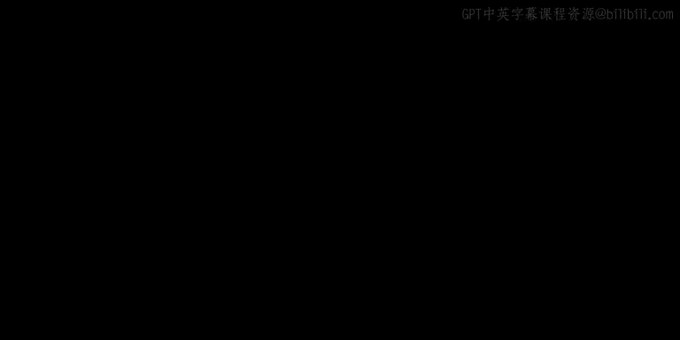
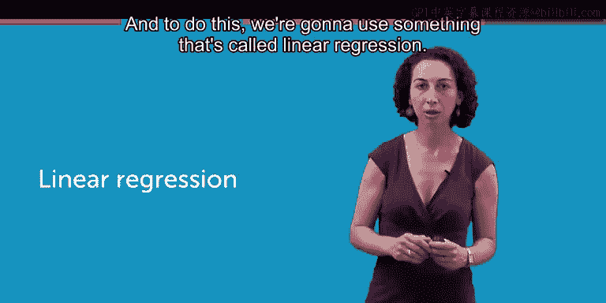
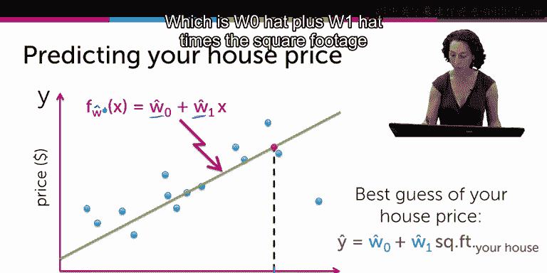

# 21：线性回归 - 基于模型的方法 📈

在本节课中，我们将学习线性回归的基本概念。这是一种通过拟合直线来建模特征与目标之间关系的简单而强大的方法。我们将探讨如何定义模型、评估拟合质量，并利用模型进行预测。

---

## 模型定义与参数

上一节我们讨论了直接分析数据的方法，本节中我们来看看如何通过建模来理解房屋面积与售价之间的关系。最简单的方法是使用线性回归，即用一条直线来拟合数据。

这条直线由两个参数定义：**截距**（W₀）和**斜率**（W₁）。斜率 W₁ 也称为**回归系数**，它表示特征 X（房屋面积）每变化一个单位，对观测到的房屋售价 Y 产生的影响大小。

我们可以将线性函数明确表示为：

`f_W(x) = W₀ + W₁ * x`

其中下标 W 表示该函数由参数集合 W = {W₀, W₁} 决定。

---

## 如何选择“最佳”直线？

面对数据，我们可以画出许多不同的直线，每条线对应一组不同的参数 W。那么，哪条线才是最适合数据集的“好”线呢？

为了回答这个问题，我们需要定义一个衡量直线拟合好坏的**成本**（或损失）。一个非常常用的指标是**残差平方和**。

以下是计算残差平方和的步骤：

1.  对于数据集中的每一个观测点（即每一栋房屋），计算模型预测值（直线上对应的点）与实际观测值（真实售价）之间的差值，这个差值称为**残差**。
2.  将所有残差进行平方（这能放大较大误差的影响并避免正负抵消）。
3.  将所有平方后的残差求和。

用公式表示如下：

`RSS(W) = Σ (price_i - (W₀ + W₁ * sqft_i))²`

其中，`price_i` 是第 i 栋房屋的观测售价，`sqft_i` 是其面积，`(W₀ + W₁ * sqft_i)` 是模型对该房屋售价的预测值。

我们的目标是找到一组参数 Ŵ = {Ŵ₀, Ŵ₁}，使得残差平方和 RSS(W) 最小。这组参数对应的直线就是对数据的最佳拟合（在最小二乘意义下）。存在高效、成熟的算法（如正规方程或梯度下降）来求解 Ŵ，这些算法将在后续回归课程中详细讨论。

---

## 利用模型进行预测

一旦我们通过最小化残差平方和得到了估计的模型参数 Ŵ₀ 和 Ŵ₁，就可以使用这个拟合好的模型进行预测了。

例如，现在我想预测自己房屋的售价。我已知自己房屋的面积（sqft_my_house）。预测过程非常简单直接：

1.  在图中找到对应房屋面积的点。
2.  该点在拟合直线上的对应值，就是模型给出的最佳房价预测。

用公式计算预测值：

`predicted_price = Ŵ₀ + Ŵ₁ * sqft_my_house`

---

## 总结

本节课中我们一起学习了线性回归的核心思想。我们介绍了如何用带参数的线性函数 `f_W(x) = W₀ + W₁ * x` 来建模变量间的关系。为了找到最佳参数，我们引入了**残差平方和** `RSS(W) = Σ (y_i - (W₀ + W₁ * x_i))²` 作为衡量模型拟合好坏的成本函数，并通过最小化该函数来求解最优参数 Ŵ。最后，我们学会了如何使用训练好的模型 `predicted_price = Ŵ₀ + Ŵ₁ * x_new` 对新数据进行预测。线性回归是机器学习中最基础、最重要的工具之一，为理解更复杂的模型奠定了基础。