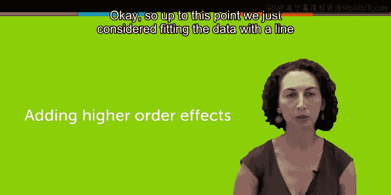
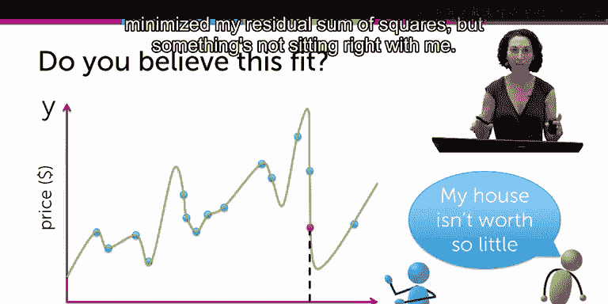

# 22：添加高阶效应 📈

在本节课中，我们将要学习如何通过添加高阶效应（如二次项、高次多项式）来改进线性回归模型。我们将探讨为什么有时简单的线性拟合可能不够，以及如何通过引入更多特征来捕捉数据中的非线性关系。同时，我们也会讨论高阶拟合可能带来的问题。

---

## 概述

到目前为止，我们只考虑了用直线拟合数据。问题是，这是一个好的选择吗？

我对自己的分析感觉相当不错。我拟合了这条线，最小化了残差平方和，并对我的房屋价值做出了预测。在这个过程中，我利用了所有我记录下来的近期房屋销售观测数据。然后我去找卡洛斯，对他说：“嘿，看看我的分析，这是我对我们房屋价值的估计。”😊

---

## 卡洛斯的质疑

卡洛斯回答说：“嗯，我不太确定。对我来说，我不确定这是线性趋势。”实际上，根据我的漫画，他说：“伙计，那不是线性关系。”当然，卡洛斯可能不会说“伙计”，但重点是，卡洛斯不认为这是线性关系。

他认为，也许这是二次关系。他问：“你试过二次拟合吗？”我回答：“没有。”我看着他在屏幕上展示的图，然后说：“实际上，那看起来很不错。”

---

## 二次拟合

我需要做什么？我需要找出最适合这些数据的二次拟合。我该怎么做？我将再次去最小化我的残差平方和。

我正准备去最小化我的残差平方和。让我们谈谈这涉及到什么。因为当我看一个二次函数时，我现在有三个参数。

*   我仍然有我的截距 `W0`，它决定了这条曲线在Y轴上的上下位置。
*   然后我有 `x` 的线性项 `W1*x`。
*   现在我还有这个额外的项 `W2*x^2`，这就是二次项的来源。

这里我想快速说明一点：这实际上仍然被称为**线性回归**。原因是我们把 `x^2` 仅仅看作是另一个特征。我们看到 `W` 总是以 `w` 的形式出现，而不是 `w^2` 或其他 `W` 的函数。我们将在回归课程中更详细地讨论这一点，但请记住，即使我们讨论的是对数据的二次函数拟合，这仍然被称为线性回归。

关键点在于，当我要最小化残差平方和时，我现在有三个参数。我必须在三个不同事物的组合空间中搜索，找到能最小化残差平方和的最佳 `W0`、`W1` 和 `W2`，从而确定二次拟合。

好的，我正准备进行这个计算，结果证明它也是高效的。同样，我们将在回归课程中讨论其通用性。

---

## 高阶多项式拟合

然后卡洛斯有了一个绝妙的主意，他说：“等等，等等。我告诉过你二次拟合，但你试过13阶多项式吗？”我回答：“不，我没有。”这确实很有道理。看看这个，这相当不错。

这是卡洛斯用他的13阶多项式得到的拟合。他说：“我只是最小化了你的残差平方和。很不错，对吧？我的残差平方和基本上为零。”😊

但是，我个人对此感觉不太好，因为我在看，并且说：“我的房子不值这么少，我知道的。”是的，我们讨论过残差平方和是拟合的成本，是的，卡洛斯似乎真的、真的、真的最小化了我的残差平方和。但有些地方让我觉得不对劲，这个函数看起来太疯狂了。

---

## 总结

本节课中，我们一起学习了如何通过添加高阶项（如 `x^2`）将线性回归扩展到非线性关系。我们了解到，即使模型包含特征的幂次项，只要参数是线性的，这仍然属于线性回归的范畴。同时，我们也看到了过度拟合的风险：使用非常高阶的多项式（如13阶）可以完美拟合训练数据（残差平方和接近零），但得到的模型可能非常复杂、不直观，并且在新数据上的预测性能可能很差。这引出了机器学习中的一个核心问题：如何在模型复杂度和泛化能力之间取得平衡。