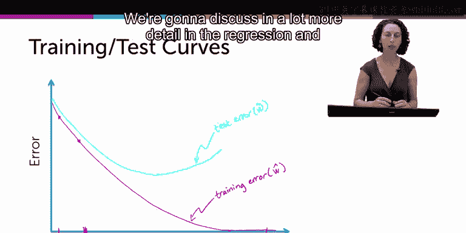

# 机器学习基础篇（第1课/共4课）｜P24：训练与测试曲线 📈

在本节课中，我们将要学习模型复杂度如何影响训练误差和测试误差。我们将通过观察不同阶数模型的误差变化，理解过拟合现象，并初步探讨如何选择合适的模型复杂度。

---

## 训练误差随模型复杂度变化

上一节我们介绍了不同阶数的多项式模型。本节中我们来看看训练误差如何随模型复杂度增加而变化。

对于每一个可能考虑的模型阶数，例如线性模型、二次模型，一直到非常复杂的13阶多项式模型（当然我们也可以考虑更高阶的模型），训练误差会如何变化？

随着模型阶数增加，模型能够越来越好地拟合训练数据集中的观测值。因此，我们的训练误差会随着模型复杂度的增加而**下降**。

还记得我们之前看到的曲线吗？从线性拟合、二次拟合一直到13阶多项式拟合（该模型几乎穿过了每一个观测点），我们看到残差平方和（RSS）在不断下降。即使我们预留一部分数据作为测试集，仅观察训练数据集，这个结论依然成立：随着模型灵活性增加，训练误差会不断减小。

我们用 $\hat{w}$ 表示通过训练数据估计得到的模型参数。对于每一种模型复杂度（如线性、二次等），我们通过优化来找到参数 $\hat{w}$。对于线性模型，我们搜索所有可能的直线，以最小化训练误差。这就是我们估计模型参数的方式：最小化训练数据集上的误差。我们得到线性模型的 $\hat{w}$，并计算与之相关的训练误差。对于二次模型，我们搜索所有可能的二次曲线拟合，最小化训练误差，得到二次模型的 $\hat{w}$，并绘制其训练误差，以此类推。

以下是训练误差变化的要点：
*   训练误差随模型复杂度增加而单调下降。
*   模型参数 $\hat{w}$ 是通过最小化训练集上的误差得到的。
*   高阶模型在训练集上可以达到极低的误差。

---

## 测试误差随模型复杂度变化

理解了训练误差的变化后，我们再来看看测试误差。这里的情况稍微复杂一些，因为当我们不断增加模型阶数时，测试误差会如何变化？

回想一下那个非常曲折的13阶多项式拟合线，它做出了非常糟糕的预测。当我们考虑预留的测试数据时，仅在训练数据上拟合一个13阶多项式，我们会得到一个非常曲折、奇怪的拟合线。然后，当我们观察那些被预留的测试观测值（那些房屋）时，我们对实际值的预测可能会非常差。

因此，我们预期在某个点之后，我们的测试误差很可能会**上升**。测试误差的曲线往往呈现以下形态：误差在一段时间内下降，但在某个点之后，误差开始再次增加。

这条曲线代表的是我们**测试误差**，而这些模型是使用训练数据拟合得到的。

以下是测试误差变化的要点：
*   测试误差随模型复杂度增加先下降后上升。
*   存在一个“最佳点”，使得测试误差最小。
*   超过该点后，模型开始过拟合训练数据，导致测试性能变差。

---

## 总结与展望

本节课中，我们一起学习了训练误差和测试误差随模型复杂度变化的典型曲线。我们看到，训练误差随模型变复杂而持续下降，但测试误差会先降后升，形成一条U形曲线。这直观地展示了模型过拟合的现象。

关于如何利用这些概念来实际选择模型或其复杂度以进行预测，我们将在后续的回归和分类课程中进行更详细的讨论。理解这些曲线是评估模型性能和进行模型选择的基础。