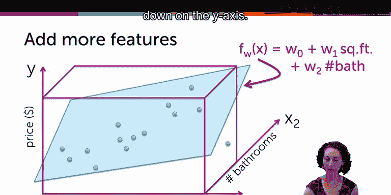
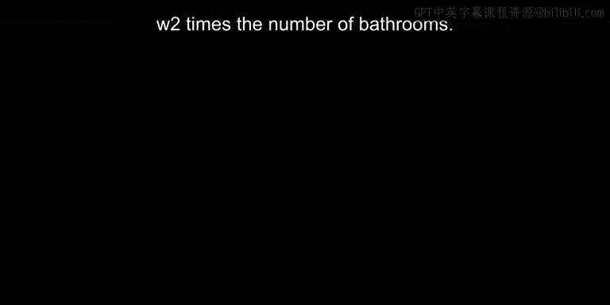
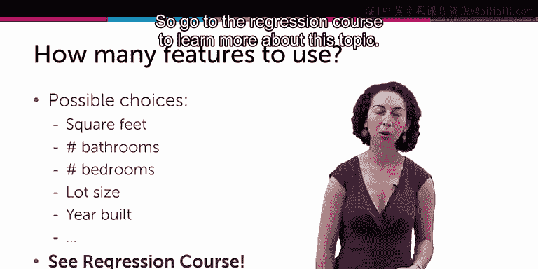

# 25讲：添加其他特征 🏠📈

在本节课中，我们将学习如何在机器学习模型中添加更多特征，以提升预测的准确性。我们将从单一特征模型扩展到多特征模型，并介绍如何通过引入额外信息来改进预测结果。

---

## 从单一特征到多特征

上一节我们介绍了如何使用房屋面积（平方英尺）作为唯一特征来预测房价。本节中，我们来看看如何通过添加更多特征来改进模型。

假设我们深入分析数据，发现一个与我的房屋面积非常相似的房源。该房源对预测我的房价产生了显著影响。然而，该房源仅有一个卫生间，而我的房屋有三个卫生间。因此，该房源的售价不应作为预测我房屋售价的可靠参考。

为了解决这个问题，我们可以考虑添加更多特征。除了房屋面积与价格的关系外，我们还可以加入卫生间数量。对于之前查看的每个房源，我们需要记录其面积和卫生间数量，并将这些数据点绘制在三维空间中。这个空间是一个超立方体，维度包括面积、卫生间数量和价格。

现在，如果我们考虑一个简单模型，不再拟合一条直线，而是拟合一个超平面。这个超平面是空间中的一个切片，其方程如下：

**公式：** `价格 = w0 + w1 × 面积 + w2 × 卫生间数量`

其中：
- `w0` 是截距，表示超平面在Y轴上的位置。
- `w1` 是面积的权重。
- `w2` 是卫生间数量的权重。

---

## 特征选择的问题

但问题在于，我们应该在何处停止添加特征？是否仅添加卫生间数量作为额外特征？实际上，我们可以考虑许多可能影响房价的因素。

以下是可能影响房价的其他特征示例：

- 卧室数量
- 地块大小
- 房屋年龄
- 以及其他可能影响房屋价值的属性

然而，我们将暂时搁置哪些特征对回归任务重要的问题，直到进入回归课程再深入探讨。请前往回归课程以了解更多相关内容。

---

## 总结

本节课中，我们一起学习了如何通过添加更多特征来改进机器学习模型。我们从单一特征模型扩展到多特征模型，介绍了拟合超平面的概念，并讨论了特征选择的重要性。通过引入额外信息，我们可以更准确地预测目标变量，为后续学习更复杂的回归模型打下基础。