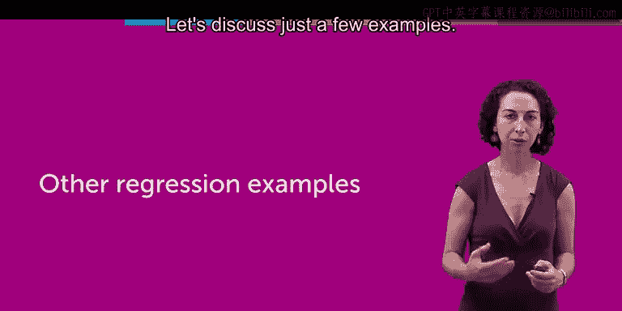
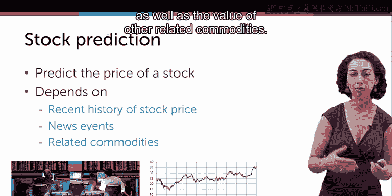
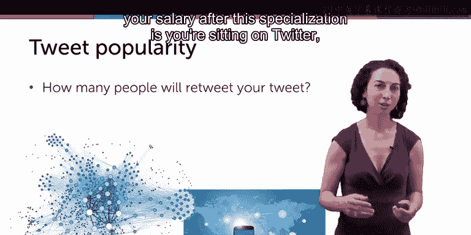
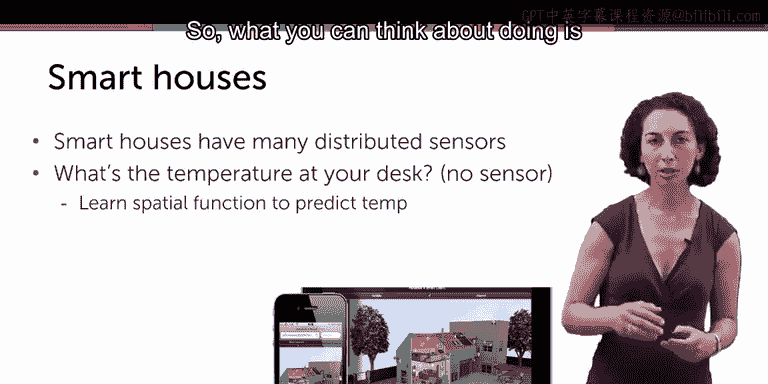
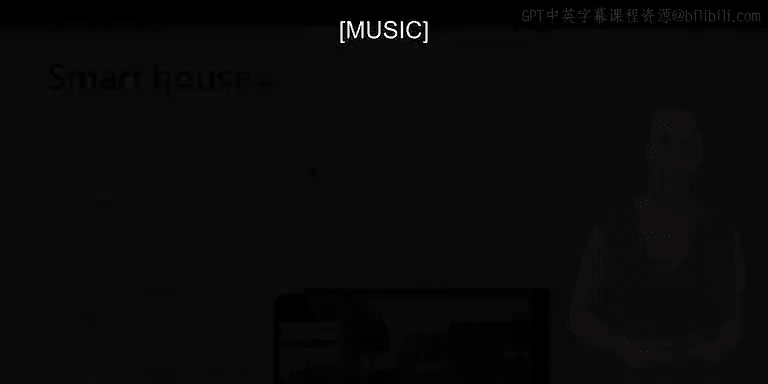

# 机器学习基础篇（第1课/共4课）｜P26：其他回归示例 📊

在本节课中，我们将探讨回归模型在多个不同领域的应用示例。回归不仅可用于预测房价，还能应用于薪资预测、股票价格分析、社交媒体影响力评估，甚至智能家居环境控制等多个场景。

---

## 回归模型回顾 🔄

上一节我们详细讨论了如何使用回归模型预测房价。回归的核心思想是建立一个线性模型，通过输入特征来预测连续型目标变量。其基本公式为：

**y = W₀ + W₁x₁ + W₂x₂ + ... + Wₙxₙ**

其中，**y** 是预测值，**W₀** 是截距项，**W₁** 到 **Wₙ** 是各特征对应的权重，**x₁** 到 **xₙ** 是输入特征。

---

## 回归应用示例 🌟

以下是回归模型在不同领域的具体应用示例，每个示例都展示了如何将实际问题转化为回归任务。

### 1. 薪资预测 💼

预测完成机器学习专项课程后的薪资水平。薪资可能取决于课程表现、毕业项目质量、论坛参与度等因素。

模型参数包括截距 **W₀** 以及对应课程表现 **W₁**、项目质量 **W₂** 和论坛参与 **W₃** 的权重。我们可以利用以往学员的课程表现和最终薪资数据来估计这些参数。

### 2. 股票价格预测 📈

预测明日股票价格。价格可能受近期股价历史、新闻事件、全球形势以及其他相关商品价值的影响。

### 3. 社交媒体转发量预测 🐦

预测一条推文最终获得的转发数量。这可能取决于你的粉丝数、粉丝的粉丝数、推文文本特征、所包含话题标签的流行度，以及你历史推文的转发情况等。

事实证明，这类模型能有效预测推文的最终转发量。

### 4. 智能家居温度预测 🏠

在拥有多种传感器和控制装置（如温控器、通风口、百叶窗）的智能家居中，预测书桌处的温度。由于书桌处没有直接传感器，可以通过建立空间回归模型来预测。

该模型可能依赖于房屋温控器设置、百叶窗开合状态、室外温度、通风设置以及一天中的时间等特征。

---

## 总结 ✨

本节课我们一起探讨了回归模型在薪资预测、股票分析、社交媒体和智能家居等领域的多样化应用。这些示例仅触及了回归应用领域的冰山一角，但它们充分展示了回归作为一个强大工具的广泛适用性和实用性。