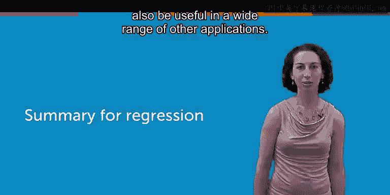
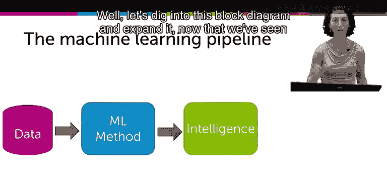
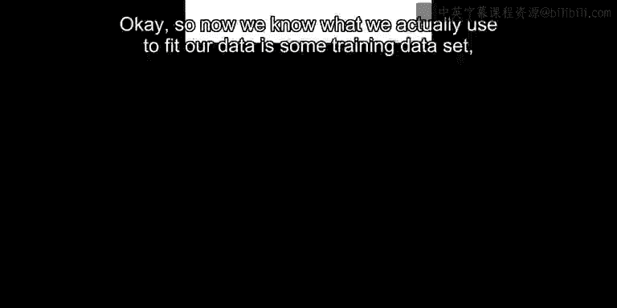
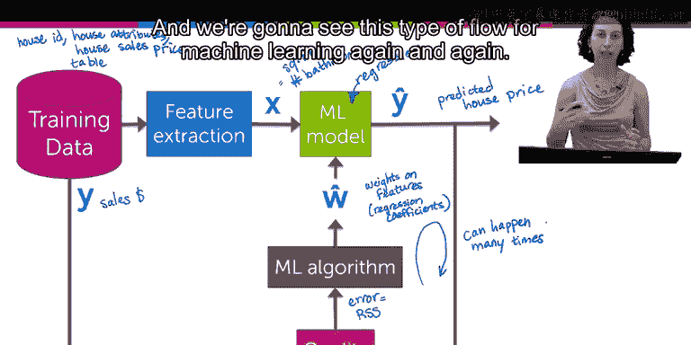

# 机器学习基础课程（第1课/共4课）：回归机器学习模块图 📊

在本节课中，我们将学习回归机器学习模块图。我们将了解如何从数据出发，通过特征提取、模型构建、质量评估和参数调整，最终得到预测结果。这个过程是机器学习的基础，适用于多种应用场景。

---

## 从数据到智能的流程

在课程介绍中，卡洛斯提出了一个机器学习流程：我们从数据开始，将其输入到某种机器学习方法中，从而获得智能。现在，让我们深入探讨这个模块图，并扩展它，因为我们已经在更多细节上了解了一些机器学习工具。

## 训练数据集

我们实际用于拟合数据的是训练数据集。在预测房价的住房应用中，我们收集的数据是一个表格。

这个表格包含房屋ID、一系列房屋属性以及房屋的销售价格。我们为社区中的许多房屋收集了这些数据，并将其整理成一个表格。这个表格代表了我们的训练数据集。

## 特征提取器

接下来，我们获取这些数据，并通过特征提取器进行处理。在这个例子中，特征提取器非常简单：我们只选择房屋属性的一个子集。

以下是我们在本模块中考察的两个特征示例：
*   **房屋面积**（平方英尺）
*   **浴室数量**

我们讨论了可能使用更多特征，这将在回归课程中进一步探讨。

## 机器学习模型与预测

我们的目标是利用这些特征，通过某种模型来预测房价。因此，我们输出的智能就是**预测的房价**。

我们将对训练数据集中的每一栋房屋进行此操作：获取其相关特征，输入到这个机器学习模型中，并预测其价格。我们讨论的机器学习模型就是**回归**。

## 模型参数

这个机器学习模型有一组参数，我们称之为 **W**，即特征的权重。例如，它是房屋面积或浴室数量的权重。更专业地说，这些被称为**回归系数**。

我们讨论了如何从数据中估计这些参数。**W_hat** 就是我们对这些参数的估计值。

## 质量评估与参数更新

我们获取预测的输出（即预测的房价），并将其与真实的房价（即我们在训练数据表中记录的实际销售价格）进行比较。**y** 代表训练数据中房屋的**实际销售价格**。

我们比较预测房价和实际房价，并使用一个质量指标来衡量我们预测的效果。我们讨论的误差指标是**残差平方和**，即对训练数据中所有房屋，计算实际销售价格与预测销售价格之差的平方和。

我们的质量指标接收预测值和实际房屋销售观测值，输出这个误差。然后，这个误差将输入到一个机器学习算法中，用于更新权重，即更新我们模型的参数。

我们将在实际的回归课程中更多地讨论这个机器学习算法或其不同变体。但这就是我们房屋预测问题的机器学习方法的整体流程图。

## 迭代优化过程

这个循环——获取预测值，计算相对于实际房价的误差，并更新权重或模型参数——通常以迭代的方式进行，即我们反复更新这些值。

## 抽象流程总结

如果我们进行抽象，可以看到：我们有一些训练数据，一个特征提取过程，一个机器学习模型。模型将产生一些智能（在本例中是预测）。我们将使用某种质量度量来评估我们智能的质量，并利用该误差（或准确度，取决于我们的衡量方式）通过某种算法来调整我们的模型参数。我们将在机器学习中反复看到这种类型的流程。

---

## 课程总结

在本模块中，我们学习了如何获取数据，并使用一种称为**回归**的方法来获得智能。我们有一个将特征与输出关联起来的模型。我们在预测房屋价值的背景下讨论了这一点，并且您还完成了一个非常有趣的 iPython 笔记本练习。现在，您应该能够在实践中部署真正有趣的回归模型了。