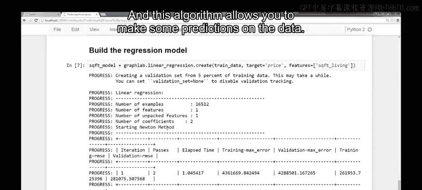

# 机器学习基础课程（第1课/共4课）：学习简单回归模型以根据房屋大小预测房价 🏠

在本节课中，我们将学习如何构建一个简单的线性回归模型，用于根据房屋的居住面积（平方英尺）来预测其价格。我们将使用训练数据来训练模型，并理解其背后的核心概念。

---

## 构建回归模型

上一节我们介绍了训练数据和测试数据。本节中，我们来看看如何使用这些数据构建一个回归模型。

GraphLab Create 提供了许多预实现的机器学习算法，适用于各种任务。你也可以根据需要实现自己的算法。在本课程中，我们将主要使用预实现的算法，以便专注于理解机器学习的工作原理。

我们将构建一个名为“平方英尺模型”的预测模型。在 GraphLab Create 中，可以使用线性回归算法。线性回归是我们在模块教学中深入探讨并理解透彻的方法。

要创建线性回归模型，我们使用 `linear_regression.create` 函数。这个函数需要指定输入数据、预测目标以及特征。

以下是创建模型的具体步骤：

1.  指定训练数据。
2.  定义预测目标（`target`），这里我们预测的是价格（`price`）。
3.  定义特征（`features`），即模型的输入。如果不指定，模型将使用数据中的所有列作为特征。但在这里，我们只希望使用“居住面积平方英尺”这一特征。

注意，特征名称需要以字符串形式传入。GraphLab Create 的函数参数支持标签自动补全功能，这非常方便。

执行创建命令后，GraphLab Create 会自动选择一个合适的算法（例如牛顿法）来拟合数据并生成模型。这个训练好的模型随后就可以用来对数据进行预测。

---

## 总结

本节课中，我们一起学习了如何利用 GraphLab Create 的线性回归工具，根据房屋面积这一单一特征来构建房价预测模型。我们明确了构建模型所需的三个关键要素：**训练数据**、**预测目标（target）** 以及 **特征（features）**。通过这个过程，我们实践了从数据到模型的基本机器学习流程。