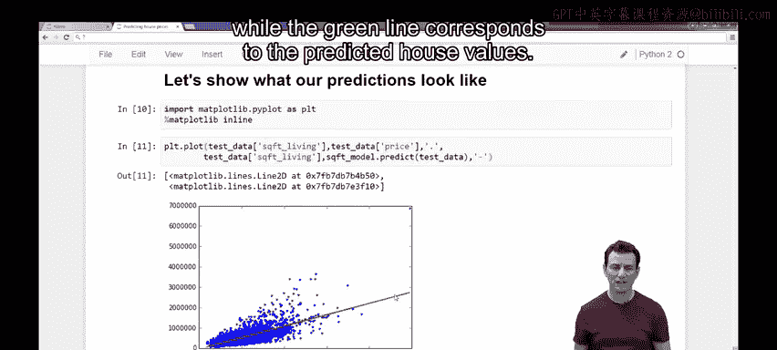

# 32：使用Matplotlib可视化简单模型的预测 📊


在本节课中，我们将学习如何使用Python的Matplotlib库来可视化一个简单线性回归模型的预测结果。我们将通过绘制测试数据点和模型预测线，直观地展示模型的表现。

---

上一节我们介绍了如何使用GraphLab Canvas进行数据可视化。本节中，我们来看看如何使用另一个常用的Python工具——Matplotlib，来可视化模型的预测结果。

首先，我们需要导入Matplotlib库中的绘图模块。在Python中，我们通常使用`import`语句来导入库，并通过`as`关键字为其设置一个简短的别名，以便后续调用。

以下是导入Matplotlib并设置其在Jupyter Notebook中内嵌显示的代码：

```python
import matplotlib.pyplot as plt
%matplotlib inline
```

代码`%matplotlib inline`是一个魔法命令，它确保图形直接显示在Notebook中，而不是弹出一个新窗口。

导入完成后，我们就可以开始绘制图形了。我们将创建一个图表，其中包含两组数据：实际的测试数据点和模型的预测线。

以下是绘制图形的步骤：

1.  首先，我们绘制测试数据。我们将房屋的居住面积（`sqft_living`）作为X轴，将房屋价格（`price`）作为Y轴，并使用圆点（`‘.‘`）来表示每个数据点。
2.  接着，我们在同一张图上绘制模型的预测结果。X轴同样是居住面积，但Y轴是模型对每个测试房屋的预测价格。我们将使用虚线（`‘—‘`）来绘制这条预测线。

以下是实现上述步骤的代码：

```python
plt.plot(test_data[‘sqft_living‘], test_data[‘price‘], ‘.‘, label=‘test data‘)
plt.plot(test_data[‘sqft_living‘], sqft_model.predict(test_data), ‘—‘, label=‘predicted‘)
plt.legend()
```

执行这段代码后，我们将得到一张图表。图表中的蓝色圆点代表测试集中的真实房屋数据，而绿色虚线则代表我们的线性回归模型根据居住面积做出的价格预测。

---



本节课中，我们一起学习了如何使用Matplotlib库来可视化机器学习模型的预测。我们通过绘制测试数据散点图和模型预测线，直观地看到了一个简单线性回归模型（仅使用居住面积一个特征）的拟合情况。这种可视化方法有助于我们快速评估模型的表现和理解其预测趋势。