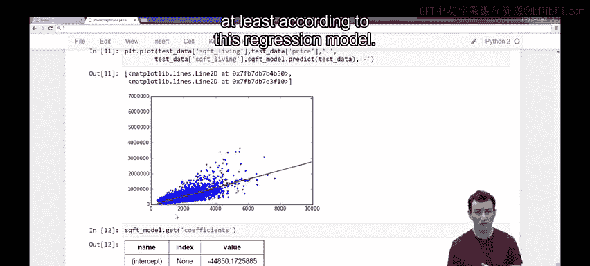

# 33讲：检查学习到的模型系数 🧮

在本节课中，我们将学习如何查看线性回归模型学习到的系数，并理解这些系数的实际含义。通过分析模型系数，我们可以更好地解释模型如何根据输入特征进行预测。

---

上一节我们介绍了如何构建一个简单的线性回归模型。本节中，我们来看看如何查看并理解模型学习到的具体参数。

事实上，我们可以查看模型所拟合直线的系数。以我们构建的“房屋面积”模型为例，我们可以调用函数来获取这些系数。

以下是获取模型系数的步骤：

1.  调用模型的 `get` 函数。
2.  获取并查看系数值。

这些系数在课程中被称为**权重**。对于这个简单的线性回归模型，共有两个系数。

第一个系数是**截距**。它代表直线与y轴的交点。在本例中，截距值为 **-44000**。

第二个系数是**房屋面积的系数**。它决定了直线的斜率。具体到本例，可以将其解释为**每平方英尺的房价**，即每增加一平方英尺的面积，房屋价格会增加多少。该系数值为 **280**。

这意味着，根据此回归模型，西雅图地区的房屋平均每平方英尺价格约为280美元。当然，实际市场中，有些房屋（如图中位置较高的点）每平方英尺价格更高，有些则更低，但此模型给出的平均估值是280美元每平方英尺。

---

本节课中，我们一起学习了如何检查线性回归模型的系数。我们了解到，截距表示预测的基准值，而特征系数则量化了该特征对预测目标的影响程度。理解这些系数是解释模型行为的关键一步。