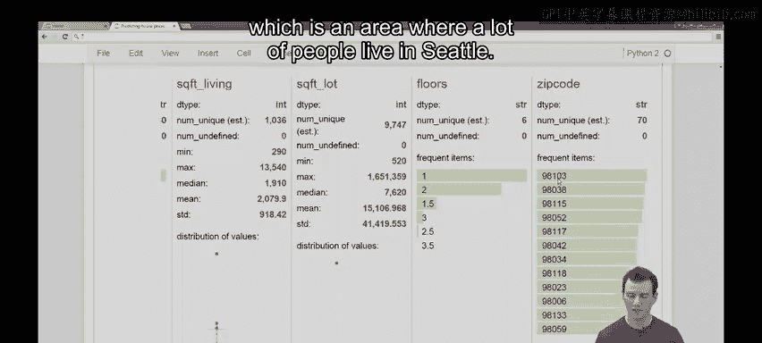
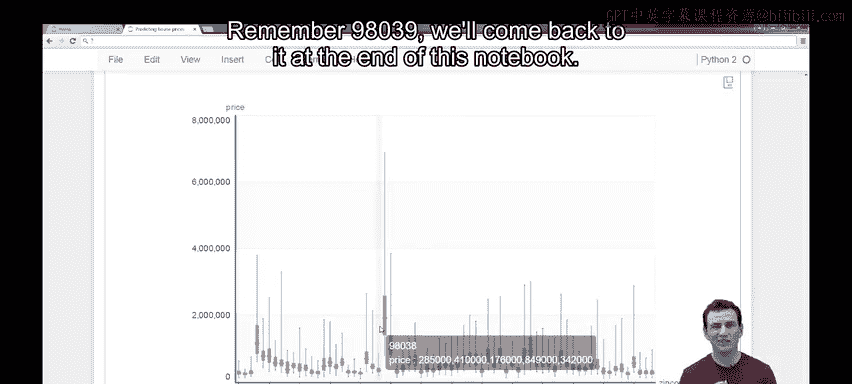

# 34：探索数据的其他特征 🏠

在本节课中，我们将学习如何探索数据集中除居住面积之外的其他特征。我们将通过可视化工具来观察这些特征与房价之间的关系，并理解不同特征对房价的影响。

---

我们已经完成了一些简单的回归分析。之前的回归分析仅使用了居住面积这一特征。但请记住，我们的数据集包含许多其他列或特征。接下来，我们将探索数据中的其他特征。

我们将探索一组可能用于预测房价的特征。以下是我们要探索的特征列表：

*   **卧室数量** (`bedrooms`)
*   **浴室数量** (`bathrooms`)
*   **居住面积** (`sqft_living`) - 这是我们之前一直在使用的特征
*   **地块面积** (`sqft_lot`) - 房屋周围的土地面积
*   **楼层数** (`floors`)
*   **邮政编码** (`zipcode`) - 在美国代表地区编码

现在，让我们查看这些特征列的数据概览。通过调用 `.show()` 方法，我们可以直观地看到每个特征的分布情况：

*   **卧室数量**：数据集中有13种不同的卧室数量。大多数房屋有3间卧室，其次是4间和2间，拥有10间卧室的房屋非常罕见。
*   **浴室数量**：在美国，浴室数量可以是小数。例如，2.5个浴室最为常见，这通常意味着房屋包含一个完整浴室（带浴缸）和另一个只有洗手池和马桶的“半卫”。
*   **居住面积**：我们可以看到房屋居住面积的分布范围。
*   **楼层数**：大多数房屋是单层，部分为两层。
*   **邮政编码**：最常见的邮政编码是98103，这是西雅图一个人口密集的区域。

我们已经从高层面上查看了数据各列的分布情况。接下来，让我们探索数据之间的其他关系，进行一些有趣的可视化分析。

我们将创建一个**箱线图**来观察两个变量之间的关系。在X轴上，我们将使用**邮政编码**；在Y轴上，我们将绘制**房价**。这样，我们就能看到房屋所在地（邮政编码）与价格之间的关系。

运行代码后，生成的箱线图清晰地展示了不同地区的房价差异：

*   例如，邮政编码为98003的区域，平均房价较低（红线表示中位数），且价格波动范围较小。
*   而邮政编码98004的区域，平均房价要高得多，大约在110万美元左右，并且价格波动范围非常大，从约80万美元到近400万美元不等。
*   当我们向下滚动查看更多邮政编码时，会发现一个异常值：邮政编码98039的区域，其房价高得惊人，甚至超出了图表范围，有些房屋价格高达约700万美元。我们将在本课程末尾再次提到这个有趣的发现。

---

本节课中，我们一起学习了如何探索数据集中除核心特征外的其他属性。我们通过创建特征列表并利用可视化工具（如`.show()`概览和箱线图），直观地分析了卧室数量、浴室数量、地理位置（邮政编码）等特征与房价的分布及关联关系。特别是通过箱线图，我们发现了不同邮政编码区域房价存在的显著差异，这为后续构建更复杂的模型提供了重要的特征选择依据。