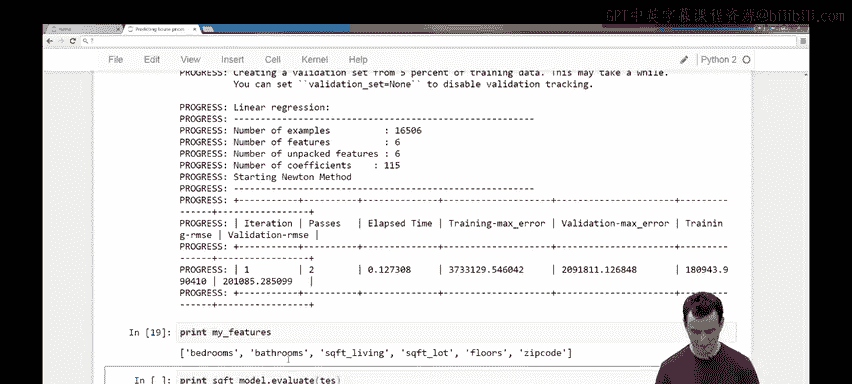

# 35：使用更多特征预测房价 🏠


## 概述

在本节课中，我们将学习如何构建一个使用多个特征来预测房价的回归模型。我们将从之前仅使用“居住面积”的简单模型出发，探索加入更多特征（如卧室数量、浴室数量、邮政编码等）后，模型性能如何提升。

---

## 回顾简单模型

上一节我们介绍了仅使用“居住面积”这一特征来预测房价的简单线性回归模型。该模型的公式可表示为：

**`price = w0 + w1 * sqft_living`**

其中，`w0` 是截距，`w1` 是“居住面积”特征的权重。

---

## 引入更多特征

然而，仅凭面积预测房价显然不够精确。我们探索了其他特征，例如“邮政编码”和“卧室数量”，发现它们对房价有显著影响。本节中，我们来看看如何将这些特征整合到一个模型中，以期获得更好的预测效果。

我们将构建一个使用更多特征的回归模型。以下是我们要使用的特征列表：

*   卧室数量
*   浴室数量
*   居住面积
*   地块面积
*   楼层数
*   邮政编码

---

## 构建多特征模型

我们将使用 `graphlab` 库中的线性回归工具来创建这个“多特征模型”。代码实现如下：

```python
my_features_model = graphlab.linear_regression.create(
    training_data,
    target='price',
    features=my_features
)
```

在这段代码中：
*   `training_data` 是我们的训练数据集。
*   `target='price'` 指定了我们要预测的目标变量是房价。
*   `features=my_features` 指定了用于建模的特征列表，即我们上面列出的那些特征。

执行这段代码后，模型将基于提供的特征进行训练。

---

## 模型性能对比

现在，我们有了两个模型：仅使用面积的“平方英尺模型”和使用多个特征的“多特征模型”。如何比较它们的性能呢？

我们将使用测试数据集对两个模型进行评估，并比较它们的预测误差。以下是评估代码：



```python
# 评估平方英尺模型
print(sqft_model.evaluate(test_data))

# 评估多特征模型
print(my_features_model.evaluate(test_data))
```

---

## 结果分析

对比两个模型的评估结果，我们可以观察到性能的提升：

*   **最大误差**：在简单的平方英尺模型中，最大误差约为 **404万美元**。而在多特征模型中，最大误差下降至约 **334万美元**。
*   **均方根误差**：平方英尺模型的均方根误差约为 **25.5万美元**，这可以看作是一种平均误差。多特征模型的均方根误差则下降到了 **17.9万美元**。

这些结果表明，通过添加更多相关特征，模型的预测准确性得到了显著改善。理论上，随着加入的特征越来越多，并且数据量充足，模型的误差有望进一步降低。但即使只是添加了几个额外特征，也已经对我们的模型性能带来了积极影响。

---

## 总结

本节课中，我们一起学习了如何构建一个使用多个特征的线性回归模型来预测房价。我们从单一特征模型出发，通过引入卧室、浴室、邮政编码等特征，构建了更复杂的模型，并验证了多特征模型在降低预测误差方面的有效性。这体现了特征工程在机器学习中的重要性：选择合适的特征能极大地提升模型性能。