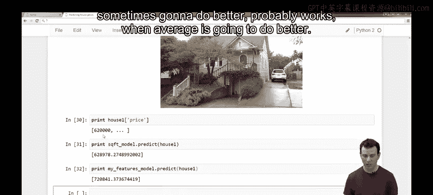

# 机器学习基础篇（第1课/共4课）🏠 第36讲：应用学习模型预测平均房屋价格


在本节课中，我们将学习如何应用已训练的回归模型来预测具体房屋的价格。我们将使用两个模型：一个仅基于居住面积的简单模型，另一个基于更多特征的复杂模型。通过对比它们对三套不同房屋的预测结果，我们可以直观地理解模型在实际应用中的表现。

---

上一节我们介绍了如何构建回归模型，本节中我们来看看如何将这些模型应用于具体的预测任务。

我们将应用已学习的模型来预测数据集中三套房屋的价格。以下是三套不同的房屋，它们具有不同的面积、属性和地理位置。

首先，我们从数据集中选择第一套房屋。这套房屋的ID为“5309101200”，我们通过该ID在销售数据中定位它。

在Python笔记本中，我们不仅可以嵌入文本和代码，还可以嵌入HTML和图像。以下是为该房屋添加的图片示例。


这套房屋于2014年以620,000美元售出，拥有4间卧室、2.25间浴室，建于1929年。

现在，让我们看看模型对它的预测结果。

首先，打印房屋的真实价格作为参考。

```python
print("房屋真实价格: $620,000")
```

接下来，应用第一个模型进行预测。该模型仅基于居住面积构建。

```python
prediction_simple = model_simple.predict(house1_features)
print("简单模型预测价格: $", prediction_simple)
```

模型预测价格为628,000美元，与真实价格非常接近。

然后，应用第二个模型进行预测。该模型基于更多特征构建。

```python
prediction_advanced = model_advanced.predict(house1_features)
print("复杂模型预测价格: $", prediction_advanced)
```

模型预测价格为720,000美元。对于这套特定房屋，简单模型的预测结果反而比复杂模型更准确。

这说明，尽管平均而言，添加更多特征通常会提升模型性能，但对于个别案例，简单模型有时可能表现更好。这是可以预期的现象。

---

以下是预测步骤的总结：

1.  **选择目标房屋**：根据唯一ID从数据集中定位具体房屋。
2.  **提取特征**：获取该房屋用于预测的特征值（如面积、卧室数量等）。
3.  **应用模型**：将特征输入到训练好的模型中。
4.  **获得预测**：模型输出预测的房屋价格。
5.  **对比分析**：将预测价格与真实价格对比，评估模型表现。

---



本节课中，我们一起学习了如何应用回归模型进行实际预测。我们看到了简单模型与复杂模型在特定案例上的不同表现，并理解了模型预测结果存在波动是正常现象。关键在于，在平均意义上，更丰富的特征通常能带来更可靠的预测能力。