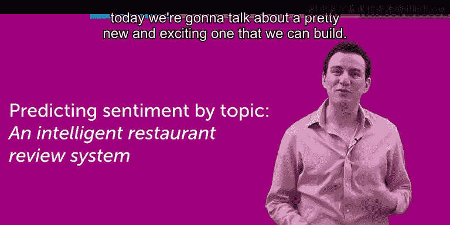
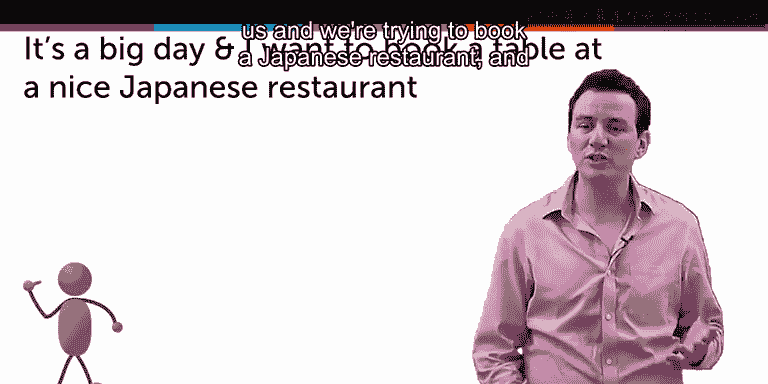
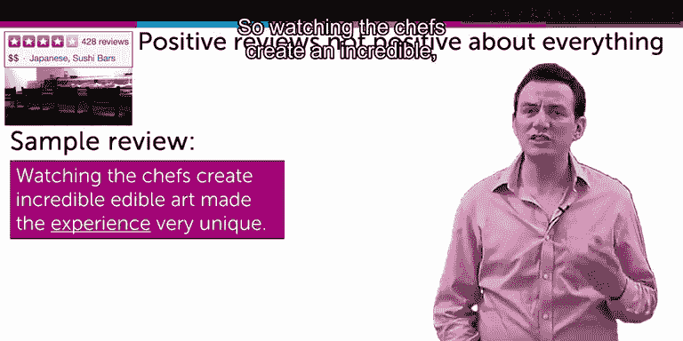
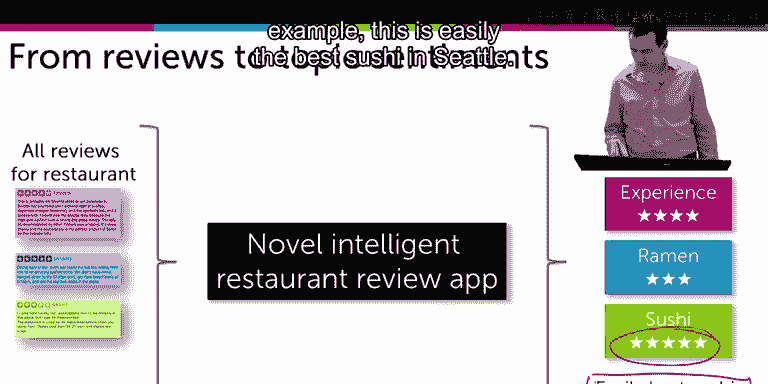
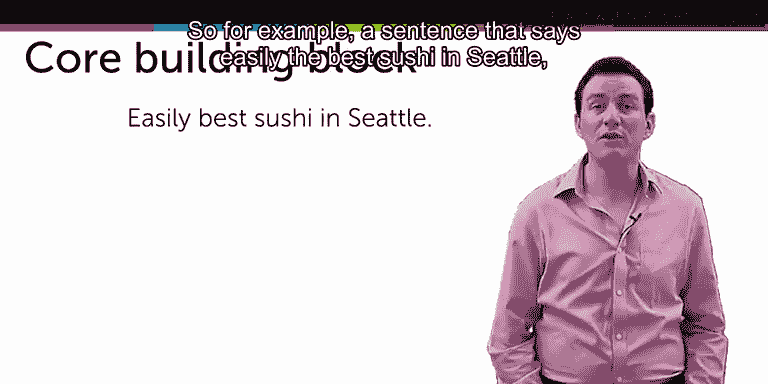
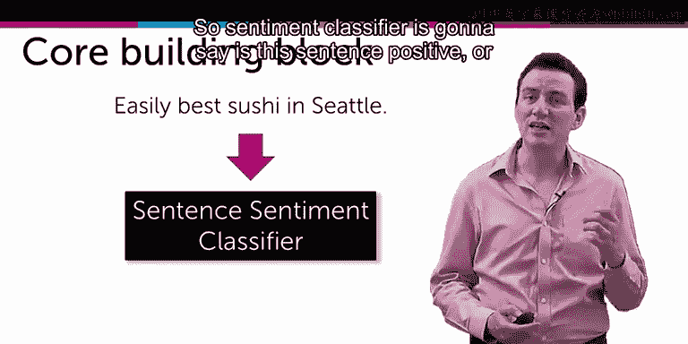
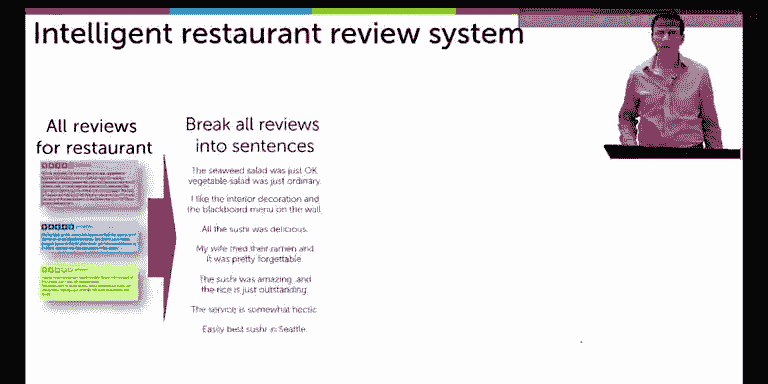
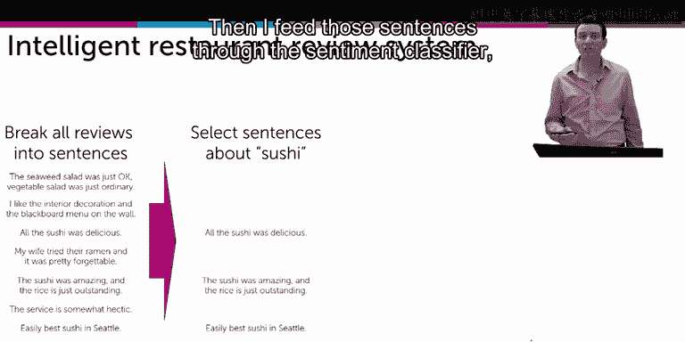

# 课程1：什么是智能餐厅评论系统 🍣

在本节课中，我们将学习如何构建一个智能的餐厅评论系统。这个系统不仅能提供餐厅的整体评分，还能分析评论中关于特定方面（例如寿司）的情感，从而为用户提供更个性化的推荐。

---

目前市面上存在许多餐厅评论系统。

今天我们将讨论一个可以构建的、相当新颖且令人兴奋的系统。

假设今天是一个重要的日子，我们想预订一家日本餐厅。我们喜爱日本料理，并希望找到一个享用日料的绝佳地点。

我们生活在西雅图，这座城市以出色的日本料理而闻名，因此有许多寿司店可供选择。事实上，许多餐厅都拥有很高的评分，例如四星。

因此，当我在考虑去哪家餐厅时，我不仅会考虑餐厅的整体星级，还会思考它在食物、氛围方面的表现，尤其是我真正关心的寿司质量。

我热爱寿司，希望获得最新鲜的鱼和最棒的创新寿司。

当我们谈论餐厅的好评时，以西雅图一家我们喜爱的餐厅为例，一条评论可能这样写道：“观看厨师们创作出令人难以置信、可食用的艺术品，真是一次独特的体验。” 这表明用餐体验非常积极。

然而，这条评论可能还会继续写道：“我妻子尝试了拉面，但味道平平无奇。” 这意味着拉面并不出色。

评论继续写道：“所有的寿司都很美味，是西雅图最好的寿司。” 这表明寿司获得了极高的评价。

我不关心拉面，我去这家店不是为了吃拉面。我不在乎评论者或其妻子不喜欢拉面。我真正关心的是良好的体验和美味的寿司，所以这条评论对我而言非常有价值。

因此，当我查看餐厅评论时，我希望理解餐厅各方面是积极还是消极的，并思考哪些方面真正影响我的兴趣。如果我将所有餐厅评论输入这个新颖且令人兴奋的推荐系统，它会告诉我：体验很好（四星），拉面一般（但谁在乎呢），而我真正关心的寿司，则是五星。

不仅如此，它还能提供一些有趣的反馈，例如：“这无疑是西雅图最好的寿司。” 这正是我想去的地方。

---

那么，我们如何构建这样一个智能的餐厅评论系统呢？

我们将从所有评论开始，首先将它们分解成句子。每条评论都由多个句子组成，其中一些句子描述了餐厅的不同方面。

例如，对于“这无疑是西雅图最好的寿司”这个句子，我们将把它输入一个**情感分类器**。情感分类器会判断这个句子是积极的还是消极的。

现在，我们有了一个可以接收句子并判断其情感倾向的分类器。那么，如何构建这种新颖的餐厅评论体验呢？

我们首先将所有评论分解成句子，然后从中筛选出描述我关心方面（例如寿司）的句子。这些句子只是所有句子中的一个子集。

接着，我将这些筛选出的句子逐一输入情感分类器，然后对结果取平均值。

在这个例子中，所有关于寿司的句子都是积极的，因此我会说，在寿司方面，这是一家五星级餐厅。

不仅如此，我还可以查看关于寿司的句子，并找出其中最积极的那些。例如，“这无疑是西雅图最好的餐厅”可能是最积极的句子，我可以展示它。同时，我也可以展示最消极的句子，不过在这个案例中，关于寿司并没有什么负面评价。

---

**总结**

本节课中，我们一起学习了智能餐厅评论系统的核心概念。该系统通过以下步骤工作：
1.  **分解评论**：将每条用户评论拆分成独立的句子。
2.  **筛选相关句子**：根据用户兴趣（如“寿司”）筛选出相关的句子。
3.  **情感分析**：使用**情感分类器**对每个相关句子进行情感判断（积极/消极）。
4.  **汇总与展示**：计算这些句子的平均情感得分，并可以突出显示最积极或最消极的评论片段。

这种方法超越了简单的整体评分，能够针对用户关心的特定方面提供深入洞察，从而实现更个性化的推荐。