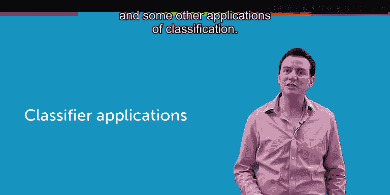
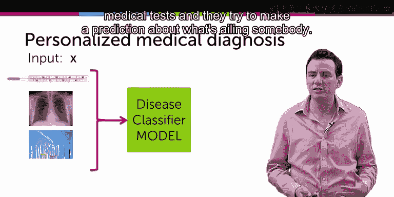
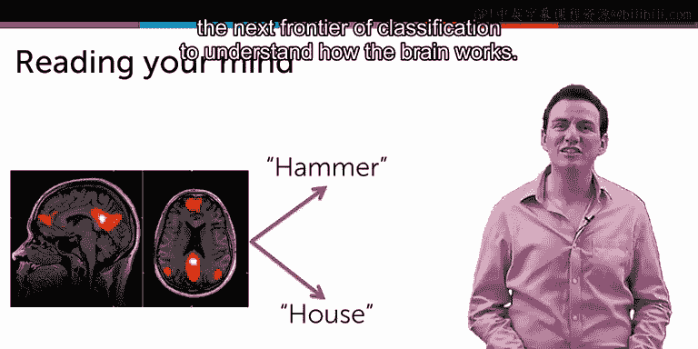

# 40：分类任务示例 🧠




在本节课中，我们将要学习分类任务的基本概念及其在不同领域的应用。分类是机器学习中的核心任务之一，它通过模型将输入数据映射到预定义的类别中。

---

## 什么是分类器？ 🤖

上一节我们介绍了分类任务的基本概念，本节中我们来看看分类器的具体工作原理。

分类器接收输入 **X**（例如，一段评论句子），通过一个**模型**处理后，输出我们试图预测的值 **y**，这里 **y** 是一个类别。例如，在情感分析中，**y** 可以是“正面”或“负面”。

```python
# 分类器的基本形式
y = model.predict(X)
```

在情感分析的例子中，“正面”对应好评（竖起大拇指），“负面”对应差评（拇指向下）。但这只是分类的一个例子。

---

## 分类的多样化应用 🌐

分类任务的应用非常广泛，不仅限于情感分析。以下是几个典型的应用场景：

### 文本分类

例如，对网页内容进行分类。我们可以将网页划分到不同的类别，如教育、金融或技术等。分类的类别数量可以是两个、三个，甚至成千上万个。

### 垃圾邮件过滤

垃圾邮件过滤是深刻影响我们生活的分类应用。早期的过滤器基于简单规则（如特定关键词），但效果不佳。机器学习分类器通过分析邮件内容、发件人、IP地址等多种特征，极大地提升了过滤准确性。

### 计算机视觉

在计算机视觉中，分类任务用于识别图像内容。输入 **X** 是图像的像素，分类器可以预测图像中的物体，例如判断图片中是狗（如拉布拉多犬）还是其他物体。深度学习方法在此领域实现了极高的准确率。

### 医疗诊断



分类也应用于医疗诊断系统。医生通过体温、X光片、化验结果等数据，预测患者的健康状况（如健康、感冒、流感或肺炎）。现代个性化医疗还能结合个人的DNA序列和生活方式数据，做出更精准的预测。

### 脑机接口与读心术

分类技术甚至能用于解读大脑活动。通过功能性磁共振成像（fMRI）等脑部扫描技术，分类器可以预测一个人正在阅读的词语（如“锤子”或“房子”）或观看的图片，这为理解大脑工作原理开辟了新前沿。

---

## 总结 📝



本节课中我们一起学习了分类任务的基本原理及其广泛的应用场景。我们了解到，分类器通过模型将输入数据映射到特定类别，这个过程在情感分析、网页分类、垃圾邮件过滤、图像识别、医疗诊断乃至脑科学研究中都发挥着关键作用。掌握分类是理解机器学习的重要一步。