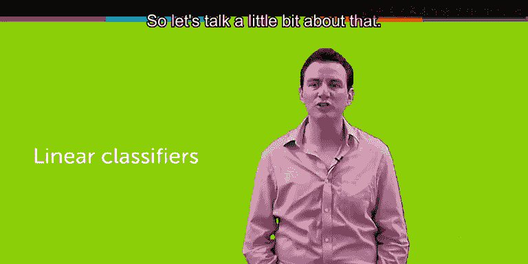
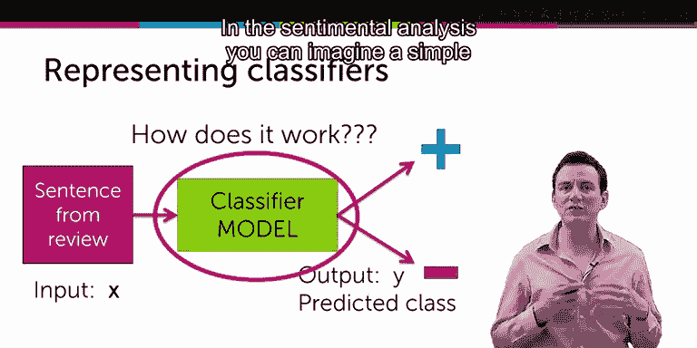
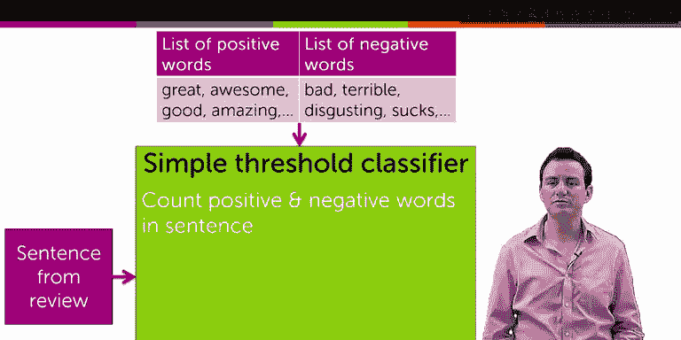
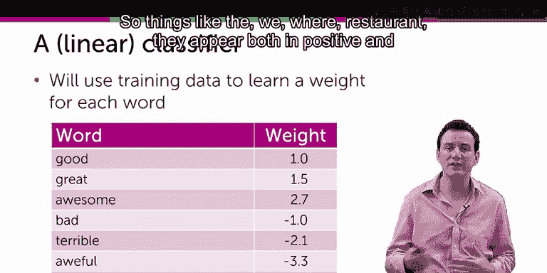
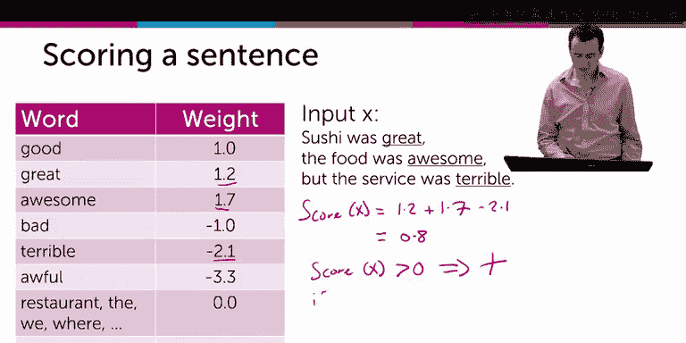
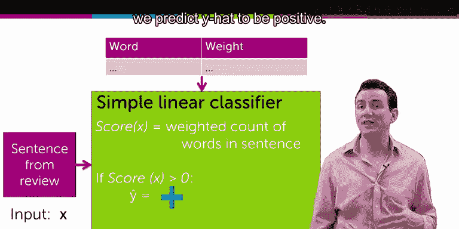

# 41：线性分类器 📊

在本节课中，我们将要学习机器学习中最常见的分类器类型之一：线性分类器。我们将从情感分析这一具体应用场景出发，理解线性分类器的基本工作原理、核心公式，并探讨其优势与局限性。

---

## 线性分类器的基本思想 🤔

上一节我们介绍了分类器的概念，本节中我们来看看线性分类器是如何表示和工作的。

在情感分析任务中，分类器的目标是判断一个句子是积极的还是消极的。我们可以想象一种非常简单的阈值分类器。

以下是其工作原理：
*   假设我们有一个已知的积极词汇列表（如“great”、“awesome”、“good”）和一个消极词汇列表（如“bad”、“terrible”、“disgusting”）。
*   对于一个输入句子，我们分别统计其中出现的积极词数量和消极词数量。
*   如果积极词数量多于消极词数量，则预测句子为积极；反之，则预测为消极。

例如，对于句子“The sushi was great, the food was awesome, but the service was terrible”，我们统计到两个积极词（great, awesome）和一个消极词（terrible）。因此，积极词胜出，我们预测该句子为积极。

然而，这种简单的阈值分类器存在一些局限性：
*   积极词和消极词列表从何而来？
*   不同词语的“积极”或“消极”程度不同（例如，“amazing”可能比“good”更积极），如何为它们分配不同的权重？
*   仅靠单个词语可能不足以做出准确分类（例如，“not good”是消极的，但其中包含“good”这个积极词）。

前两个问题（词表来源和权重分配）可以通过学习一个分类器来解决，我们将在接下来讨论。第三个问题则需要使用比单个词语更复杂的特征，我们将在本模块的后续部分进行探讨。

---

## 线性分类器的工作原理 ⚙️

上一节我们看到了简单阈值分类器的不足，本节中我们来了解线性分类器如何通过引入权重来解决这些问题。

线性分类器不再使用简单的积极/消极词列表，而是为所有词语分配一个权重值。

例如：
*   “good”的权重可能是 **+1.0**
*   “great”的权重可能是 **+1.5**
*   “awesome”的权重可能是 **+2.7**
*   “bad”的权重可能是 **-1.0**
*   “terrible”的权重可能是 **-2.1**
*   “awful”的权重可能是 **-3.3**
*   与情感无关的词语（如“the”、“was”）的权重则为 **0**

假设我们已经通过某种方式获得了每个词的权重（我们稍后会讨论如何学习这些权重），那么如何判断一个句子的情感呢？这里我们引入“评分”的概念。

对于一个输入句子，我们计算其得分。具体方法是：找出句子中出现的所有词，将它们对应的权重相加，得到总分。

**公式表示如下：**
`score(x) = Σ (weight_i * count_of_word_i_in_x)`

其中，`x` 代表输入句子，`weight_i` 是第 `i` 个词的权重。

**决策规则如下：**
*   如果 `score(x) > 0`，则预测句子为积极（`ŷ = +`）。
*   如果 `score(x) < 0`，则预测句子为消极（`ŷ = -`）。

让我们用之前的例子来演示。句子是：“The sushi was great, the food was awesome, but the service was terrible.”
*   “great”出现，加 **+1.5**
*   “awesome”出现，加 **+2.7**
*   “terrible”出现，加 **-2.1**
*   其他词（the, sushi, was, food, service）权重为0，不影响得分。

计算总分：`1.5 + 2.7 - 2.1 = 0.8`。因为 `0.8 > 0`，所以我们预测该句子为积极。

这种分类器之所以被称为“线性”分类器，是因为其输出（得分）是输入特征（词语）的加权线性求和。

---

## 总结 📝

本节课中我们一起学习了线性分类器的核心概念。

我们从一个简单的基于词频计数的阈值分类器入手，指出了其在词表来源、词语权重和特征表达能力上的局限性。

随后，我们引入了正式的线性分类器模型。它的核心是为每个特征（如词语）分配一个可学习的权重。分类决策基于输入句子所有特征权重的加权和（即得分）：
*   **计算得分**：`score(x) = Σ (weight_i * feature_i(x))`
*   **做出预测**：如果 `score(x) > 0`，预测为积极；如果 `score(x) < 0`，预测为消极。

线性分类器通过为不同词语赋予不同权重，更精细地捕捉了语言的情感倾向，为后续学习如何自动从数据中获取这些权重奠定了基础。