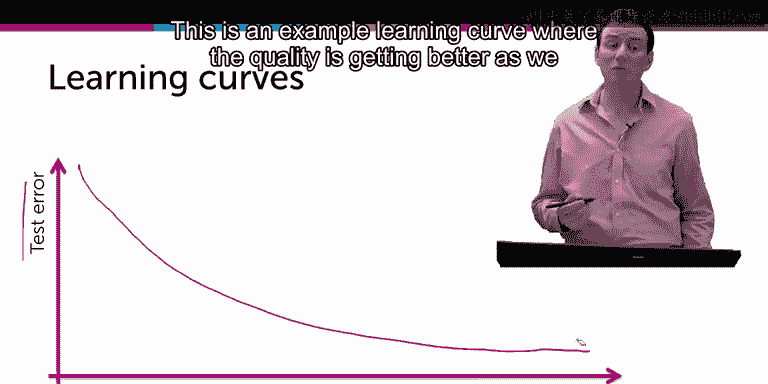
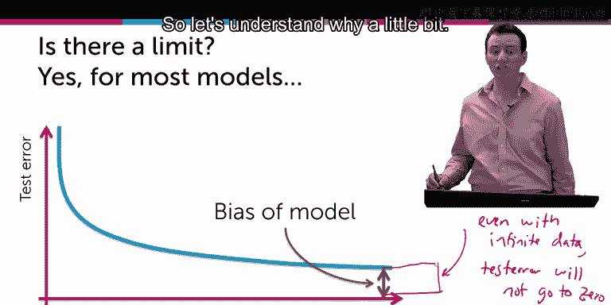
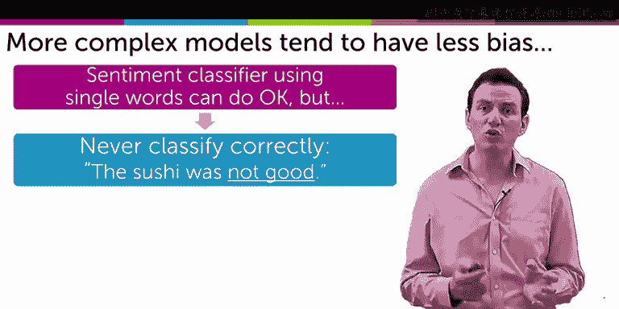
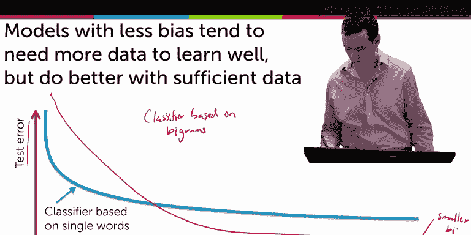

# 机器学习基础课程（第1课/共4课）：学习曲线 📈

在本节课中，我们将要学习**学习曲线**的概念。学习曲线描述了训练数据量与模型测试误差之间的关系，是理解模型性能和数据需求的重要工具。我们将探讨数据量如何影响模型表现，以及模型复杂度与数据量之间的权衡。

---

## 数据量与模型质量的关系

在回归模块中，我们讨论了误差或准确率与模型复杂度之间的关系。本节中，我们来看看数据量对学习效果的影响。

我们探索了“需要多少数据才能有效学习”的问题。这在机器学习中是一个复杂且困难的问题。当然，在数据质量良好的前提下，数据越多越好。质量差的大量数据，远不如少量但高质量的数据点。虽然存在一些理论技术来分析所需数据量，但它们通常过于宽泛，难以直接应用于实践。在实践中，我们使用一些经验性技术来理解误差的大小和性质。在后续课程中，我们将深入探讨这些技术。现在，让我在分类任务的背景下，为你提供一些指导和见解。

---

## 什么是学习曲线？📊

数据与质量关系的一个重要表示方法就是**学习曲线**。学习曲线将我们用于训练的数据量与所犯的误差联系起来，这里我们指的是**测试误差**。

如果你用于训练的数据很少，那么你的测试误差会很高。如果你有大量训练数据，你的测试误差则会降低。随着数据越来越多，曲线会变得越来越好。

以下是一个示例学习曲线，展示了随着数据增加，模型质量（误差降低）得到改善。

---

## 误差的极限：偏差

你可能会问，是否存在极限？质量是否会随着数据无限增加而永远变好？我们知道，测试误差会随着数据增加而减少。然而，这里存在一个**差距**，问题是这个差距能否变为零。答案通常是：**不能**。这个差距被称为**偏差**。

直观地说，这意味着即使拥有无限数据，测试误差也不会降至零。让我们来理解一下原因。

更复杂的模型往往具有更小的偏差。以我们一直在构建的情感分析分类器为例，如果你只使用“awesome”、“good”、“great”、“terrible”、“awful”等单词，它可能表现尚可，甚至很好。但即使你拥有世界上所有的数据（无限数据），你也永远无法正确判断“The sushi was not good”这个句子。因为你的模型只看单个单词“good”和“not”，而没有看单词对。

---

## 复杂模型与数据需求

更复杂的模型，例如处理单词组合的模型（如**二元模型**，它关注像“not good”这样的连续单词对），可以表现得更好。它们可能为“good”设置一个参数（例如0.15），为“not good”设置另一个参数（例如-2.1），从而正确判断“The sushi was not good”这个句子。因此，它们偏差更小，能够表示原本无法表示的句子，潜在地更准确。

但是，它们需要更多数据来学习，因为参数更多。这不仅仅是“good”一个参数，还有“not good”以及所有可能的单词组合参数。一般来说，模型参数越多，学习所需的数据就越多。

让我们回到之前的例子。

---

## 单字模型与二元模型的对比

我们讨论了训练数据量对测试误差的影响。假设我正在构建一个基于**单个单词**的分类器。问题是，这与基于**单词对**的分类器相比如何？

对于基于二元模型的分类器，当数据较少时，由于需要拟合更多参数，它的表现不会那么好。但当数据更多时，它会表现得更好，因为它能够捕捉像“The sushi was not good”这样的情况。因此，你将看到的行为大致如下：

在某个点上，二元模型的性能会超过单字模型，形成一个交叉点。但请注意，二元模型在这里仍然存在一些偏差，尽管这个偏差更小。

---

## 总结

本节课中，我们一起学习了**学习曲线**的核心概念。我们了解到：

1.  **学习曲线**展示了训练数据量与测试误差之间的关系。
2.  增加数据量通常能降低测试误差，提升模型性能。
3.  误差存在一个下限，称为**偏差**，即使拥有无限数据也无法消除。
4.  **模型复杂度**与**数据需求**之间存在权衡：更复杂的模型（如二元模型）偏差更小，潜力更大，但需要更多数据来有效学习；而简单模型（如单字模型）在数据较少时可能表现更好，但存在固有的性能上限。

理解学习曲线有助于我们评估模型性能、诊断问题（如高偏差或高方差），并做出关于是否收集更多数据或尝试更复杂模型的明智决策。