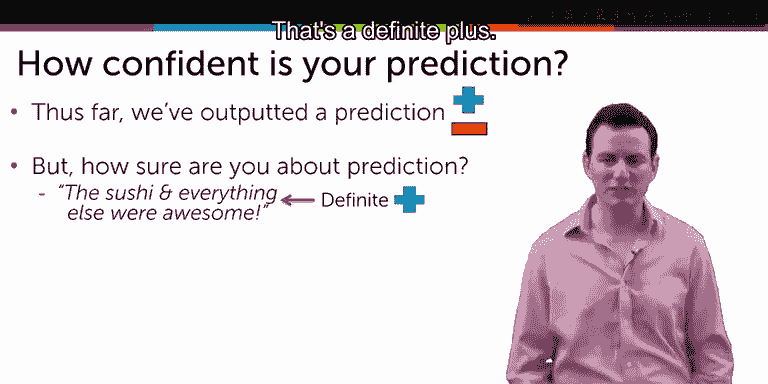

# 47：类别概率 🎯


在本节课中，我们将学习分类任务中一个重要的进阶概念：**类别概率**。我们将探讨如何不仅预测一个样本属于哪个类别，还能评估模型对该预测的**置信度**。通过引入概率，我们可以更细致地理解模型的判断，并为后续的决策优化（如调整分类阈值）奠定基础。

---

## 从硬分类到概率预测 🔄

上一节我们介绍了基本的分类任务，即模型直接输出样本的类别标签（例如“正面”或“负面”）。然而，在实际应用中，我们常常希望了解模型做出这个判断的**把握有多大**。

分类器通常不会只输出“正面”或“负面”这样的硬性判断，而是会输出一个**置信度**或**概率**。这表示模型对预测结果的确定程度。

一种实现方法是计算**条件概率**。其核心思想是：给定输入数据 `x`（例如一个句子），模型输出该数据属于某个类别 `y` 的概率。


用公式可以表示为：
```
P(y | x)
```
其中，`y` 是输出标签（如“正面”），`x` 是输入句子。



---

## 概率预测的实例说明 📊

以下是两个具体的例子，展示了不同置信度下的概率输出：

*   **高置信度正面评价**：
    对于句子 **“The sushi and everything else were awesome.”**，模型非常确定这是一个正面评价。因此，它可能会输出：
    ```
    P(正面 | x) = 0.99
    ```

*   **低置信度正面评价**：
    对于句子 **“The sushi is good, the service was okay.”**，模型觉得它可能是正面评价，但不太确定。因此，它可能会输出一个接近中性的概率：
    ```
    P(正面 | x) = 0.55
    ```

---

## 概率预测的重要性 ⚖️

预测概率或置信度极其重要。在后续的分类课程中我们会看到，掌握概率信息使我们能够做很多事情。

例如，当我们知道了样本属于各个类别的概率后，就可以做出更优的决策：

*   如何设定一个最佳的**决策边界**，来权衡**假阳性**（False Positive）和**假阴性**（False Negative）？
*   如何在两类错误之间取得平衡？

这些决策都依赖于模型输出的概率信息，而不仅仅是简单的类别标签。

---

## 本节总结 ✨

本节课中，我们一起学习了**类别概率**的概念。我们明白了分类任务不仅是预测“是或否”，更重要的是评估预测的**置信度**，这通常通过计算条件概率 `P(y | x)` 来实现。概率输出为我们提供了更丰富的信息，是进行高级模型评估和决策优化的基础。在接下来的课程中，我们将看到如何具体应用这些概率。