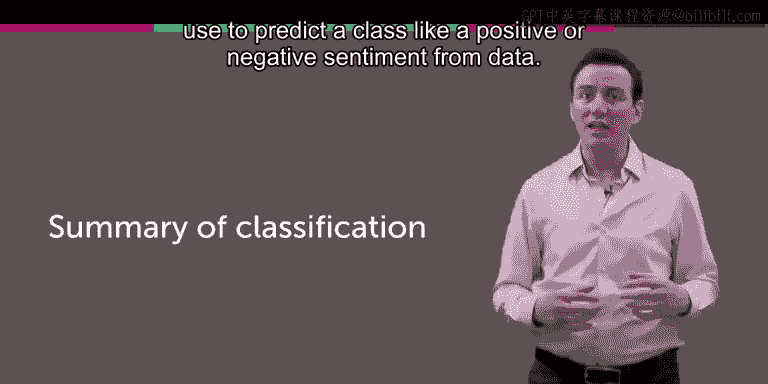
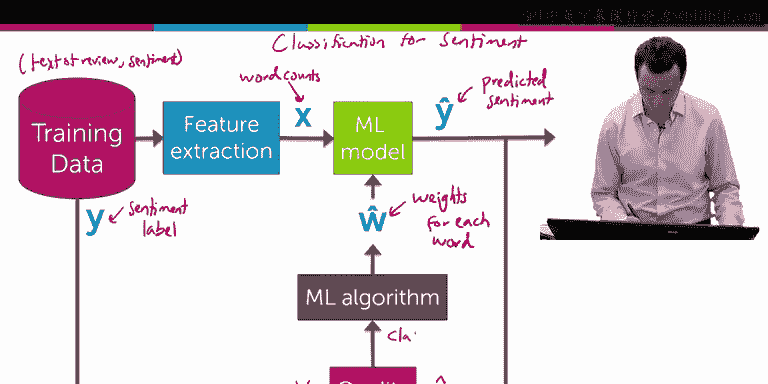

# 机器学习基础篇（第1课/共4课）：分类机器学习模块图详解 🧠


在本节课中，我们将学习分类机器学习的基本流程，特别是如何通过一个模块图来理解分类算法（如情感分析）的工作方式。我们将以情感分析为例，详细解析从数据输入到模型预测，再到参数优化的完整循环。



---

## 从回归到分类：模块图的通用性 🔄

在回归部分，我们曾介绍过一个描述机器学习算法如何迭代处理数据的模块图。现在，我们将使用相同的模块图框架，来阐述它在分类任务（特别是情感分析）中是如何运作的。

## 分类任务中的模块图解析 📊

以下是分类机器学习模块图的核心组成部分及其工作流程。

### 数据与特征提取

在情感分析任务中，数据是评论文本的集合。每条评论都对应一个已标注的情感标签（如正面或负面）。特征提取阶段将这些文本转化为算法可处理的输入 **x**。具体来说，**x** 是每个评论的词频统计。

**代码示例：特征提取**
```python
# 假设 reviews 是评论文本列表
from sklearn.feature_extraction.text import CountVectorizer
vectorizer = CountVectorizer()
X = vectorizer.fit_transform(reviews)  # X 即为词频特征矩阵
```

### 机器学习模型与预测

模型接收输入数据 **x**（词频）以及一组参数 **Ŵ**（每个词的权重）。通过结合这两者，模型会输出一个预测分数。在情感分析中，我们设定一个简单的规则：如果分数大于0，则预测为正面情感；如果分数小于0，则预测为负面情感。

**公式：预测规则**
\[
\text{预测情感} = 
\begin{cases} 
\text{正面}, & \text{如果 分数} > 0 \\
\text{负面}, & \text{如果 分数} < 0 
\end{cases}
\]

### 评估与反馈循环



如果仅使用模型进行预测，流程到此结束。但在机器学习算法阶段，我们需要评估预测结果，并利用反馈来优化模型参数。

我们将模型的预测情感 **ŷ** 与真实的情感标签 **y** 进行比较。评估指标通常使用**分类准确率**。

**公式：分类准确率**
\[
\text{准确率} = \frac{\text{正确预测的数量}}{\text{总预测数量}}
\]

机器学习算法（我们将在分类课程中详细讨论）会接收这个准确率评估结果，并试图通过更新参数 **Ŵ** 来提高它。这样就形成了一个“预测 -> 评估 -> 优化”的完整循环。

## 本章内容回顾与总结 🎯

在本模块中，我们深入探讨了分类任务的执行方法。我们查看了分类在各种场景下的应用实例，重点讨论了在情感分析背景下构建分类器的几种模型。通过实际演示和动手构建分类器的实践，我们完整地体验了从数据到分析的全过程。

掌握这些知识后，你已经具备了构建一个以分类器为核心的智能应用的基础能力。