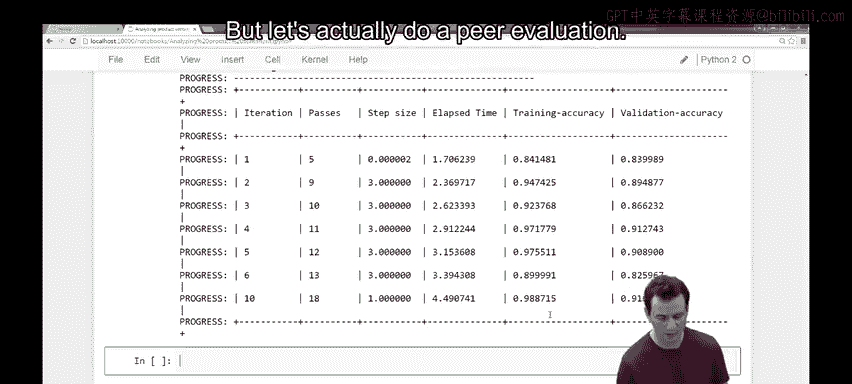

# 53：训练情感分类器 🧠


在本节课中，我们将学习如何训练一个情感分类器。我们将分两步进行：首先对数据进行训练集与测试集的划分，然后使用逻辑分类器构建情感模型。整个过程将使用GraphLab Create库完成，适合机器学习初学者。

---

## 数据划分：训练集与测试集 📊

上一节我们介绍了情感分析的基本概念，本节中我们来看看如何准备数据。首先，我们需要将数据集划分为训练集和测试集，这与回归课程中艾米丽讲解的方法一致。

以下是具体步骤：

*   我们使用产品评论数据表 `products`。
*   执行随机划分，80%的数据用于训练，20%用于测试。
*   为确保结果可复现，设置随机种子 `seed=0`。在实际应用中，您可以选择其他随机种子。

```python
train_data, test_data = products.random_split(0.8, seed=0)
```

完成数据划分后，我们就可以开始构建情感分类模型了。

---

## 构建情感分类模型 🏗️

现在，我们使用GraphLab Create库来构建著名的情感分类模型。我们将使用一种特定的分类器——逻辑分类器。在后续的分类课程中，我们会学习更多分类器，如逻辑回归、支持向量机和决策树等。

以下是创建分类器的关键参数：

*   **训练数据**：使用上一步得到的 `train_data`。
*   **目标**：指定我们要预测的列是 `sentiment`（情感）。
*   **特征**：使用我们之前创建的 `word_count`（词频）列。
*   **验证集**：提供 `test_data` 作为验证集，用于在训练过程中评估模型性能。

```python
sentiment_model = graphlab.logistic_classifier.create(train_data,
                                                      target='sentiment',
                                                      features=['word_count'],
                                                      validation_set=test_data)
```

执行以上代码后，模型将开始训练。这个过程通常只需几秒钟。您会看到迭代过程以及随着训练进行，验证准确率逐步提升。

---

## 模型评估与总结 📈

训练完成后，我们可以对模型进行重新评估，以确认其最终性能。



本节课中我们一起学习了情感分类器的完整训练流程。我们首先将数据划分为训练集和测试集，然后使用逻辑分类器和词频特征构建了一个情感分析模型。通过观察训练过程中的验证准确率，我们看到了模型性能的逐步提升，这为后续更复杂的模型学习打下了基础。